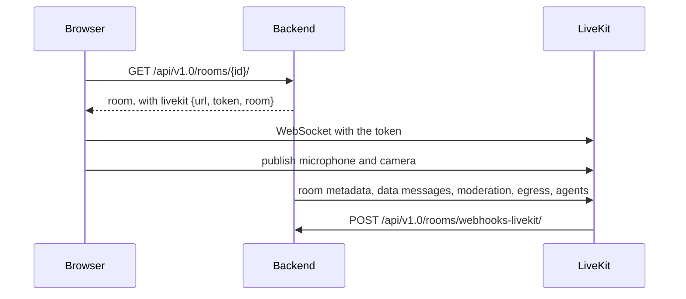

# Code tour

[How Meet works](../overview/how-meet-works.md) explains how the parts work together, and [Develop locally](develop.md) how to run them.

## TL;DR

The Django backend is [`src/backend`](https://github.com/suitenumerique/meet/tree/main/src/backend), the React frontend [`src/frontend`](https://github.com/suitenumerique/meet/tree/main/src/frontend), and LiveKit carries the media. The agents, the summary service and the Helm chart each have their own directory under `src/`.

## The repository

```
meet/
├── src/
│   ├── backend/      Django application: API, rooms, recordings, LiveKit control
│   ├── frontend/     React application served to browsers
│   ├── agents/       LiveKit agents: live subtitles, metadata collector
│   ├── summary/      FastAPI service that transcribes and summarises recordings
│   ├── sdk/          TypeScript SDK: a button that creates a Meet link in another app
│   ├── addons/       Outlook add-in
│   ├── mail/         MJML sources of the emails
│   └── helm/         Helm chart and the helmfile used for local Kubernetes
├── .github/          CI: pull request checks, image builds, chart release
├── docker/           Keycloak, LiveKit, nginx, Garage dev config; DINUM frontend image
├── env.d/            Environment file templates, for development and production
├── bin/              docker compose wrappers, Tiltfile, release, Scalingo buildpack
├── deploy/           The nginx configuration template of the Scalingo deployment
├── crowdin/          The Crowdin configuration that syncs the translations
├── docs/             This site
├── gitlint/          The commit message rule CI applies
├── compose.yml       The development stack
├── Dockerfile        The backend image, development and production stages
├── Makefile          Every development command
├── CHANGELOG.md      One line per change, written in each pull request
└── UPGRADE.md        What an operator does when upgrading
```

## Backend

A [Django](https://www.djangoproject.com/) 5.2 project in three parts:

- [`meet`](https://github.com/suitenumerique/meet/tree/main/src/backend/meet), the project, holds the settings and the root URLs.
- [`core`](https://github.com/suitenumerique/meet/tree/main/src/backend/core), an app, holds the code.
- [`demo`](https://github.com/suitenumerique/meet/tree/main/src/backend/demo), a second app, holds the `create_demo` and `createsuperuser` commands that `make demo` and `make superuser` call.

| Path under `src/backend/` | What it holds |
|---|---|
| [`meet/settings.py`](https://github.com/suitenumerique/meet/blob/main/src/backend/meet/settings.py) | Every setting, read from environment variables through django-configurations; each variable is in [Environment variables](../reference/env-variables.md). `DJANGO_CONFIGURATION` picks the class: `Development` or `Test` locally, `Production` on a server |
| [`meet/celery_app.py`](https://github.com/suitenumerique/meet/blob/main/src/backend/meet/celery_app.py) | The Celery application the `celery-dev` worker runs |
| [`core/models.py`](https://github.com/suitenumerique/meet/blob/main/src/backend/core/models.py) | The data model, described under [Models](#models) |
| [`core/api/`](https://github.com/suitenumerique/meet/tree/main/src/backend/core/api) | The REST API the frontend calls, under `/api/v1.0/`, built on [Django REST Framework](https://www.django-rest-framework.org/): viewsets, serializers, permissions, throttling |
| [`core/external_api/`](https://github.com/suitenumerique/meet/tree/main/src/backend/core/external_api) | The API other applications call to create and manage rooms, authenticated with application tokens |
| [`core/addons/`](https://github.com/suitenumerique/meet/tree/main/src/backend/core/addons) | The endpoints of add-ins embedded in other applications, such as the Outlook add-in |
| [`core/authentication/`](https://github.com/suitenumerique/meet/tree/main/src/backend/core/authentication) | Sign-in, and the authentication of requests carrying a LiveKit pass |
| [`core/services/`](https://github.com/suitenumerique/meet/tree/main/src/backend/core/services) | The logic behind the API: the waiting room, presence, invitations, moderation, LiveKit webhooks, phone dial-in, subtitles |
| [`core/recording/`](https://github.com/suitenumerique/meet/tree/main/src/backend/core/recording) | Starting and stopping recordings, and what happens once one ends |
| [`core/tasks/`](https://github.com/suitenumerique/meet/tree/main/src/backend/core/tasks) | Celery tasks: deleting connection-test rooms, deleting files, sending email. They run on the Celery worker when [`CELERY_ENABLED`](../reference/env-variables.md#CELERY_ENABLED) is on. Otherwise file deletion and email run inline in the request, and the connection-test room cleanup is not scheduled |
| [`core/management/commands/`](https://github.com/suitenumerique/meet/tree/main/src/backend/core/management/commands) | Maintenance commands: `purge_deleted_files`, `purge_inactive_rooms`, `clean_pending_files` and `merge_duplicate_users` |
| [`core/audit/`](https://github.com/suitenumerique/meet/tree/main/src/backend/core/audit), [`core/auditing.py`](https://github.com/suitenumerique/meet/blob/main/src/backend/core/auditing.py) | The audit log of room, token and recording operations, see [The audit log](#the-audit-log) |
| [`core/roomkit/`](https://github.com/suitenumerique/meet/tree/main/src/backend/core/roomkit) | Meeting-room hardware joining over SIP |
| [`core/analytics/`](https://github.com/suitenumerique/meet/tree/main/src/backend/core/analytics) | Product analytics sent to PostHog, and the feature flags read from it |
| [`core/admin.py`](https://github.com/suitenumerique/meet/blob/main/src/backend/core/admin.py) | The Django admin pages |
| [`core/factories.py`](https://github.com/suitenumerique/meet/blob/main/src/backend/core/factories.py), [`core/tests/`](https://github.com/suitenumerique/meet/tree/main/src/backend/core/tests) | Test data factories and the test suite |
| [`locale/`](https://github.com/suitenumerique/meet/tree/main/src/backend/locale) | The backend's translations |

Sign-in goes through the `oidc_login` module of [django-lasuite](https://github.com/suitenumerique/django-lasuite), built on mozilla-django-oidc; [`core/urls.py`](https://github.com/suitenumerique/meet/blob/main/src/backend/core/urls.py) mounts its URLs. Meet's own backend class is in [`core/authentication/backends.py`](https://github.com/suitenumerique/meet/blob/main/src/backend/core/authentication/backends.py).

### Models

| Model | What it stores |
|---|---|
| `User` | An account, created at the first OIDC sign-in. A staff account signs in to `/admin/` with its `admin_email` and a password |
| `Room` | A meeting room: its `slug`, the code in the URL; its `access_level`, `public`, `trusted` or `restricted`; its `configuration`, a JSON object every participant receives; and its telephony `pin_code` |
| `ResourceAccess` | A user's role on a room: `owner`, `administrator` or `member` |
| `Recording`, `RecordingAccess` | A recording or a transcription, its `status` from `initiated` to `saved` or a failure, and who may see it |
| `Application`, `ApplicationDomain` | An application allowed to call the external API, and the email domains it may act for |
| `File` | An uploaded file, such as a custom background image, and its upload state |

### API

[`core/urls.py`](https://github.com/suitenumerique/meet/blob/main/src/backend/core/urls.py) mounts two APIs. Their endpoints and authentication are in the [API reference](../reference/api.md).

| API | Prefix | Routes and their code |
|---|---|---|
| Browser API | `/api/v1.0/` | `users`, `rooms`, `resource-accesses`, `recordings`, `files` and `diagnostics` from [`core/api/viewsets.py`](https://github.com/suitenumerique/meet/blob/main/src/backend/core/api/viewsets.py); `roomkit` from `core/roomkit/`; `addons/sessions` from `core/addons/`; the sign-in routes; `config/`, the instance's settings for the frontend |
| External API | `/external-api/v1.0/`, mounted only when `EXTERNAL_API_ENABLED` is on | `application`, `rooms` and `users` from [`core/external_api/viewsets.py`](https://github.com/suitenumerique/meet/blob/main/src/backend/core/external_api/viewsets.py) |

Most actions on a room are extra routes of `RoomViewSet`, such as `request-entry`, `start-recording` or `mute-participant`.

## Frontend

A [React](https://react.dev/) 18 and [TypeScript](https://www.typescriptlang.org/) application built with [Vite](https://vite.dev/). Its libraries, whose versions are in [`package.json`](https://github.com/suitenumerique/meet/blob/main/src/frontend/package.json):

| For | Library |
|---|---|
| Components | [React Aria](https://react-spectrum.adobe.com/react-aria/) |
| Styles | [Panda CSS](https://panda-css.com/) |
| Global state | [Valtio](https://valtio.dev/) |
| Server data | [TanStack Query](https://tanstack.com/query) |
| Routes | [wouter](https://github.com/molefrog/wouter) |
| Translations | i18next |
| Calls | LiveKit's [`livekit-client`](https://github.com/livekit/client-sdk-js) and [`@livekit/components-react`](https://github.com/livekit/components-js) |

| Path under `src/frontend/src/` | What it holds |
|---|---|
| [`features/`](https://github.com/suitenumerique/meet/tree/main/src/frontend/src/features) | One directory per feature: `rooms`, `chat`, `recording`, `participants`, `settings` and the others. Each keeps its own components, hooks and API calls |
| [`features/rooms/livekit/`](https://github.com/suitenumerique/meet/tree/main/src/frontend/src/features/rooms/livekit) | Everything inside a call: the control bar, the participant tiles, the background effects, the LiveKit hooks |
| [`primitives/`](https://github.com/suitenumerique/meet/tree/main/src/frontend/src/primitives) | The styled building blocks, `Button`, `ToggleButton`, `Dialog`, `Menu` and others, wrapping React Aria. A new component uses these rather than raw HTML or a direct React Aria import |
| [`components/`](https://github.com/suitenumerique/meet/tree/main/src/frontend/src/components) | Components several features share |
| [`stores/`](https://github.com/suitenumerique/meet/tree/main/src/frontend/src/stores) | Valtio stores, one file per concern: `layout.ts`, `chat.ts`, `recording.ts` and the others. A component reads one with `useSnapshot()` and changes it by assigning to the store |
| [`api/`](https://github.com/suitenumerique/meet/tree/main/src/frontend/src/api) | `fetchApi`, which calls the backend, the TanStack Query client, and `useConfig`, which reads the instance's settings from `/api/v1.0/config/` |
| [`hooks/`](https://github.com/suitenumerique/meet/tree/main/src/frontend/src/hooks) | Hooks shared across features, such as `useScreenReaderAnnounce` |
| [`locales/`](https://github.com/suitenumerique/meet/tree/main/src/frontend/src/locales), [`i18n/`](https://github.com/suitenumerique/meet/tree/main/src/frontend/src/i18n) | One JSON file per namespace and language, and the i18next setup |
| [`routes.ts`](https://github.com/suitenumerique/meet/blob/main/src/frontend/src/routes.ts) | The pages and their URLs |
| [`utils/livekit.ts`](https://github.com/suitenumerique/meet/blob/main/src/frontend/src/utils/livekit.ts) | Browser detection the LiveKit workarounds rely on |

Server data, such as a room or the list of recordings, goes through TanStack Query. A Valtio store holds what only the browser knows, such as the layout or an open panel.

Accessibility follows these patterns:

- Every interactive element has an accessible name, from its visible text or an `aria-label` read through `t()`. [`HandToggle.tsx`](https://github.com/suitenumerique/meet/blob/main/src/frontend/src/features/rooms/livekit/components/controls/HandToggle.tsx) shows the usual shape: a `ToggleButton` from the primitives, its label and tooltip translated.
- A state change the screen does not show, such as a recording starting, is announced with `useScreenReaderAnnounce()`.
- A room event goes through the toasts of [`ToastProvider.tsx`](https://github.com/suitenumerique/meet/blob/main/src/frontend/src/features/notifications/components/ToastProvider.tsx).
- A tooltip shown in picture-in-picture uses `VisualOnlyTooltip` instead of `TooltipWrapper`, so a screen reader does not read it twice. For the same reason, an element that only shows something carries no `aria-live`: announce the change once, with `useScreenReaderAnnounce()`.
- A React Aria `Dialog` traps focus and gives it back to the button that opened it. A side panel or a custom toolbar does neither: move focus into it yourself, with `autoFocus`, a `ref.focus()` or a `FocusScope`.

## How Meet talks to LiveKit

### The pass

The pass is the LiveKit access token the backend signs for each participant; the browser connects to LiveKit with it, as [Joining a meeting](../overview/how-meet-works.md#joining-a-meeting) describes.

[`generate_token()`](https://github.com/suitenumerique/meet/blob/main/src/backend/core/utils.py) in `core/utils.py` builds it. The token's name is the participant's display name, and it carries three attributes derived from the participant's identity: `room_role`, `is_authenticated` and `color`.

Owners and administrators get LiveKit's `room_admin` grant, which lets them moderate.

The pass reaches the browser two ways:

- In the `livekit` field of `GET /api/v1.0/rooms/<id>/`, which `RoomSerializer` in [`core/api/serializers.py`](https://github.com/suitenumerique/meet/blob/main/src/backend/core/api/serializers.py) adds when the visitor may enter at once.
- In the answer to `POST /api/v1.0/rooms/<id>/request-entry/`, once someone admits the visitor from the waiting room, from [`core/services/lobby.py`](https://github.com/suitenumerique/meet/blob/main/src/backend/core/services/lobby.py).

The pass also authenticates the API calls that [LiveKit room token](../reference/api.md#livekit-room-token) lists, for every participant, signed in or not. They accept it through `LiveKitTokenAuthentication` in [`core/authentication/livekit.py`](https://github.com/suitenumerique/meet/blob/main/src/backend/core/authentication/livekit.py).



### What the backend asks LiveKit

Every call goes through the client that [`create_livekit_client()`](https://github.com/suitenumerique/meet/blob/main/src/backend/core/utils.py) returns.

| What | Backend side | What the frontend does with it |
|---|---|---|
| Room metadata: the room's configuration and access level, and the recording state | `RoomManagement.update_metadata()` in [`core/services/room_management.py`](https://github.com/suitenumerique/meet/blob/main/src/backend/core/services/room_management.py) | [`RoomMetadataSynchronizer`](https://github.com/suitenumerique/meet/blob/main/src/frontend/src/features/rooms/livekit/components/RoomMetadataSynchronizer.tsx) copies the configuration and access level into the cached room, and [`useRecordingStatuses`](https://github.com/suitenumerique/meet/blob/main/src/frontend/src/features/recording/hooks/useRecordingStatuses.ts) reads the recording state |
| Data messages to every participant, such as someone waiting to enter | `notify_participants()` in [`core/utils.py`](https://github.com/suitenumerique/meet/blob/main/src/backend/core/utils.py) | [`MainNotificationToast.tsx`](https://github.com/suitenumerique/meet/blob/main/src/frontend/src/features/notifications/MainNotificationToast.tsx) turns them into toasts and sounds |
| Muting, removing and updating a participant | [`core/services/participants_management.py`](https://github.com/suitenumerique/meet/blob/main/src/backend/core/services/participants_management.py) | LiveKit applies it to the participant's connection |
| Recording, through LiveKit Egress | [`core/recording/worker/services.py`](https://github.com/suitenumerique/meet/blob/main/src/backend/core/recording/worker/services.py), behind [`mediator.py`](https://github.com/suitenumerique/meet/blob/main/src/backend/core/recording/worker/mediator.py) | Shows the state carried by the room metadata |
| Sending an agent into a room | [`core/services/subtitle.py`](https://github.com/suitenumerique/meet/blob/main/src/backend/core/services/subtitle.py) for subtitles, [`core/recording/services/metadata_collector.py`](https://github.com/suitenumerique/meet/blob/main/src/backend/core/recording/services/metadata_collector.py) during a transcription | Shows the subtitles the agent publishes |
| Phone dial-in rules, which route a caller's PIN to the room | [`core/services/sip_management.py`](https://github.com/suitenumerique/meet/blob/main/src/backend/core/services/sip_management.py) | Nothing: the caller joins as an audio-only participant |

### What LiveKit tells the backend

LiveKit posts its events to `/api/v1.0/rooms/webhooks-livekit/`, the `webhooks_livekit` action of `RoomViewSet`. `LiveKitEventsService` in [`core/services/livekit_events.py`](https://github.com/suitenumerique/meet/blob/main/src/backend/core/services/livekit_events.py) checks the signature, then handles each event:

| Event | What the backend does |
|---|---|
| `egress_updated` | Updates the recording's status |
| `egress_ended` | Clears the recording state from the room metadata and stops the metadata collector. On success, [`core/recording/event/notification.py`](https://github.com/suitenumerique/meet/blob/main/src/backend/core/recording/event/notification.py) emails a screen recording's link to the people [Email](../self-hosting/configuration/email.md) names, and sends a transcription to the summary service |
| `room_started` | Closes the LiveKit room again if its Meet room was deleted; otherwise records the start time `purge_inactive_rooms` reads, and creates the room's phone dial-in rule when telephony or Roomkit is on |
| `room_finished` | Deletes that rule and clears the room's presence and waiting-room state |
| `participant_left` | Removes the participant from the presence cache, unless [`PRESENCE_CLEAR_ON_PARTICIPANT_LEFT`](../reference/env-variables.md#PRESENCE_CLEAR_ON_PARTICIPANT_LEFT) is off |

Any other event is acknowledged and ignored, and so is every event of a connection-test room or of a room whose name [`LIVEKIT_WEBHOOK_EVENTS_FILTER_REGEX`](../reference/env-variables.md#LIVEKIT_WEBHOOK_EVENTS_FILTER_REGEX) does not match. In development, LiveKit finds the endpoint through the `webhook` section of [`docker/livekit/config/livekit-server.yaml`](https://github.com/suitenumerique/meet/blob/main/docker/livekit/config/livekit-server.yaml).

### The frontend side

[`Conference.tsx`](https://github.com/suitenumerique/meet/blob/main/src/frontend/src/features/rooms/components/Conference.tsx) fetches the room, builds the LiveKit `Room` with Meet's options, and renders `<LiveKitRoom>` with the pass and the server URL. It also holds the browser workarounds, such as an early WebSocket that lets Firefox connect behind some proxies, when `enable_firefox_proxy_workaround` is on.

The call's interface is [`VideoConference.tsx`](https://github.com/suitenumerique/meet/blob/main/src/frontend/src/features/rooms/livekit/prefabs/VideoConference.tsx).

## Agents

[`src/agents`](https://github.com/suitenumerique/meet/tree/main/src/agents) holds two LiveKit agents, workers that LiveKit sends into a room as silent participants when the backend asks.

| File | What it does |
|---|---|
| [`multi_user_transcriber.py`](https://github.com/suitenumerique/meet/blob/main/src/agents/multi_user_transcriber.py) | Live subtitles: transcribes each speaker and publishes the text to the room |
| [`voxtral_vllm_stt.py`](https://github.com/suitenumerique/meet/blob/main/src/agents/voxtral_vllm_stt.py) | The speech-to-text plugin for Voxtral served by vLLM, one of the subtitles providers |
| [`metadata_collector.py`](https://github.com/suitenumerique/meet/blob/main/src/agents/metadata_collector.py) | During a transcription, records who speaks when, connections and chat, and writes them to S3 for the summary service |

Their settings are under [Agents](../reference/env-variables.md#agents).

## Summary service

[`src/summary`](https://github.com/suitenumerique/meet/tree/main/src/summary) is a [FastAPI](https://fastapi.tiangolo.com/) application with [Celery](https://docs.celeryq.dev/) workers:

- The backend posts a recording to its API, [`summary/api/route/tasks_v2.py`](https://github.com/suitenumerique/meet/blob/main/src/summary/summary/api/route/tasks_v2.py).
- The workers in [`summary/core/celery_worker.py`](https://github.com/suitenumerique/meet/blob/main/src/summary/summary/core/celery_worker.py) transcribe it, summarise it and report back to the backend's `/api/v1.0/recordings/external-process-hook/`.

The queues and the order of the steps are in [How Meet works](../overview/how-meet-works.md#transcription-and-summary), and the settings under [Summary service](../reference/env-variables.md#summary-service).

## Other packages

| Path | What it holds |
|---|---|
| [`src/sdk`](https://github.com/suitenumerique/meet/tree/main/src/sdk) | The SDK in `library/`, published on npm as `@gouvfr-lasuite/visio-sdk`, which adds to another web application a button that creates a Meet link, and a sample application using it in `consumer/`. Its own guide is [`src/sdk/library/CONTRIBUTING.md`](https://github.com/suitenumerique/meet/blob/main/src/sdk/library/CONTRIBUTING.md) |
| [`src/addons/outlook`](https://github.com/suitenumerique/meet/tree/main/src/addons/outlook) | The Outlook add-in that adds a Meet link to an event, calling [`core/addons/`](https://github.com/suitenumerique/meet/tree/main/src/backend/core/addons) |
| [`src/mail`](https://github.com/suitenumerique/meet/tree/main/src/mail) | The MJML sources of the emails, compiled as [Email templates](develop.md#email-templates) describes |

## Deployment files

| Path | What it holds |
|---|---|
| [`src/helm/meet`](https://github.com/suitenumerique/meet/tree/main/src/helm/meet) | The Helm chart. Its values are documented in its [`README.md`](https://github.com/suitenumerique/meet/blob/main/src/helm/meet/README.md), which `generate-readme.sh` regenerates from `values.yaml`. [Helm deployment](../self-hosting/kubernetes/helm.md) covers deploying it |
| [`src/helm/helmfile.yaml.gotmpl`](https://github.com/suitenumerique/meet/blob/main/src/helm/helmfile.yaml.gotmpl), [`src/helm/env.d`](https://github.com/suitenumerique/meet/tree/main/src/helm/env.d) | The helmfile and the values of the `dev-keycloak` and `dev-dinum` environments that Tilt deploys |
| [`env.d/development`](https://github.com/suitenumerique/meet/tree/main/env.d/development) | One `.dist` template per service of the development stack, which [First run](develop.md#first-run) copies |
| [`env.d/production.dist`](https://github.com/suitenumerique/meet/tree/main/env.d/production.dist) | The production templates. The directory carries the `.dist` suffix, not the files, so each keeps its name when the [Deployment guide](../self-hosting/compose/deployment-guide.md) downloads it |
| [`Dockerfile`](https://github.com/suitenumerique/meet/blob/main/Dockerfile), [`src/frontend/Dockerfile`](https://github.com/suitenumerique/meet/blob/main/src/frontend/Dockerfile), [`docker/dinum-frontend`](https://github.com/suitenumerique/meet/tree/main/docker/dinum-frontend) | The backend image, the frontend image, and the frontend image with the French government's styles |
| [`deploy/`](https://github.com/suitenumerique/meet/tree/main/deploy), [`Procfile`](https://github.com/suitenumerique/meet/blob/main/Procfile) | The Scalingo deployment, described in [Scalingo](../self-hosting/scalingo.md) |

## The audit log

[Audit logging](../self-hosting/configuration/audit-logging.md) describes what each event holds and how operators collect it.

### Declaring an action

Every action is declared once, in `core/auditing.py`, as an `audit.Action` constant. An action may carry its ECS category and types, which then apply to every event it emits; a type its category does not expect fails at import time:

```python
APPLICATION_TOKEN_ISSUE = audit.Action(
    "application.token.issue",
    category=EventCategory.AUTHENTICATION,
    types=(EventType.START,),
)
ROOM_CREATE = audit.Action("room.create")
```

`core/auditing.py` imports nothing but the audit facility and leaf helpers such as `core.services.transit_code`, so that any module can import it, authentication classes included. Models and authentication classes are registered separately, in `core/audit_registry.py`.

### Auditing a DRF view

A DRF view only declares the actions it audits: everything else is derived from the response.

CRUD actions are mapped in `audit_actions`. An extra action names its own on its route, so that renaming its method cannot silently stop auditing it:

```python
from core import audit, auditing


class RoomViewSet(audit.AuditViewMixin, viewsets.GenericViewSet):
    audit_actions = {"create": auditing.ROOM_CREATE, "retrieve": auditing.ROOM_RETRIEVE}

    def perform_create(self, serializer):
        self.audit_target = serializer.save()

    @action(detail=True, methods=["post"], audit_action=auditing.RECORDING_START)
    def start_room_recording(self, request, pk=None): ...
```

`AuditViewMixin` fills in the rest:

- The ECS category and types come from the action, or default to `api` and the DRF action.
- The outcome, reason and status code come from the response status: 401, 403 and 429 are `denied`, other errors are `failure`, filed as [Classification](../self-hosting/configuration/audit-logging.md#classification) describes.
- The target is the object `get_object()` returned, unless the view assigns `audit_target`.
- A view can also assign `audit_user_target`, `audit_details` and `audit_actor`, where `None` records no account, or override `get_audit_fields()`.

### Auditing from anywhere else

Outside of `AuditViewMixin`, from a view or deeper in a service, call `audit.log`. A `category` or `types` given here wins over the action's:

```python
audit.log(auditing.USER_PROVISION, target=user)
```

Without `request=`, the event reads the context of the request being served, `audit.request_context()`, which `AuditLogMiddleware` captures when the request comes in. Outside a request, as in a Celery task, the context is empty and the actor is the system.

!!! note
    That context holds the Django request. DRF copies the user and auth onto the Django request, but not the authenticator, so a call made inside a DRF view without `request=` should pass `auth_method=`.

### How fields are filled

- **Request fields** are read from the request: the real client address, the path, the user agent and the request id.
- **The actor** comes from `request.user`, `request.auth` and the DRF authenticator, as [Actors](../self-hosting/configuration/audit-logging.md#actors) describes. `audit.register_auth_method` maps the authenticator's class to an auth method, see [Registering models](#registering-models-and-authentication-methods). Without a request, the actor is the system. Override the actor with `actor=`, `actor_type=`, `auth_method=` and `client_id=`; an explicit `actor_type=` keeps the signed-in account. `actor=None` records no account: for a caller failing to authenticate, an application acting before it is given a delegated user, or the system.
- **The target** is described by its model name, its primary key and the `fields` its model is registered with, see [Targets](../self-hosting/configuration/audit-logging.md#targets). A model that is not registered is still identified. The account the action is about, `user.target`, is found from the target, unless given as `user_target=`. Name a service the backend calls with `target_service=`. Any other keyword argument is recorded under `lasuite.details`.

### Emission never raises

A broken configuration or value is reported on the application logger and to Sentry, and the business operation goes on. A registered field that cannot be read is left out of the target, and the event is still emitted.

### Admin pages need nothing

Every admin class, Django's own included, is audited as it is registered, by `AuditedAdminSite` in `core/audit/admin.py`. Registering a new admin's model only adds its category and allowed values.

### Registering models and authentication methods

The project describes itself to the audit facility in code, in `core/audit_registry.py`. Once the audit app is ready, it imports the `audit_registry` module of every installed app.

**`audit.register(Model, ...)`** tells the audit log how to handle a model:

- `fields`: the fields describing it as a target;
- `admin_values`: the fields whose before and after values may be recorded for admin writes;
- `category`: the ECS category of its admin writes;
- `entity_type`: its ECS entity type, when one of the allowed values fits, such as `application` or `user`;
- `user_target`: the attribute holding the account an event on it is about, such as `user` for an access.

A proxy model falls back to its concrete model. Registering a model twice raises `AlreadyRegistered`, and an entity type ECS does not allow raises `ValueError`.

**`audit.register_auth_method(klass, name)`** sets the `lasuite.auth.method` of a DRF authentication class or of a login backend. A DRF class inherits the name of its closest registered base, and DRF's own classes are built in. A login backend must be registered itself, because custom backends often subclass `ModelBackend` just for its permission checks. `ModelBackend` is built in as `password`.
