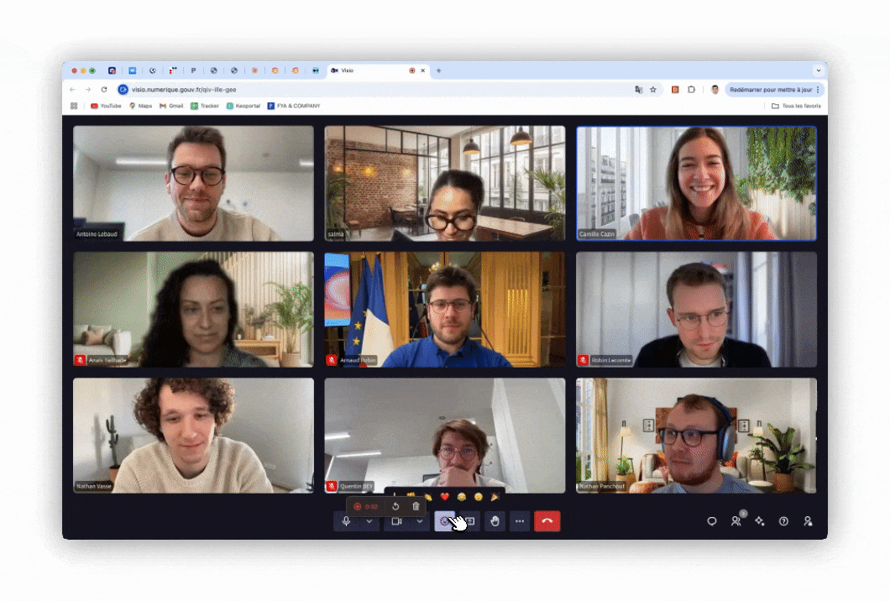

# LaSuite Meet

**Open Source video conferencing, self-hostable under MIT.**

Built on [LiveKit](https://livekit.io/), LaSuite Meet runs HD audio and video calls in the browser, with nothing to install. [DINUM](https://www.numerique.gouv.fr/), the French government's digital agency, develops it, and it powers [Visio](https://visio.numerique.gouv.fr/), the video platform of French public servants.

<figure markdown="span">
  
  <figcaption>A meeting in LaSuite Meet</figcaption>
</figure>

## Features

- **HD audio and video**, with noise suppression and quality that adapts to each connection
- **Large meetings**, built for more than 100 participants
- **Several screen shares at once**, each one zoomable
- **Chat, emoji reactions and raised hands**, kept only with a transcription, see [What is stored where](overview/how-meet-works.md#what-is-stored-where)
- **Waiting room** and three access levels, so the host decides who comes in
- **Recording** to S3-compatible storage, with the download link sent by email
- **Transcription and AI summary**, in beta, delivered to [LaSuite Docs](https://github.com/suitenumerique/docs)
- **Real-time subtitles**, in beta
- **Dial-in by phone** with a PIN
- **Sign-in through any [OpenID Connect](https://openid.net/developers/how-connect-works/) provider**
- **Virtual backgrounds**: blur or an image
- **Keyboard navigation and screen reader support**

Every feature is in the open source code.

## Where to start

-   **Participants, hosts and teachers**

    ---

    [Getting Started](user/getting-started.md), then a guide for your case:

    - [Hosting a large meeting](user/guides/large-meeting-host.md)
    - [On a phone or a weak connection](user/guides/phone-or-weak-connection.md)
    - [Deaf or hard of hearing](user/guides/deaf-hard-of-hearing.md)
    - [Blind or low vision](user/guides/blind-low-vision.md)
    - [Sign-language interpreter](user/guides/sign-language-interpreter.md)

-   **System administrators**

    ---

    - [Install it](self-hosting/index.md)
    - [See everything you can customise](self-hosting/customising.md)
    - [Look up a setting](reference/env-variables.md)
    - [Fix a problem](reference/troubleshooting.md)

-   **Developers, integrators and contributors**

    ---

    - [How Meet works](overview/how-meet-works.md)
    - [Connect another application](reference/external-api.md)
    - [Browse the API routes](reference/swagger.html)
    - [Show Meet inside your app](reference/external-api.md#signing-a-user-in-to-an-iframe)
    - [Change the code](contributing/develop.md)

!!! ai "With an AI assistant"

    An AI assistant can install and configure Meet for you. Give it [`llms.txt`](llms.txt), the index of this documentation, and tell it how you install Meet, Docker Compose, Kubernetes or Scalingo, and what you want: "install Meet with recording on my server", for example. To change an existing install, point it at [Customising Meet](self-hosting/customising.md), which links every setting to its guide.

    Then check the result yourself, as [Check that it works](self-hosting/index.md#check-that-it-works) shows: an assistant can report success on an install that does not carry a call.

## Known public instances

| URL | Operator | Access |
|---|---|---|
| [visio.numerique.gouv.fr](https://visio.numerique.gouv.fr/) | DINUM | French central administration, [ProConnect](https://www.proconnect.gouv.fr/) required |
| [visio.suite.anct.gouv.fr](https://visio.suite.anct.gouv.fr/) | ANCT | French territorial administration, ProConnect required |
| [visio.lasuite.coop](https://visio.lasuite.coop/) | lasuite.coop | Demo: test accounts from [lasuite.coop](https://lasuite.coop/applications/demo/), deleted after a month |
| [mosa.cloud](https://mosa.cloud/) | mosa.cloud | Dutch commercial instance |
| [Clever Cloud](https://www.clever.cloud/product/visio/) | Clever Cloud | Commercial offer, Openvisio |
| [Email.eu](https://email.eu/) | Email.eu | Sovereign business workspace |
| [visio.samourai.app](https://visio.samourai.app/) | Samouraï | French cooperative instance, guests join by link |

## Community and support

- **Matrix**: [#meet-official:matrix.org](https://matrix.to/#/#meet-official:matrix.org)
- **GitHub Issues**: [github.com/suitenumerique/meet/issues](https://github.com/suitenumerique/meet/issues)
- **GitHub Discussions**: [github.com/suitenumerique/meet/discussions](https://github.com/suitenumerique/meet/discussions)
- **Roadmap**: [GitHub Projects](https://github.com/orgs/suitenumerique/projects/3/views/2)
- **Source code**: [github.com/suitenumerique/meet](https://github.com/suitenumerique/meet)

## Reporting a vulnerability

- Report it privately, through the [vulnerability report form](https://vdp.numerique.gouv.fr/p/Send-a-report?lang=en) or to `visio@numerique.gouv.fr`, never in a public issue or pull request.
- The maintainers fix it first, then name it in the release notes with its GitHub advisory and, where one exists, its CVE.
- The full policy is [SECURITY.md](https://github.com/suitenumerique/meet/blob/main/SECURITY.md).

## License

Code is released under the **MIT License** by DINUM. Documentation in the `docs/` directory is released under the [Etalab-2.0 license](https://spdx.org/licenses/etalab-2.0.html).
