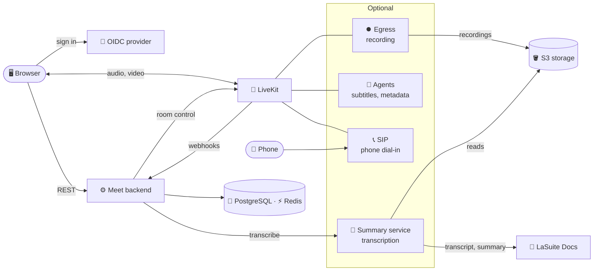
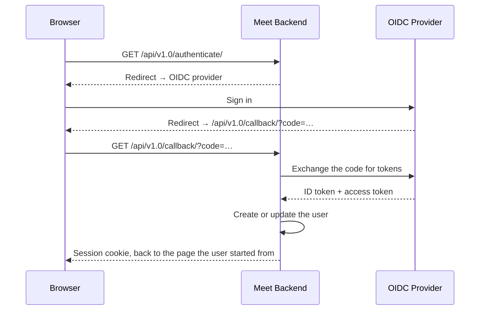
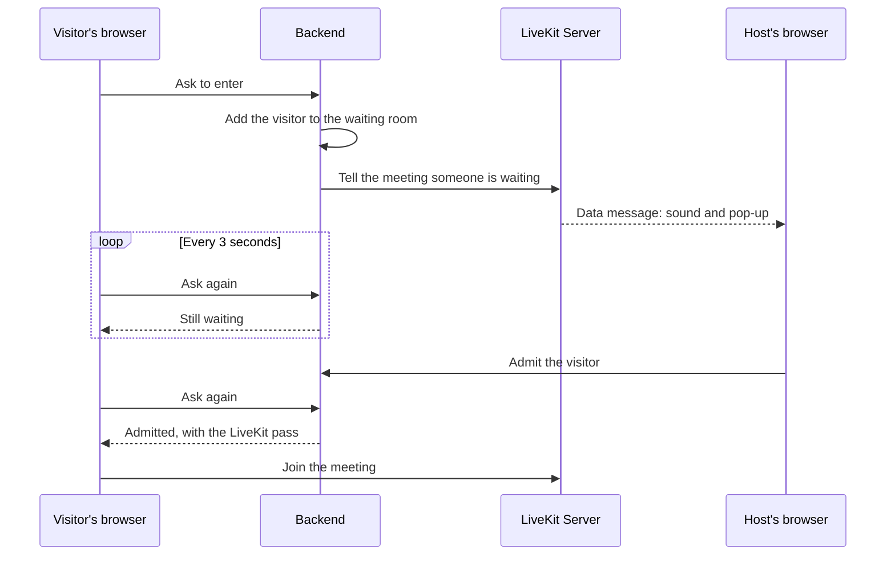
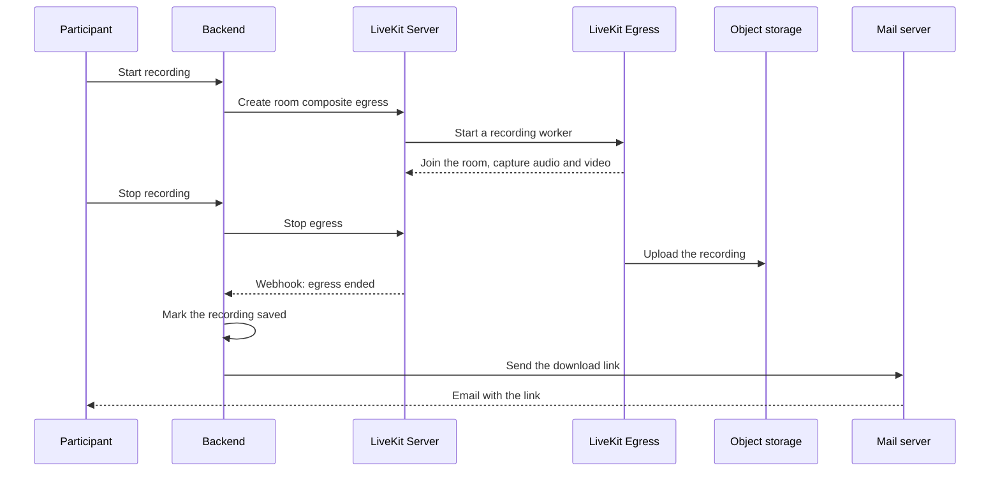
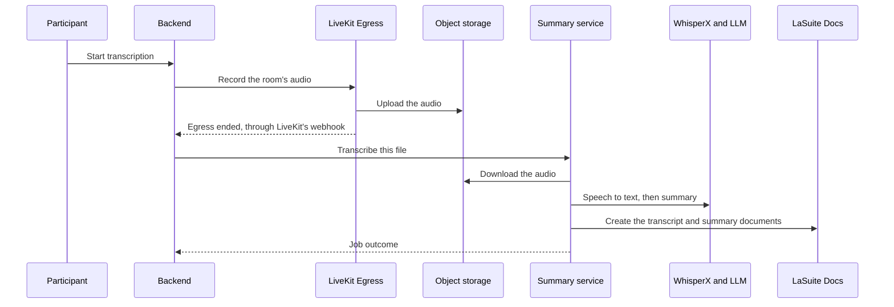
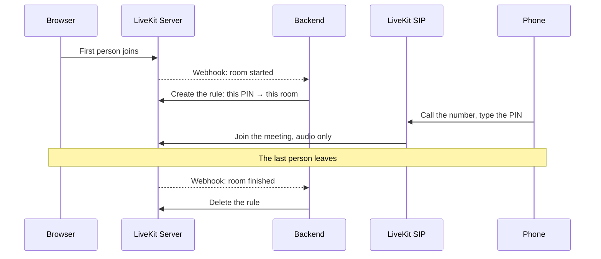

# How Meet works

## TL;DR

Meet is a [Django](https://www.djangoproject.com/) backend and a [React](https://react.dev/) frontend built around [LiveKit](https://livekit.io/), an [SFU](#key-concepts): a media server that receives each participant's audio and video once, over [WebRTC](https://webrtc.org/), and forwards it to everyone else without mixing it, at the quality each viewer's connection holds.

The backend decides who may join a room and hands the browser a signed pass; from then on, the browser talks to LiveKit directly.

Recording, transcription, live subtitles and phone dial-in are optional services beside that core.

## What runs where? { #the-pieces }

Each piece's ports are in [Firewall & Ports](../self-hosting/configuration/firewall.md), the requests between the pieces in [Networking](../reference/networking.md), and their code in the [Code tour](../contributing/code-tour.md).

| Piece | What it does |
|---|---|
| 🖥️ Frontend | The interface in your browser. Talks to the backend over REST and to LiveKit directly for audio and video. |
| ⚙️ Backend | Signs users in, creates rooms, decides who joins, mints the LiveKit pass, starts and stops recordings, receives LiveKit's webhooks, writes the audit log. An optional [Celery](https://docs.celeryq.dev/) worker runs its background tasks, see [`CELERY_ENABLED`](../reference/env-variables.md#CELERY_ENABLED) |
| 🎥 LiveKit Server | Forwards each participant's audio and video to the others, carries the signalling, and has a TURN relay built in |
| ⏺️ LiveKit Egress, optional | Records a meeting to a file in S3 storage, when the backend asks |
| 📞 LiveKit SIP, optional | Bridges phone calls into meetings through a SIP trunk |
| 🤖 LiveKit Agents, optional | Two programs that join meetings: the subtitles transcriber and the metadata collector |
| 📝 Summary service, optional | Transcribes recordings and writes summaries, on three Celery queues |
| 🐘 [PostgreSQL](https://www.postgresql.org/) | Users, rooms, roles, recordings |
| ⚡ [Redis](https://redis.io/) | Cache, sessions, the waiting room, Celery's queues, LiveKit's state |
| 🪣 S3-compatible storage | Recordings, transcripts, uploaded backgrounds, transcription metadata |

## Key concepts { #key-concepts }

- **SFU, Selective Forwarding Unit.** LiveKit is an [SFU](https://bloggeek.me/webrtcglossary/sfu/): it receives each participant's streams once and forwards them to everyone else without decoding them, so a browser's upload does not grow with the number of viewers.
- **WebRTC.** [WebRTC](https://webrtc.org/) is the browser standard for live audio and video, and it encrypts every stream between the browser and LiveKit. See [Is it secure?](#security)
- **Signalling and media.** Signalling is the control talk of a call, such as joining or who publishes what, over a WebSocket on port 443. Media is the audio and video, over UDP, or TCP when UDP is blocked. See [Getting through firewalls](#firewalls).
- **[Simulcast](https://bloggeek.me/webrtcglossary/simulcast/) and [SVC](https://bloggeek.me/webrtcglossary/svc/).** Each camera sends its video at up to three qualities, and LiveKit forwards to each viewer the one that fits their connection and the size their video is shown at.
- **The LiveKit pass.** What the browser shows LiveKit to join a meeting: a signed [JWT](https://datatracker.ietf.org/doc/html/rfc7519) the backend issues. See [What happens when someone joins?](#joining-a-meeting)
- **Room and meeting.** A room is the lasting record, its code, settings and roles, kept in PostgreSQL. A meeting is the live session LiveKit opens when the first person joins the room and closes when the last one leaves. See [What happens when a meeting ends?](#when-the-meeting-ends)
- **Roles and access levels.** A role ties a user to a room: owner, co-host or member. The access level decides who walks straight in and who waits. See [Who can do what?](#who-gets-in)
- **The waiting room.** **Lobby** in the app: where a visitor waits until a host admits them. See [Who can do what?](#who-gets-in)
- **Webhooks.** LiveKit calls the backend over HTTP when a meeting starts or ends, someone leaves, or a recording changes state. These calls feed recordings, phone dial-in, the clean-up after a meeting and the [room purge](../self-hosting/configuration/room-purge.md#how-a-room-becomes-purgeable); see [Webhook](../self-hosting/configuration/livekit.md#webhook).
- **SIP.** The protocol phone networks and meeting-room video systems use to set up calls. LiveKit SIP turns a call into an audio-only participant. See [How do phone calls join?](#agents-and-phone-calls)
- **STUN and TURN.** [STUN](https://bloggeek.me/webrtcglossary/stun/) tells a machine the public address it is seen from; LiveKit uses it at startup to [find its own](../self-hosting/configuration/livekit.md#use_external_ip). [TURN](https://bloggeek.me/webrtcglossary/turn/) relays the media of a participant whose network blocks every direct path. See [Getting through firewalls](#firewalls).

## What is stored, and for how long? { #what-is-stored-where }

| Data | Where | How long |
|---|---|---|
| Accounts, rooms and their roles, recording entries, uploaded-file entries, registered applications | PostgreSQL | Until deleted. Deleted rooms, and rooms nobody starts any more, go when the [room purge](../self-hosting/configuration/room-purge.md) removes them; it is off by default |
| Sessions, waiting-room requests, which signed-in participants are in a meeting | Redis | They expire on their own: a session after 12 hours, an admission after 6 hours, presence after an hour |
| Audio, video, screen shares, reactions, and chat outside a transcription | Nowhere: LiveKit forwards them live and keeps nothing | Gone when sent |
| Recordings | S3 storage, under `recordings/` | Meet never deletes them. [`RECORDING_EXPIRATION_DAYS`](../reference/env-variables.md#RECORDING_EXPIRATION_DAYS) only marks them expired; a lifecycle rule on the bucket deletes the files |
| Transcripts, as JSON | S3 storage, under `transcripts/` | Meet never deletes them; set a bucket rule |
| Who spoke when, connections and chat during a transcription, from the metadata collector | S3 storage, under `metadata/` | Meet never deletes them; set a bucket rule |
| Uploaded background images | S3 storage, under `files/` | A deleted image is removed 7 days later by the `purge_deleted_files` command, which the Helm chart runs nightly; on Docker Compose, schedule it yourself |
| Transcripts and summaries as documents | [LaSuite Docs](https://github.com/suitenumerique/docs), when connected | Like any document there |
| Audit events, one JSON line each | The backend's standard output by default, for your log collector. What they cover is in [Audit logging](../self-hosting/configuration/audit-logging.md#catalogue) | Meet keeps none: as long as your log store keeps them |

What Meet sends by email is in [Email](../self-hosting/configuration/email.md).

## Is it secure? { #security }

Every stream is encrypted between your browser and LiveKit, as WebRTC requires. Meet has no end-to-end encryption, though: LiveKit decrypts the streams to forward them, so whoever runs the server could reach the media.

On the backend:

- Every request is checked against your role on the room.
- Some actions are rate-limited, as [Rate limiting](../reference/security.md#rate-limiting) lists.
- Sensitive actions leave a trace in the audit log.

How to harden a server is in [Security](../reference/security.md).

## What happens when someone joins? { #joining-a-meeting }

A meeting lives at a room code, such as `meet.example.com/abc-defg-hij`. When you open that link, the browser asks the backend about the room. If you may walk straight in, the answer carries your LiveKit pass:

- It is signed with LiveKit's API secret, so LiveKit trusts it without ever seeing a user account.
- It names you, the room and what you may publish: microphone, camera, screen share.
- It stays valid for 6 hours.

If you may not walk straight in, you go through the [waiting room](#who-gets-in) first. With the pass, the browser opens a WebSocket to LiveKit and starts sending and receiving audio and video.

Sign-in decides who you *are*; the pass decides what you may *do* in the room.

### Signing in { #signing-in }

Users have no password in Meet; only the Django admin accounts do.

Meet hands sign-in to any [OpenID Connect](https://openid.net/developers/how-connect-works/) provider, such as [Keycloak](https://www.keycloak.org/), [Authentik](https://goauthentik.io/), Google or [ProConnect](https://www.proconnect.gouv.fr/), and keeps a session cookie once the provider confirms who you are. Setup is in [SSO & Authentication](../self-hosting/configuration/sso.md).

## How do audio and video travel? { #media }

Once you are in, each kind of traffic takes its own road:

- **Audio and video** go to LiveKit, which forwards them to everyone else.
- **Chat and reactions** go the same way, as LiveKit data messages between browsers. Nothing stores them outside a transcription, so Meet has no chat history.
- **Changes to the meeting**, such as muting someone, raising a hand or making someone co-host, go to the backend. It checks that you are allowed, then asks LiveKit to apply the change.

### Getting through firewalls { #firewalls }

Signalling reaches LiveKit through your reverse proxy on port 443, like any web page.

Media then takes the best path the participant's network allows, in the order that [How media connects](../self-hosting/configuration/livekit.md#how-media-connects) lists. [TURN](../self-hosting/configuration/livekit.md#turn) says when a relay is worth it.

## Who can do what? { #who-gets-in }

Two things decide who gets in: your role on the room and the room's access level.

- **Roles** are owner, co-host and member. Co-host is *administrator* in the API. Anyone with a role joins directly; who holds which is in [Roles](../user/features-controls.md#roles).
- **Access levels** are **Open**, **Open to trusted people** and **Restricted**, written `public`, `trusted` and `restricted` in the API. Who joins directly at each is in [Room access levels](../user/features-controls.md#access-levels).

Everyone else waits in the waiting room, which lives in Redis rather than in the database:

- The backend checks the access level on every request, so opening the room lets in people already waiting.
- A request not renewed within 6 seconds expires, so closing the tab leaves the queue.
- The browser gives up after 10 minutes without an answer.
- Who may admit is in [Permissions](../user/features-controls.md#permissions).

Inside the meeting, the host settings can stop participants from using their microphone, camera or screen share, or from muting others.

Those that limit publishing reach LiveKit as each person's publishing rights: in the pass for newcomers, and as an update for people already in.

A room code that matches no room still opens a meeting, with no owner and open to anyone, unless your server turns that off; see [Unauthenticated access](../self-hosting/configuration/sso.md#unauthenticated-access).

## How does recording work? { #recording }

The backend asks LiveKit Egress to record the meeting, and Egress joins it as a hidden participant. If Egress fails, the backend marks the recording failed and tells the participants.

What the person recording sees is in [Recording & Transcription](../user/recording.md#recording), who may start one in [Who can record](../self-hosting/configuration/recording.md#who-can-record), and setup in [Recording](../self-hosting/configuration/recording.md).

## How do transcription and the summary work? { #transcription-and-summary }

A transcription starts like a recording, and Egress records only the audio unless **Also start a video recording** is ticked.

Once the file is in storage, the backend hands it to the summary service, whose workers take it from there:

- The first turns the speech into text through a [WhisperX](https://github.com/suitenumerique/meet-whisperx) API, names the speakers where the metadata collector ran, and writes the transcript to LaSuite Docs.
- The second asks a language model for a summary, where your server turns summaries on.
- The third tells the backend how the job went.

The metadata collector, a LiveKit agent, joins a transcription when your server enables it. It notes who speaks when, who connects and leaves, and the chat, so the summary service can put names on the voices.

Setup is in [AI Transcription](../self-hosting/configuration/transcription.md).

## How do live subtitles work? { #subtitles }

Live subtitles come from an agent. When someone clicks **Show subtitles**, the backend asks LiveKit to send the subtitles agent into the meeting. The agent then:

- listens to each speaker separately;
- sends their audio to a speech-to-text provider: [Deepgram](https://deepgram.com/), [Kyutai](https://kyutai.org/) or [Voxtral](https://mistral.ai/news/voxtral);
- publishes the text back into the meeting as captions, and keeps none of it.

Setup is in [Real-time Subtitles](../self-hosting/configuration/subtitles.md).

## How do phone calls join? { #agents-and-phone-calls }

LiveKit SIP bridges the phone network into meetings. A caller dials your server's number and types the room's PIN, then joins as an audio-only participant. The PIN works only while a meeting is running:

Meeting-room video systems dial in over SIP the same way, through Roomkit. For them, LiveKit SIP asks the backend which room the PIN belongs to, and the backend creates the rule on the spot, so they can open an empty meeting.

Setup is in [Telephony](../self-hosting/configuration/telephony.md).

## What happens when a meeting ends? { #when-the-meeting-ends }

Leaving never ends the meeting for the others: Meet has no "end for all".

Shortly after the last person leaves, LiveKit closes the meeting and tells the backend, which clears:

- the waiting room;
- its record of who was present;
- the phone PIN rule.

Deleting a room is different: only its owner can, through the API, and that ends any meeting in it at once. Its link then says the room was deleted, until the [room purge](../self-hosting/configuration/room-purge.md) removes it for good.

## How do other applications connect? { #integrating }

Other applications create and manage rooms through the [external API](../reference/external-api.md). [Getting a token](../reference/external-api.md#getting-a-token) lists the ways to get a token for it, from an application's own credentials to an add-in such as the [Outlook add-in](https://github.com/suitenumerique/meet/tree/main/src/addons/outlook).

An application can also show Meet inside its own page and [sign the user in there](../reference/external-api.md#signing-a-user-in-to-an-iframe).
