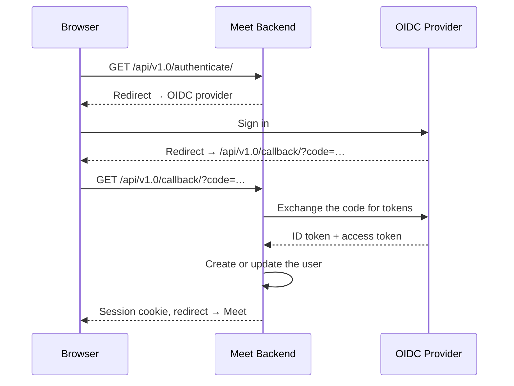
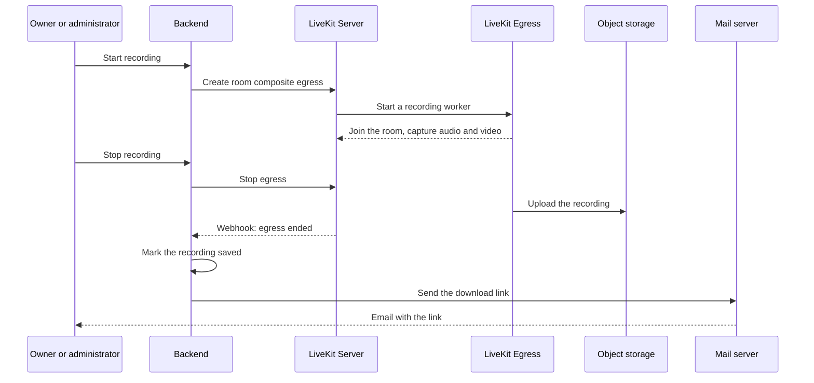

# How Meet works

## TL;DR

Meet is a Django backend and a React frontend around [LiveKit](https://livekit.io/), the media server that carries every call's audio and video. The backend decides who may join a room and hands the browser a short-lived pass; the browser then talks to LiveKit directly. Recording, transcription, subtitles and phone dial-in are optional services added beside that core.

## The pieces

Everything a meeting touches, and who calls whom. The optional services join only when you enable their feature.

| Piece | What it does | Ports |
|---|---|---|
| Frontend (React, TypeScript, Vite, React Aria) | The browser UI. Talks to the backend over REST for sign-in, rooms and recordings, and to LiveKit directly for media | 3000 in development, 8080 in the production container |
| Backend (Django, Django REST Framework) | Signs users in, creates rooms, decides who joins, mints the LiveKit pass, starts and stops recordings, handles LiveKit's webhooks | 8000 |
| LiveKit Server | The media server: forwards each participant's streams to the others, handles signalling and TURN/STUN | 7880 (HTTP/WebSocket), 7881/TCP, 7882/UDP |
| LiveKit Egress (optional) | Records a room to a file in S3, started by the backend | none public |
| LiveKit SIP (optional) | Bridges phone calls into rooms through a SIP trunk | 5060/UDP, 10000–20000/UDP |
| LiveKit Agents (optional) | Two workers: the subtitles transcriber and the metadata collector | none public |
| Summary service (optional, FastAPI) | Transcribes recordings and writes summaries, on three Celery queues | 8000, internal |
| PostgreSQL | Users, rooms, roles, recordings | 5432 |
| Redis | Cache, sessions, waiting room state, Celery broker, LiveKit state | 6379 |
| S3-compatible storage | Recordings, uploaded backgrounds, transcription metadata | 9000 for MinIO |

How each request travels between them is in [Networking](../reference/networking.md).

## Joining a meeting

A meeting lives at a room code, `meet.example.com/abc-defg-hij`.

1. The frontend asks the backend for the room: `GET /api/v1.0/rooms/abc-defg-hij/`.
2. If the visitor may walk straight in, see [Who gets in](#who-gets-in), the answer carries a LiveKit pass: a short-lived JWT, signed with the LiveKit API secret, naming the person, the room and what they may publish.
3. Otherwise the browser asks to come in, `POST /api/v1.0/rooms/<id>/request-entry/`, and keeps asking while it waits. The backend tells everyone in the room that someone is waiting.
4. Once someone admits them, the browser's next request returns the pass.
5. The browser opens a WebSocket to LiveKit with the pass, then sends and receives media over WebRTC.

LiveKit never sees a user account: it trusts the pass the backend signed. OIDC decides who someone *is*; the pass decides what they may *do* in the room.

### Signing in

Meet delegates sign-in to any OpenID Connect provider: Keycloak, Authentik, Google, ProConnect and others, see [SSO & Authentication](../self-hosting/configuration/sso.md).

## Who gets in

Each room has an access level, and people holding a role on the room (owner, administrator, member) always join directly.

| Access level | Joins directly | Waits in the waiting room |
|---|---|---|
| `public` | Anyone with the link | No one |
| `trusted` | Signed-in users | Visitors who are not signed in |
| `restricted` | People holding a role on the room | Everyone else |

A room code that matches no room gives a meeting with no owner, open to anyone, unless the instance turns that off. Which level a new room gets, and the setting behind unknown codes, are in [Unauthenticated access](../self-hosting/configuration/sso.md#unauthenticated-access).

Room owners and administrators admit people from the waiting room. In a `trusted` room, any signed-in participant already in the meeting can admit too.

## Inside the meeting

LiveKit is a Selective Forwarding Unit: it forwards each participant's streams to the others without re-encoding them, which uses far less CPU than mixing them. Each sender uses **simulcast**, sending its video at several qualities at once, so LiveKit can forward each receiver the quality its connection holds.

Chat and reactions travel as LiveKit data messages between browsers, so Meet keeps no chat history. A raised hand goes through the backend, which stamps the time on the participant so everyone sees hands in order. A room's **configuration** decides which sources participants may publish (camera, microphone, screen) and whether everyone can mute each other; owners and administrators set it, and it reaches LiveKit as room metadata.

What participants can do is in [Features & Controls](../user/features-controls.md).

## Recording

The link goes to whoever started the recording. Setup is in [Recording](../self-hosting/configuration/recording.md).

## Transcription and summary

1. A transcription starts, on its own or alongside a screen recording, and Egress records the room's audio.
2. The backend sends the file's location to the summary service.
3. A Celery worker on `transcribe-queue-v2` downloads the audio and runs speech-to-text.
4. The transcript is formatted, and diarized speakers are matched to participants.
5. A worker on `summarize-queue-v2` asks the configured LLM for a summary.
6. A worker on `call-webhook-queue-v2` tells the backend whether it succeeded.

The backend only records that outcome. The transcript and summary reach users through LaSuite Docs, for tenants allowed to push there. Setup is in [AI Transcription](../self-hosting/configuration/transcription.md).

## Agents and phone calls

Two optional LiveKit agents join rooms as silent participants. The **subtitles transcriber** turns speech into live captions through Deepgram, Kyutai or Voxtral, see [Real-time Subtitles](../self-hosting/configuration/subtitles.md). The **metadata collector** records who speaks when, connections and chat during a transcription, and stores them in S3 for the summary service.

**LiveKit SIP** lets people dial in by phone with the room's PIN, as audio-only participants, see [Telephony](../self-hosting/configuration/telephony.md).

## Integrating

Other applications create and manage rooms through the external API, in three authentication modes: an application acting for its users, a user's own OIDC token, or a calendar add-in. See the [API reference](../reference/api.md).
