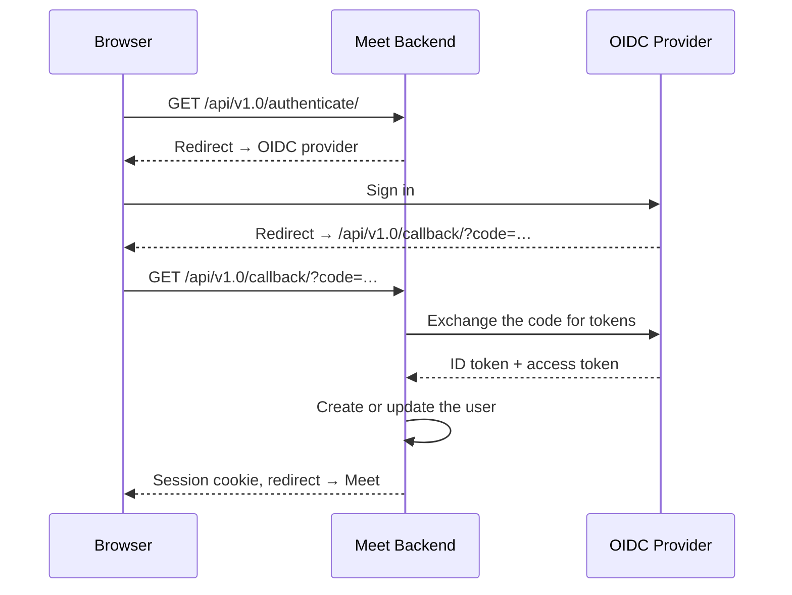
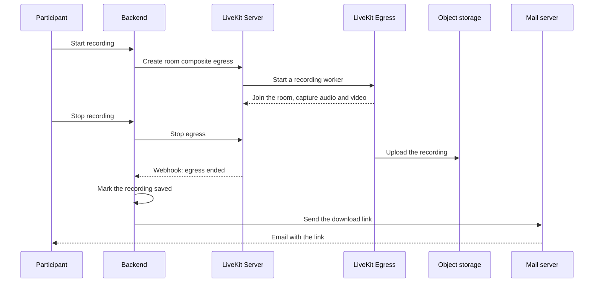
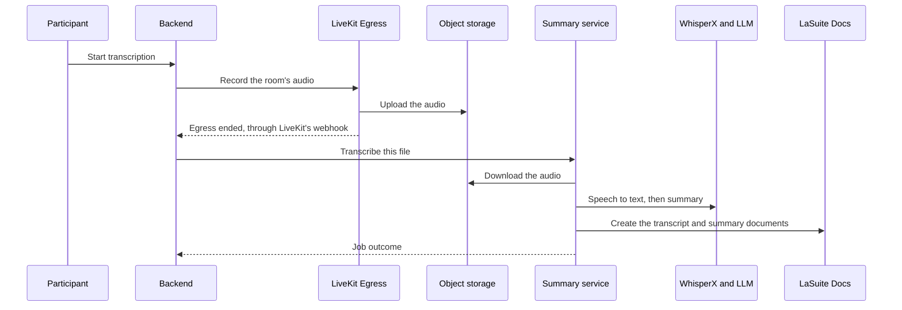

# How Meet works

## TL;DR

Meet is a Django backend and a React frontend built around [LiveKit](https://livekit.io/), the media server that carries every call's audio and video. The backend decides who may join a room and hands the browser a pass; from then on, the browser talks to LiveKit directly. Recording, transcription, live subtitles and phone dial-in are optional services that sit beside that core.

## What runs where? { #the-pieces }

The pieces marked optional run only when you turn on their feature. How each request travels between them is in [Networking](../reference/networking.md).

| Piece | What it does | Ports |
|---|---|---|
| 🖥️ Frontend (React, TypeScript, Vite, React Aria) | The browser UI. Talks to the backend over REST for sign-in, rooms and recordings, and to LiveKit directly for media | 3000 in development, 8080 in the production container |
| ⚙️ Backend (Django, Django REST Framework) | Signs users in, creates rooms, decides who joins, mints the LiveKit pass, starts and stops recordings, handles LiveKit's webhooks, writes the audit log | 8000 |
| 🎥 LiveKit Server | The media server: forwards each participant's streams to the others, handles signalling and TURN/STUN | 7880 (HTTP/WebSocket), 7881/TCP, 7882/UDP |
| ⏺️ LiveKit Egress (optional) | Records a room to a file in S3, started by the backend | none public |
| 📞 LiveKit SIP (optional) | Bridges phone calls into rooms through a SIP trunk | 5060/UDP and an RTP port range, 10000–20000/UDP by default |
| 🤖 LiveKit Agents (optional) | Two workers: the subtitles transcriber and the metadata collector | none public |
| 📝 Summary service (optional, FastAPI) | Transcribes recordings and writes summaries, on three Celery queues | 8000, internal |
| 🐘 PostgreSQL | Users, rooms, roles, recordings | 5432 |
| ⚡ Redis | Cache, sessions, waiting room state, Celery broker, LiveKit state | 6379 |
| 🪣 S3-compatible storage | Recordings, uploaded backgrounds, transcription metadata | The store's own |

## What happens when someone joins? { #joining-a-meeting }

A meeting lives at a room code, such as `meet.example.com/abc-defg-hij`. When someone opens that link, the browser first asks the backend about the room. If the visitor is allowed straight in, the answer carries a LiveKit pass: a token, signed with the LiveKit API secret, that names the person, the room and what they may publish. It stays valid for 6 hours by default.

If the visitor is not allowed straight in, the browser asks to enter and keeps asking while it waits in the waiting room. The backend tells everyone in the meeting that someone is waiting, and once a host admits them, the next request returns the pass.

With the pass in hand, the browser opens a WebSocket to LiveKit and starts sending and receiving audio and video over [WebRTC](https://webrtc.org/). LiveKit never sees a user account: it simply trusts the pass the backend signed. Sign-in decides who someone *is*; the pass decides what they may *do* in the room.

### Signing in

Meet has no passwords of its own. It hands sign-in to any [OpenID Connect](https://openid.net/developers/how-connect-works/) provider, such as [Keycloak](https://www.keycloak.org/), [Authentik](https://goauthentik.io/), Google or [ProConnect](https://www.proconnect.gouv.fr/), and keeps a session cookie once the provider confirms who the user is. Setup is in [SSO & Authentication](../self-hosting/configuration/sso.md).

## How do audio and video travel?

LiveKit is a Selective Forwarding Unit: it receives each participant's streams and forwards them to the others without re-encoding them, which costs far less CPU than mixing them into one. Each sender sends its video at several qualities at once, so LiveKit can give every receiver the quality its connection can handle. With VP9, the default, and AV1, those qualities are layers of a single stream; with VP8 or H.264 they are separate streams.

Chat messages and reactions take the same road, as LiveKit data messages between browsers, which is why Meet keeps no chat history. Everything that changes the meeting itself, such as muting someone, raising a hand or making someone co-host, goes through the backend instead: it checks that the caller is allowed, then asks LiveKit to apply the change.

### Getting through firewalls

The browser reaches LiveKit's WebSocket through the reverse proxy on port 443, like any web page. The audio and video then take the first path the participant's network allows:

1. **UDP on port 7882**, the normal path, with the lowest delay.
2. **TCP on port 7881**, when that UDP port is blocked. It works, with more delay.
3. **A TURN relay**, when both are blocked, as on some corporate networks. It carries the media over port 443 or inside TLS on 5349, and is off until you enable it.

A room that loads but never connects almost always means none of these paths is open. Which ports to open is in [Firewall & Ports](../self-hosting/configuration/firewall.md), and when TURN is worth it in [LiveKit & TURN](../self-hosting/configuration/livekit.md#turn).

## Who can do what? { #who-gets-in }

Each room has an access level that decides who joins directly and who waits to be admitted. People with a role on the room, its owner, co-hosts (*administrator* in the API) and members, always join directly.

| Access level | Joins directly | Waits in the waiting room |
|---|---|---|
| **Open** (`public`) | Anyone with the link | No one |
| **Open to trusted people** (`trusted`) | Signed-in users | Visitors who are not signed in |
| **Restricted** (`restricted`) | People with a role on the room | Everyone else |

Inside the meeting, the host settings decide whether participants may turn on their microphone, camera or screen share, and whether they may mute each other. The owner and co-hosts change them, and they reach LiveKit as part of the room's settings. The full list of who may do what is in [Permissions](../user/features-controls.md#permissions).

A room code that matches no room opens a meeting with no owner by default. An instance can turn that off, so that only a signed-in visitor can create the room, and own it; see [Unauthenticated access](../self-hosting/configuration/sso.md#unauthenticated-access).

## What is stored, and for how long? { #what-is-stored-where }

The calls themselves leave nothing behind: LiveKit forwards audio, video and chat live and keeps none of it. What Meet does keep is below.

| Data | Where | How long |
|---|---|---|
| Accounts, rooms and their roles, recording entries, uploaded-file entries, registered applications | PostgreSQL | Until deleted. Deleted rooms, and rooms nobody starts any more, go when the [room purge](../self-hosting/configuration/room-purge.md) removes them; it is off by default |
| Sessions, waiting-room requests, who is in each room | Redis | They expire on their own: a session after 12 hours, an admission after 6, presence an hour after its last refresh |
| Audio, video, screen shares, reactions, and chat outside a transcription | Nowhere: LiveKit forwards them live and keeps nothing | Gone when sent |
| Recordings | S3 storage, under `recordings/` | Meet never deletes them. [`RECORDING_EXPIRATION_DAYS`](../reference/env-variables.md#recording) only marks them expired; a lifecycle rule on the bucket deletes the files |
| Who spoke when, connections and chat during a transcription, from the metadata collector | S3 storage, under `metadata/` | Meet never deletes them; set a bucket rule |
| Uploaded background images | S3 storage, under `files/` | A deleted image is removed 7 days later by the `purge_deleted_files` command, which the Helm chart runs nightly; on Docker Compose, schedule it yourself |
| Transcripts and summaries | [LaSuite Docs](https://github.com/suitenumerique/docs), when connected | Like any document there |
| Audit events: room reads and changes; recording starts, stops, ends and deletions; transcript requests and their outcomes; user provisioning; Django admin writes; tokens and one-time sign-in codes issued through the external API | The backend's standard output by default, one JSON line each, for your log collector, see [Audit logging](../self-hosting/configuration/audit-logging.md) | Meet keeps none: as long as your log store keeps them |

Meet sends email for two things only: a screen recording's download link, and an invitation sent through the API. Sign-in never uses it; see [Email](../self-hosting/configuration/email.md).

## Is it secure?

Every stream is encrypted between the browser and the media server, as WebRTC requires. Meet has no end-to-end encryption, though: LiveKit decrypts the streams to forward them, so whoever runs the server could reach the media.

On the backend, every request is checked against the caller's role on the room, and the actions open to abuse, such as creating rooms, starting recordings or asking to enter a waiting room, are rate-limited. Sensitive actions also leave a trace in the audit log. The details, and how to harden a server, are in [Security](../reference/security.md).

## How does recording work? { #recording }

When a host starts a recording, the backend asks LiveKit Egress to join the room as a hidden participant and capture it. Egress waits until someone has a microphone, camera or screen share on, then records until the recording is stopped or reaches its time limit. It uploads the file to object storage, LiveKit tells the backend the recording ended, and the backend emails a download link to whoever started it and the room's hosts. If Egress fails, the backend marks the recording failed and tells the participants.

Who may start a recording depends on the room's access level; see [Who can record](../self-hosting/configuration/recording.md#who-can-record). Setup is in [Recording](../self-hosting/configuration/recording.md).

## How do transcription and the summary work? { #transcription-and-summary }

A transcription starts the same way as a recording, except that Egress records only the audio, unless **Also start a video recording** is ticked. Once the file is in storage, the backend hands it to the summary service, which works through it in the background: one worker turns the speech into text and matches the voices to the participants, a second asks a language model for a summary, and a third reports back to the backend. The transcript and the summary then appear as documents in LaSuite Docs.

Setup is in [AI Transcription](../self-hosting/configuration/transcription.md).

## How do live subtitles work?

Live subtitles come from an agent: a small program that joins the room as a silent participant. When someone clicks **Show subtitles**, the backend asks LiveKit to send the subtitles agent into that room. The agent listens to each speaker, sends the audio to a speech-to-text provider ([Deepgram](https://deepgram.com/), [Kyutai](https://kyutai.org/) or [Voxtral](https://mistral.ai/news/voxtral)), and publishes the text back into the room as captions. Nothing is stored. Setup is in [Real-time Subtitles](../self-hosting/configuration/subtitles.md).

A second agent, the metadata collector, only runs during a transcription where it is enabled. It notes who speaks when, who connects and the chat, so the summary service can name the speakers.

## How do phone calls join? { #agents-and-phone-calls }

LiveKit SIP bridges the phone network into rooms. A caller dials the instance's number and types the room's PIN; LiveKit then connects them to the room as an audio-only participant. The backend creates the rule linking a PIN to its room when the meeting starts and deletes it when the meeting ends, so a caller can only join while someone is in the meeting from a browser.

Meeting-room video devices can also dial in over SIP through Roomkit. For them, LiveKit asks the backend directly whether the PIN matches a room, so they can join an empty meeting. Setup is in [Telephony](../self-hosting/configuration/telephony.md).

## What happens when a meeting ends? { #when-the-meeting-ends }

Leaving never ends the meeting for the others: there is no "end for all". When the last person leaves, LiveKit closes the room and tells the backend, which clears the waiting room and the list of who was present. The room itself, its code, settings and roles, stays in the database and can be used again.

Deleting a room is different: only its owner can, through the API, and that ends any meeting in it. The room then answers that it was deleted until it is purged for good; see [Room purge](../self-hosting/configuration/room-purge.md).

## How do other applications connect? { #integrating }

Other applications create and manage rooms through the [external API](../reference/external-api.md). They can act for their users with credentials registered in Meet, accept a token from the user's own sign-in provider, run as an add-in inside another product, such as the [Outlook add-in](https://github.com/suitenumerique/meet/tree/main/src/addons/outlook), or exchange a La Suite token through [Menshen](../reference/external-api.md#menshen-token-exchange), which so far can only create rooms.

An application can also show Meet inside its own page. Because Meet's cookies do not reach an embedded frame, the application gets a one-time code for its user from the external API, and Meet trades that code for a sign-in.
