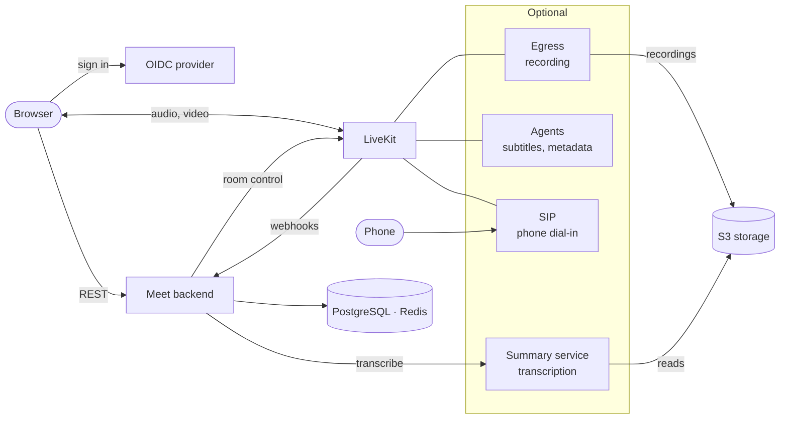
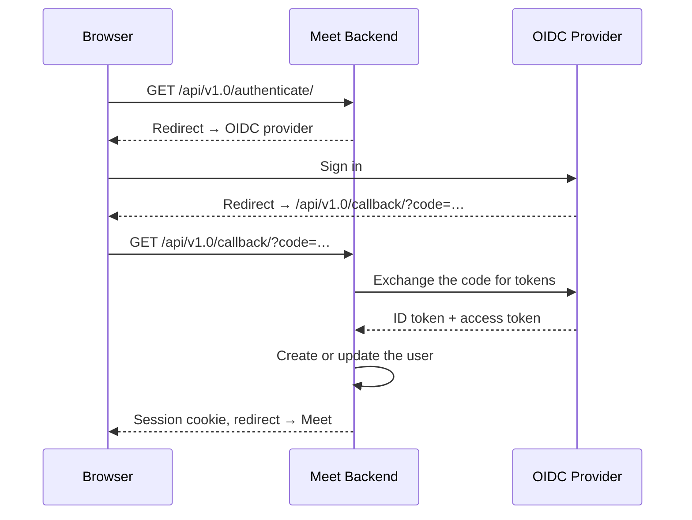
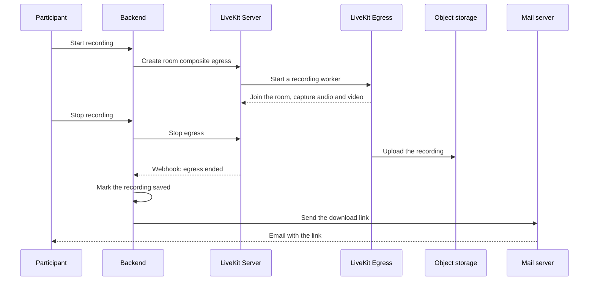

# How Meet works

## TL;DR

Meet is a Django backend and a React frontend around [LiveKit](https://livekit.io/), the media server that carries every call's audio and video. The backend decides who may join a room and hands the browser a short-lived pass; the browser then talks to LiveKit directly. Recording, transcription, subtitles and phone dial-in are optional services added beside that core.

## The pieces

Everything a meeting touches, and who calls whom. The optional services join only when you enable their feature.

| Piece | What it does | Ports |
|---|---|---|
| Frontend (React, TypeScript, Vite, React Aria) | The browser UI. Talks to the backend over REST for sign-in, rooms and recordings, and to LiveKit directly for media | 3000 in development, 8080 in the production container |
| Backend (Django, Django REST Framework) | Signs users in, creates rooms, decides who joins, mints the LiveKit pass, starts and stops recordings, handles LiveKit's webhooks, writes the audit log | 8000 |
| LiveKit Server | The media server: forwards each participant's streams to the others, handles signalling and TURN/STUN | 7880 (HTTP/WebSocket), 7881/TCP, 7882/UDP |
| LiveKit Egress (optional) | Records a room to a file in S3, started by the backend | none public |
| LiveKit SIP (optional) | Bridges phone calls into rooms through a SIP trunk | 5060/UDP, 10000–20000/UDP |
| LiveKit Agents (optional) | Two workers: the subtitles transcriber and the metadata collector | none public |
| Summary service (optional, FastAPI) | Transcribes recordings and writes summaries, on three Celery queues | 8000, internal |
| PostgreSQL | Users, rooms, roles, recordings | 5432 |
| Redis | Cache, sessions, waiting room state, Celery broker, LiveKit state | 6379 |
| S3-compatible storage | Recordings, uploaded backgrounds, transcription metadata | The store's own |

How each request travels between them is in [Networking](../reference/networking.md).

## Joining a meeting

A meeting lives at a room code, `meet.example.com/abc-defg-hij`.

1. The frontend asks the backend for the room: `GET /api/v1.0/rooms/abc-defg-hij/`.
2. If the visitor may walk straight in, see [Who gets in](#who-gets-in), the answer carries a LiveKit pass: a short-lived JWT, signed with the LiveKit API secret, naming the person, the room and what they may publish.
3. Otherwise the browser asks to come in, `POST /api/v1.0/rooms/<id>/request-entry/`, and keeps asking while it waits. The backend tells everyone in the room that someone is waiting.
4. Once someone admits them, the browser's next request returns the pass.
5. The browser opens a WebSocket to LiveKit with the pass, then sends and receives media over WebRTC.

LiveKit never sees a user account: it trusts the pass the backend signed. OIDC decides who someone *is*; the pass decides what they may *do* in the room.

### Signing in

Meet delegates sign-in to any OpenID Connect provider: Keycloak, Authentik, Google, ProConnect and others, see [SSO & Authentication](../self-hosting/configuration/sso.md).

## Who gets in

Each room has an access level, shown below with its value in the API. People holding a role on the room, owner, co-host (*administrator* in the API) or member, always join directly.

| Access level | Joins directly | Waits in the waiting room |
|---|---|---|
| **Open** (`public`) | Anyone with the link | No one |
| **Open to trusted people** (`trusted`) | Signed-in users | Visitors who are not signed in |
| **Restricted** (`restricted`) | People holding a role on the room | Everyone else |

A room code that matches no room gives a meeting with no owner, open to anyone. An instance can turn that off. With it off, a signed-in visitor who opens an unknown code creates the room and owns it, and anyone else gets an error. Which level a new room gets, and the setting behind unknown codes, are in [Unauthenticated access](../self-hosting/configuration/sso.md#unauthenticated-access). A deleted room's code is not unknown: it keeps answering that the meeting was deleted until the room is purged.

Owners and co-hosts admit people from the waiting room. In a room open to trusted people, any signed-in participant already in the meeting can admit too.

## Inside the meeting

LiveKit is a Selective Forwarding Unit: it forwards each participant's streams to the others without re-encoding them, which uses far less CPU than mixing them. Each sender sends its video at several qualities at once, so LiveKit can forward each receiver the quality its connection holds. With VP8 or H.264 these are separate streams (simulcast); with VP9, the default, and AV1 they are layers of one stream (SVC).

Chat and reactions travel as LiveKit data messages between browsers, so Meet keeps no chat history, except during a transcription when the metadata collector runs, see [below](#what-is-stored-where). A raised hand goes through the backend, which stamps the time on the participant so everyone sees hands in order. A room's **configuration**, the host settings in the meeting, decides which sources participants may publish (camera, microphone, screen) and whether everyone can mute each other. Owners and co-hosts set it, and it reaches LiveKit as room metadata.

A participant's browser publishes only its own media and its chat and reaction messages. Everything else goes through the backend, which checks the caller's role or LiveKit pass and then asks LiveKit to apply it: muting or removing someone, making someone co-host, renaming yourself, raising a hand, starting subtitles.

What participants can do is in [Features & Controls](../user/features-controls.md).

### Getting media through firewalls

The signalling WebSocket reaches LiveKit through the reverse proxy on port 443, like any web page. The media takes the first path the participant's network allows:

1. **UDP on port 7882**, the normal path, with the lowest latency.
2. **TCP on port 7881**, when the network blocks that UDP port. It works, with more latency.
3. **A TURN relay**, LiveKit's own, when both are blocked, as on some corporate networks: media then travels on 443/UDP, or inside TLS on port 5349 where all UDP is blocked. TURN is off until you enable it.

A room that loads but never connects almost always means none of these paths is open. Which ports to open is in [Firewall & Ports](../self-hosting/configuration/firewall.md), and when TURN is worth it in [LiveKit & TURN](../self-hosting/configuration/livekit.md#turn).

### When the meeting ends

Leaving never ends the meeting for the others; there is no "end for all". When the last person leaves, LiveKit closes the room and tells the backend, which clears the room's waiting-room and presence state. The room itself, its code, settings and roles, stays in the database and can be used again.

An owner deletes a room through the API. LiveKit then closes its meeting, and the room stays in the database, hidden, with its code and PIN reserved, until the room purge removes it, see [What is stored where](#what-is-stored-where).

## Recording

Owners and co-hosts can start a recording, and so can any signed-in participant in an **Open** room or one open to trusted people, unless the instance turns that off. The link goes to everyone with access to the recording: whoever started it, and the room's owners and co-hosts when it started. A recording waits until someone publishes audio or video. If Egress fails or aborts, the backend discards the recording and tells the participants. Setup is in [Recording](../self-hosting/configuration/recording.md).

## Transcription and summary

1. A transcription starts, and Egress records the room's audio, or its video too when **Also start a video recording** is ticked.
2. The backend sends the file's location to the summary service.
3. A Celery worker on `transcribe-queue-v2` downloads the audio and runs speech-to-text.
4. The transcript is formatted, and diarized speakers are matched to participants.
5. A worker on `summarize-queue-v2` asks the configured LLM for a summary.
6. A worker on `call-webhook-queue-v2` tells the backend whether it succeeded.

The backend only records that outcome. The transcript and summary reach users through LaSuite Docs, for tenants allowed to push there. Setup is in [AI Transcription](../self-hosting/configuration/transcription.md).

## Agents and phone calls

Two optional LiveKit agents join rooms as silent participants. The **subtitles transcriber** turns speech into live captions through Deepgram, Kyutai or Voxtral, see [Real-time Subtitles](../self-hosting/configuration/subtitles.md). The **metadata collector** records who speaks when, connections and chat during a transcription, and stores them in S3 for the summary service.

**LiveKit SIP** lets people dial in by phone with the room's PIN, as audio-only participants. The backend creates the rule that routes a PIN to its room when LiveKit reports the room started, and deletes it when the room ends, so a caller can join only while someone is in the meeting from a browser. See [Telephony](../self-hosting/configuration/telephony.md).

## What is stored where

| Data | Where | How long |
|---|---|---|
| Accounts, rooms and their roles, recording entries, uploaded-file entries, registered applications | PostgreSQL | Until deleted. A deleted room stays, hidden, until the [room purge](../self-hosting/configuration/room-purge.md) removes it with its roles and recording entries. The purge also removes rooms nobody has started for a set number of days, keeps any room holding a recording that has not expired, and is off by default |
| Sessions, waiting-room requests, who is in each room | Redis | They expire on their own: a session after 12 hours, an admission after 6, presence an hour after its last refresh |
| Audio, video, screen shares, reactions, and chat outside a transcription | Nowhere: LiveKit forwards them live and keeps nothing | Gone when sent |
| Recordings | S3 storage, under `recordings/` | Meet never deletes them. [`RECORDING_EXPIRATION_DAYS`](../reference/env-variables.md#recording) only marks them expired; a lifecycle rule on the bucket deletes the files |
| Who spoke when, connections and chat during a transcription, from the metadata collector | S3 storage, under `metadata/` | Meet never deletes them; set a bucket rule |
| Uploaded background images | S3 storage, under `files/` | A deleted image is removed 7 days later by the `purge_deleted_files` command, which the Helm chart runs nightly; on Docker Compose, schedule it yourself |
| Transcripts and summaries | LaSuite Docs, when connected | Like any document there |
| Audit events: who read, created, changed or deleted a room, started, stopped or deleted a recording, requested a transcript, wrote in the Django admin, or got a token through the external API | The backend's standard output by default, one JSON line each, for your log collector, see [Audit logging](../self-hosting/configuration/audit-logging.md) | Meet keeps none: as long as your log store keeps them |

Email carries two things only: a recording's download link, and an invitation sent through the API. Sign-in never uses it, see [Email](../self-hosting/configuration/email.md).

## Integrating

Other applications create and manage rooms through the external API, in four authentication modes: an application acting for its users, a user's own OIDC token, an add-in embedded in another application, or a token exchanged through Menshen, La Suite's token-exchange server, which so far can only create rooms. An application showing Meet in an iframe, where Meet's cookies do not reach, gets a one-time code for its user through the external API, and Meet exchanges it for a sign-in. See [External API](../reference/external-api.md).
