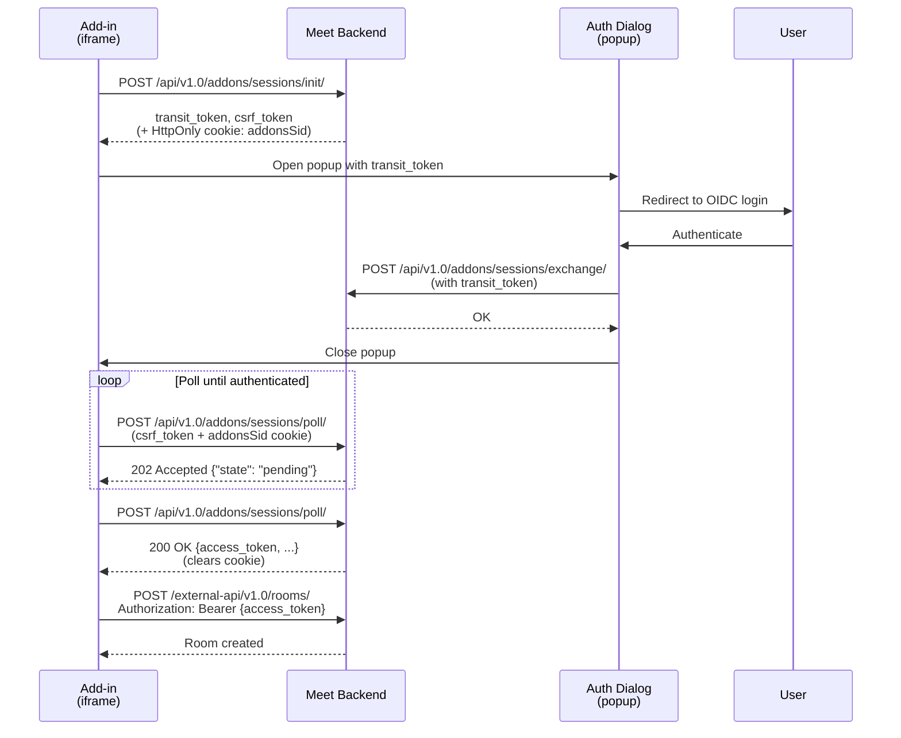

# External API - Add-ons

In this mode, an add-in running in an iframe inside another application, such as the Outlook add-in, gets a token for the user by having them sign in to Meet in a popup. [External API](external-api.md) lists the endpoints, scopes and room object the token then gives access to.

The session endpoints under `/api/v1.0/addons/sessions/` need `ADDONS_ENABLED=True`, and answer 404 without it. The room calls made with the token afterwards need `EXTERNAL_API_ENABLED=True` as well.

## When to use this mode

Your add-in's users sign in with Meet's OIDC provider. The other ways to get a token are compared in [External API: Getting a token](external-api.md#getting-a-token).

## Authentication flow



## Step 1: Initialize session

```http
POST /api/v1.0/addons/sessions/init/
```

**Response (201):**
```json
{
  "transit_token": "abc123...",
  "csrf_token": "def456..."
}
```

The backend sets an `HttpOnly`, `Secure`, `SameSite=None` cookie named `addonsSid`.

## Step 2: Exchange transit token

The popup's callback page calls this endpoint once the user has signed in. The call needs the user's Meet session, so the callback must be a Meet page: without the session, the endpoint returns 401.

```http
POST /api/v1.0/addons/sessions/exchange/
Content-Type: application/json
```

```json
{
  "transit_token": "abc123..."
}
```

**Response (200):**
```json
{"status": "ok"}
```

This binds a token for the signed-in user to the session. A transit token works once: replaying it returns 400.

## Step 3: Poll for access token

```http
POST /api/v1.0/addons/sessions/poll/
X-CSRFToken: def456...
Cookie: addonsSid=...
```

**While pending (202):**
```json
{"state": "pending"}
```

**When ready (200):**
```json
{
  "state": "authenticated",
  "access_token": "eyJhbGci...",
  "token_type": "Bearer",
  "expires_in": 7200,
  "scope": "rooms:create"
}
```

The session is deleted and the cookie cleared after this final read.

## Using the access token

With the default `ADDONS_TOKEN_SCOPE`, `rooms:create`, the token can only create rooms.

```http
POST /external-api/v1.0/rooms/
Authorization: Bearer eyJhbGci...
Content-Type: application/json
```

```json
{
  "access_level": "trusted"
}
```

## Backend configuration

Every variable, with its default: [Environment Variables: Add-ons](env-variables.md#add-ons).

## Implementation reference

- Working example, the Outlook add-in: [`src/addons/outlook/`](https://github.com/suitenumerique/meet/tree/main/src/addons/outlook)
- Its calls to the session endpoints: [`src/addons/outlook/src/common/api.js`](https://github.com/suitenumerique/meet/blob/main/src/addons/outlook/src/common/api.js)
- Session management: [`src/backend/core/addons/service.py`](https://github.com/suitenumerique/meet/blob/main/src/backend/core/addons/service.py)
- API endpoints: [`src/backend/core/addons/viewsets.py`](https://github.com/suitenumerique/meet/blob/main/src/backend/core/addons/viewsets.py)
