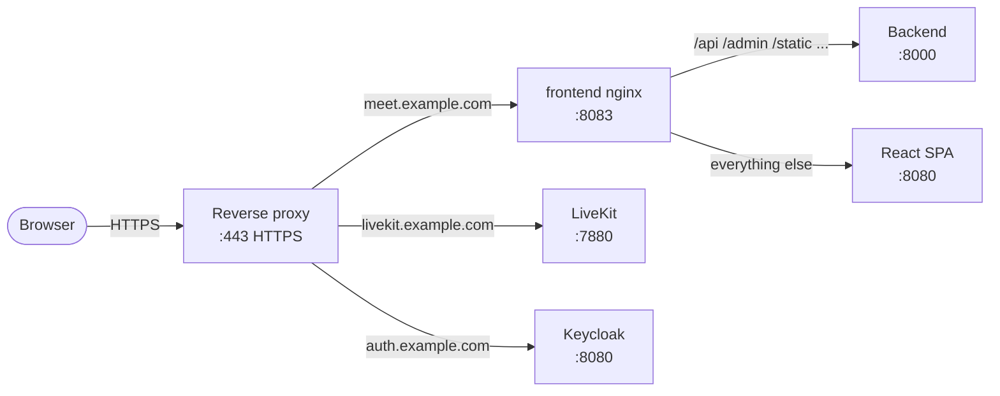

# Reverse Proxy

Meet needs a reverse proxy: the one server that receives all HTTPS traffic for three public hostnames, holds their TLS certificates, and passes each request to the right container. Any proxy works. The Deployment Guide's Stack 1 sends you here: bring your own proxy and check the routing table, or set up [nginx-proxy or Traefik](#nginx-proxy-or-traefik).

## What the proxy must route

| Hostname | Forward to | Notes |
|---|---|---|
| `meet.example.com` | `frontend`, port 8083 | Its nginx, [`nginx-routing.conf`](https://github.com/suitenumerique/meet/blob/main/docs/examples/meet/nginx-routing.conf), sends `/api`, `/admin`, `/static`, `/external-api`, `/__heartbeat__` and `/__lbheartbeat__` to the backend, the rest to the web app |
| `livekit.example.com` | `livekit`, port 7880 | A WebSocket: pass the `Upgrade` header |
| `auth.example.com` | `keycloak`, port 8080 | Only if you run the Keycloak stack |

A proxy running outside Docker cannot reach the containers by name: publish each port on the loopback interface, for example `ports: ["127.0.0.1:8083:8083"]` on `frontend`, `"127.0.0.1:7880:7880"` on `livekit` and `"127.0.0.1:8080:8080"` on `keycloak`, and forward to `127.0.0.1`.

LiveKit media stays off the proxy: it is published straight on the host, see [Firewall & Ports](../configuration/firewall.md).



The traffic flow in more detail is in [Networking: Web request](../../reference/networking.md#web-request-browser-meet-ui).

---

## nginx-proxy or Traefik

The [Deployment Guide](deployment-guide.md) uses one of these two, and the [Quick Start](quick-start.md) script sets up nginx-proxy. Either runs as its own stack on the `proxy` network, routes every container that opts in, and obtains a Let's Encrypt certificate for each:

- nginx-proxy + acme-companion find those containers by a `VIRTUAL_HOST` variable.
- Traefik finds them by `traefik.enable=true` labels.

!!! warning
    Both mount the Docker socket read-only to discover containers. To restrict that access, see their own documentation: [nginx-proxy](https://github.com/nginx-proxy/nginx-proxy/tree/main/docs) and [acme-companion](https://github.com/nginx-proxy/acme-companion/tree/main/docs), or [Traefik](https://doc.traefik.io/traefik/).

### Step 1: Set up the proxy

The `proxy` network must exist first, see [Before you start](deployment-guide.md#before-you-start-configure-your-domains). Each tab copies `~/docker/hosts` as the stack's `.env`, which gives the proxy your `LETSENCRYPT_EMAIL` for Let's Encrypt expiry notifications.

=== "nginx-proxy"

    ```bash
    mkdir -p ~/docker/nginx-proxy && cd ~/docker/nginx-proxy

    RAW="https://raw.githubusercontent.com/suitenumerique/meet/refs/heads/main"

    curl -fsSL -o compose.yml  ${RAW}/docs/examples/nginx-proxy/compose.yml
    cp ~/docker/hosts .env
    ```

=== "Traefik"

    ```bash
    mkdir -p ~/docker/traefik && cd ~/docker/traefik
    touch acme.json && chmod 600 acme.json

    RAW="https://raw.githubusercontent.com/suitenumerique/meet/refs/heads/main"

    curl -fsSL -o compose.yml  ${RAW}/docs/examples/traefik/compose.yml
    cp ~/docker/hosts .env
    ```

    `acme.json` stores Let's Encrypt certificates. It must exist with mode `600` before Traefik starts: Traefik does not use it with any other permission.

```bash
docker compose up -d
```

---

### Step 2: How Meet services opt in

Each stack's `docker-compose.override.yml`, which the Deployment Guide downloads for your proxy, opts its services in; you do not edit it. It sets `environment` or `labels`, and `compose.yml` sets `ports` and `networks`. Together, they give each row of the [routing table](#what-the-proxy-must-route) the following settings:

#### Meet frontend

=== "nginx-proxy"

    ```yaml
    frontend:
      environment:
        VIRTUAL_HOST: ${MEET_HOST}
        VIRTUAL_PORT: "8083"
        LETSENCRYPT_HOST: ${MEET_HOST}
        LETSENCRYPT_EMAIL: ${LETSENCRYPT_EMAIL}
      networks:
        - proxy
        - internal
    ```

=== "Traefik"

    ```yaml
    frontend:
      labels:
        traefik.enable: "true"
        traefik.http.routers.meet-frontend.rule: "Host(`${MEET_HOST}`)"
        traefik.http.routers.meet-frontend.entrypoints: websecure
        traefik.http.routers.meet-frontend.tls: "true"
        traefik.http.routers.meet-frontend.tls.certresolver: letsencrypt
        traefik.http.services.meet-frontend.loadbalancer.server.port: "8083"
      networks:
        - proxy
        - internal
    ```

#### LiveKit

Both proxies pass the WebSocket upgrade with their default settings. The `ports` are the media ports, published on the host:

=== "nginx-proxy"

    ```yaml
    livekit:
      environment:
        VIRTUAL_HOST: ${LIVEKIT_HOST}
        VIRTUAL_PORT: "7880"
        LETSENCRYPT_HOST: ${LIVEKIT_HOST}
        LETSENCRYPT_EMAIL: ${LETSENCRYPT_EMAIL}
      ports:
        - "7881:7881/tcp"
        - "7882:7882/udp"
      networks:
        - proxy
        - internal
    ```

=== "Traefik"

    ```yaml
    livekit:
      labels:
        traefik.enable: "true"
        traefik.http.routers.meet-livekit.rule: "Host(`${LIVEKIT_HOST}`)"
        traefik.http.routers.meet-livekit.entrypoints: websecure
        traefik.http.routers.meet-livekit.tls: "true"
        traefik.http.routers.meet-livekit.tls.certresolver: letsencrypt
        traefik.http.services.meet-livekit.loadbalancer.server.port: "7880"
      ports:
        - "7881:7881/tcp"
        - "7882:7882/udp"
      networks:
        - proxy
        - internal
    ```

#### Keycloak

=== "nginx-proxy"

    ```yaml
    keycloak:
      environment:
        VIRTUAL_HOST: ${IDP_HOST}
        VIRTUAL_PORT: "8080"
        LETSENCRYPT_HOST: ${IDP_HOST}
        LETSENCRYPT_EMAIL: ${LETSENCRYPT_EMAIL}
      networks:
        - proxy
        - internal
    ```

=== "Traefik"

    ```yaml
    keycloak:
      labels:
        traefik.enable: "true"
        traefik.http.routers.keycloak.rule: "Host(`${IDP_HOST}`)"
        traefik.http.routers.keycloak.entrypoints: websecure
        traefik.http.routers.keycloak.tls: "true"
        traefik.http.routers.keycloak.tls.certresolver: letsencrypt
        traefik.http.services.keycloak.loadbalancer.server.port: "8080"
      networks:
        - proxy
        - internal
    ```

The DNS records each hostname needs are in [Domain name](prerequisites.md#domain-name). Once every stack runs, check the certificates as in the Deployment Guide's [Verify](deployment-guide.md#verify) step.

---

## Next

Continue with the Deployment Guide's [Stack 2: Identity provider](deployment-guide.md#stack-2-identity-provider). If a hostname does not answer, see [Reverse proxy issues](../../reference/troubleshooting.md#reverse-proxy-issues).
