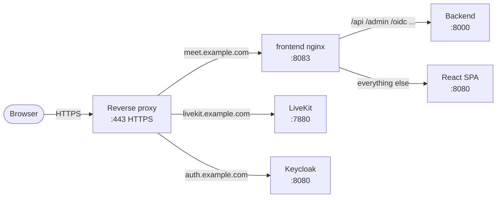

# Reverse Proxy

Meet needs a reverse proxy that terminates TLS for three public hostnames. Any proxy works: the first section lists what it must route, and the quick start sets up nginx-proxy or Traefik on a single server.

## What the proxy must route

| Hostname | Forward to | Notes |
|---|---|---|
| `meet.example.com` | `frontend`, port 8083 | The frontend container's own nginx (`nginx-routing.conf`) splits the traffic by path: `/api`, `/admin`, `/oidc` and the like go to the backend, everything else to the web app |
| `livekit.example.com` | `livekit`, port 7880 | LiveKit's signalling runs over a WebSocket, so the proxy must pass the `Upgrade` header |
| `auth.example.com` | `keycloak`, port 8080 | Only if you run the Keycloak stack |

Two things stay off the proxy:

- **LiveKit media**, 7881/TCP and 7882/UDP, is published straight on the host, see [Firewall & Ports](../configuration/firewall.md).
- **The backend** needs no proxy network: it reaches the identity provider and LiveKit at their public addresses.



The traffic flow in more detail is in [Networking: Web request](../../reference/networking.md#web-request-browser-meet-ui).

---

## Quick start: nginx-proxy or Traefik

The [Deployment Guide](deployment-guide.md) uses one of these two, and the [Quick Start](quick-start.md) script sets up nginx-proxy. Each runs as its own Docker Compose stack on the `proxy` network. It routes every container that opts in and issues its Let's Encrypt certificate: nginx-proxy + acme-companion read a `VIRTUAL_HOST` variable, Traefik reads `traefik.enable=true` labels.

!!! warning
    This quick start runs one proxy on one server. Before production, harden it per the proxy's own documentation, [nginx-proxy](https://github.com/nginx-proxy/nginx-proxy/tree/main/docs) and [acme-companion](https://github.com/nginx-proxy/acme-companion/tree/main/docs), or [Traefik](https://doc.traefik.io/traefik/), starting with the Docker socket both mount to discover containers.

### Step 1: Create the proxy network

This network is shared between the proxy and all other stacks. Create it once:

```bash
docker network create proxy
```

---

### Step 2: Set up the proxy

=== "nginx-proxy"

    ```bash
    mkdir -p ~/docker/nginx-proxy && cd ~/docker/nginx-proxy

    RAW="https://raw.githubusercontent.com/suitenumerique/meet/refs/heads/main"

    curl -fsSL -o compose.yml  ${RAW}/docs/examples/nginx-proxy/compose.yml
    curl -fsSL -o .env         ${RAW}/docs/examples/nginx-proxy/.env.example
    ```

    Edit `.env` - set your email for Let's Encrypt expiry notifications:

    ```dotenv
    LETSENCRYPT_EMAIL=you@example.com
    ```

=== "Traefik"

    ```bash
    mkdir -p ~/docker/traefik && cd ~/docker/traefik
    touch acme.json && chmod 600 acme.json

    RAW="https://raw.githubusercontent.com/suitenumerique/meet/refs/heads/main"

    curl -fsSL -o compose.yml  ${RAW}/docs/examples/traefik/compose.yml
    ```

    `acme.json` stores Let's Encrypt certificates. It must exist with mode `600` before Traefik starts - Traefik refuses to start with any other permission.

    Create `.env` and set your email for Let's Encrypt expiry notifications:

    ```dotenv
    LETSENCRYPT_EMAIL=you@example.com
    ```

Start:

```bash
docker compose up -d
```

The proxy is now listening on ports 80 and 443.

---

### Step 3: How Meet services opt in

Each Meet service opts in through the proxy override file (`docker-compose.override.yml`) of its stack, which the Deployment Guide downloads for your proxy. You don't need to edit it; this is what it sets for each row of the routing table.

#### Meet frontend

=== "nginx-proxy"

    ```yaml
    frontend:
      environment:
        VIRTUAL_HOST: ${MEET_HOST}
        VIRTUAL_PORT: "8083"
        LETSENCRYPT_HOST: ${MEET_HOST}
        LETSENCRYPT_EMAIL: ${LETSENCRYPT_EMAIL}
      networks:
        - proxy
        - internal
    ```

=== "Traefik"

    ```yaml
    frontend:
      labels:
        traefik.enable: "true"
        traefik.http.routers.meet-frontend.rule: "Host(`${MEET_HOST}`)"
        traefik.http.routers.meet-frontend.entrypoints: websecure
        traefik.http.routers.meet-frontend.tls: "true"
        traefik.http.routers.meet-frontend.tls.certresolver: letsencrypt
        traefik.http.services.meet-frontend.loadbalancer.server.port: "8083"
      networks:
        - proxy
        - internal
    ```

#### LiveKit

Both proxies pass the WebSocket upgrade without extra configuration. The media ports are mapped on the host, outside the proxy:

=== "nginx-proxy"

    ```yaml
    livekit:
      environment:
        VIRTUAL_HOST: ${LIVEKIT_HOST}
        VIRTUAL_PORT: "7880"
        LETSENCRYPT_HOST: ${LIVEKIT_HOST}
        LETSENCRYPT_EMAIL: ${LETSENCRYPT_EMAIL}
      ports:
        - "7881:7881/tcp"
        - "7882:7882/udp"
      networks:
        - proxy
        - internal
    ```

=== "Traefik"

    ```yaml
    livekit:
      labels:
        traefik.enable: "true"
        traefik.http.routers.meet-livekit.rule: "Host(`${LIVEKIT_HOST}`)"
        traefik.http.routers.meet-livekit.entrypoints: websecure
        traefik.http.routers.meet-livekit.tls: "true"
        traefik.http.routers.meet-livekit.tls.certresolver: letsencrypt
        traefik.http.services.meet-livekit.loadbalancer.server.port: "7880"
      ports:
        - "7881:7881/tcp"
        - "7882:7882/udp"
      networks:
        - proxy
        - internal
    ```

#### Keycloak

=== "nginx-proxy"

    ```yaml
    keycloak:
      environment:
        VIRTUAL_HOST: ${IDP_HOST}
        VIRTUAL_PORT: "8080"
        LETSENCRYPT_HOST: ${IDP_HOST}
        LETSENCRYPT_EMAIL: ${LETSENCRYPT_EMAIL}
      networks:
        - proxy
        - internal
    ```

=== "Traefik"

    ```yaml
    keycloak:
      labels:
        traefik.enable: "true"
        traefik.http.routers.keycloak.rule: "Host(`${IDP_HOST}`)"
        traefik.http.routers.keycloak.entrypoints: websecure
        traefik.http.routers.keycloak.tls: "true"
        traefik.http.routers.keycloak.tls.certresolver: letsencrypt
        traefik.http.services.keycloak.loadbalancer.server.port: "8080"
      networks:
        - proxy
        - internal
    ```

#### Backend

```yaml
backend:
  networks:
    - internal
```

The DNS records each hostname needs are in [Configure your domains](deployment-guide.md#before-you-start-configure-your-domains).

---

### Verification

After all stacks are running, confirm TLS is working:

```bash
curl -s -o /dev/null -w "%{http_code}" https://meet.example.com/
curl -s -o /dev/null -w "%{http_code}" https://auth.example.com/realms/meet
curl -s -o /dev/null -w "%{http_code}" https://livekit.example.com/
# All should return 200
```

If a certificate hasn't been issued yet, check the proxy's logs:

=== "nginx-proxy"

    ```bash
    cd ~/docker/nginx-proxy
    docker compose logs acme-companion | grep -i "cert\|error\|challenge"
    ```

=== "Traefik"

    ```bash
    docker logs traefik 2>&1 | grep -i "router\|certificate\|acme" | tail -20
    ```

---

## Troubleshooting

Common problems and their fixes are in [Reverse proxy issues](../../reference/troubleshooting.md#reverse-proxy-issues).
