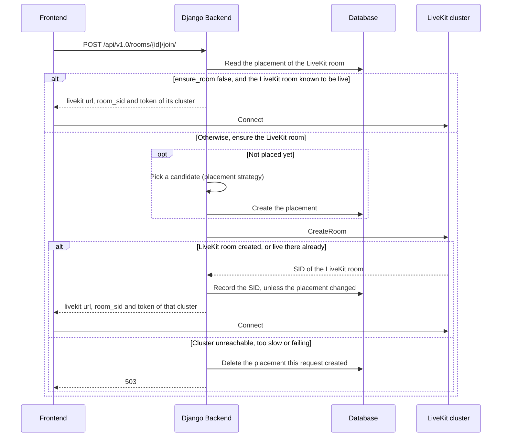
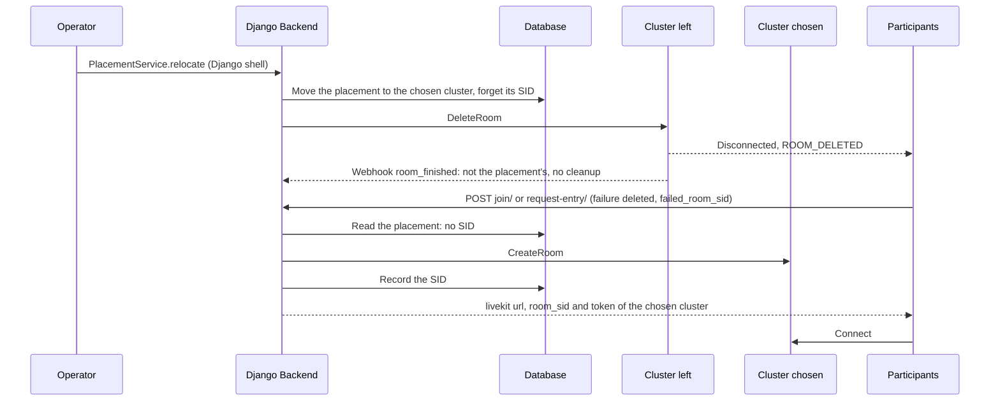

# Multi-cluster LiveKit

La Suite Meet can spread its rooms over several independent LiveKit clusters, for high availability and load balancing.

The Django backend chooses a room's cluster the first time it hands out LiveKit credentials for the room:

- It places the room's LiveKit room on one cluster and creates it there.
- It hands out a URL and a token for that cluster only.
- It sends everyone who joins afterwards to the same cluster.

When participants cannot connect to the LiveKit room, the frontend asks the backend again where to connect. This keeps them from being split between LiveKit rooms.

A deployment with a single LiveKit cluster runs the same code, see [With a single cluster](#with-a-single-cluster).

**Current limitations**:

- Telephony (`ROOM_TELEPHONY_ENABLED`) and roomkit (`ROOMKIT_ENABLED`) need a single cluster. The backend refuses to start when either is enabled and `LIVEKIT_CLUSTERS` holds more than one cluster. Phone and roomkit callers reach a cluster's SIP server before their PIN identifies the room, so the backend cannot send them to the room's cluster.
- Rooms can only be relocated from the Django shell. A relocation disconnects the participants. Their browsers reconnect automatically a few seconds later to a new LiveKit room on the new cluster, with their microphone and camera off. The chat, subtitles and recording of the LiveKit room they left are not carried over, see [Relocating a room](#relocating-a-room).
- Unregistered rooms (`ALLOW_UNREGISTERED_ROOMS`) all live on the default cluster. They are never relocated, and cannot be joined while the default cluster is down.
- A room placed on a cluster that is down cannot be joined until it is relocated. Its placement stays, so joins keep sending participants to that cluster, where they fail to connect, see [A cluster is down](#a-cluster-is-down).

## Vocabulary

- **LiveKit cluster**: one LiveKit deployment, with its own URL, API key and secret. Its nodes share a Redis, but two clusters share nothing.
- **Registry**: the clusters the backend knows, listed in `LIVEKIT_CLUSTERS`. The first is the **default cluster**.
- **Room**: a Meet room.
- **LiveKit room**: the LiveKit room that hosts a meeting on one cluster. It is named after the id of its Meet room.
- **SID**: the id a cluster gives a LiveKit room when creating it. A LiveKit room created again, on the same cluster or another, gets a new SID.
- **Placement**: the database record of the cluster a LiveKit room lives on, and of its SID once known. It is created when the backend first hands out credentials for the LiveKit room, or when a cluster first reports that the LiveKit room started there. It ends when the LiveKit room finishes, which its cluster reports with the `room_finished` webhook. If that webhook is lost, a reconciliation ends the placement instead.
- **Known to be live**: describes a LiveKit room whose placement records its SID and no absence (`absent_since`).
- **Candidate**: a registered cluster with a weight above 0, which may receive new placements.
- **Placement strategy**: the rule that picks which candidate receives a new placement.
- **Relocation**: moving a room's placement to another cluster and closing its LiveKit room on the cluster it leaves.
- **Reconciliation**: the job that runs every minute and compares the placements with the LiveKit rooms listed by their clusters. It makes up for lost webhooks, see [Reconciling placements](#reconciling-placements).

## How it works

### Joining a room

The backend hands out LiveKit credentials through `POST /api/v1.0/rooms/{id}/join/`, or `request-entry/` when it lets the participant in. Each time, it reads the placement of the room's LiveKit room.

By default, the backend ensures the LiveKit room exists:

1. If the LiveKit room is not placed yet, the backend places it on the candidate the placement strategy picks. A placement on a cluster that is no longer registered is deleted, and the LiveKit room is placed again.
2. It creates the LiveKit room on that cluster, or keeps one already live there unchanged.
3. It records the LiveKit room's SID on the placement. If the placement changed meanwhile, for example by a relocation, the backend instead reads it again and decides again, once.

With `"ensure_room": false`, the backend trusts a LiveKit room **known to be live** on a registered cluster, and hands out credentials for it without writing anything or calling LiveKit. If there is no such LiveKit room, for example because the room is not placed yet, or because its placement records no SID or an absence, the backend ensures the LiveKit room. Frontends of this release send `"ensure_room": false` while `GET /api/v1.0/config/` returns `livekit.connection_recovery` as true.

The response's `livekit` object holds:

- `url`: the URL browsers reach the cluster at
- `room`: the name of the LiveKit room
- `room_sid`: its SID, as the placement records it
- `token`: a token signed with that cluster's API key

A join that trusts the placement costs only a few database reads. Creating the LiveKit room holds a backend worker for up to `LIVEKIT_API_TIMEOUT_SECONDS`, and still guarantees nothing, because CreateRoom never keeps an empty LiveKit room alive.

The SID handed out without calling LiveKit may be stale, for example when the LiveKit room closed and its `room_finished` webhook was lost. LiveKit then refuses the connection, and the frontend asks again, see [When a LiveKit room fails](#when-a-livekit-room-fails). A reconciliation later marks such a placement absent, and joins then ensure the LiveKit room, see [Reconciling placements](#reconciling-placements).



The backend answers with a `503` and `{"detail": "This room cannot be joined for now, please try again."}` when it cannot ensure the LiveKit room:

- No cluster may receive the room, for example because every cluster weighs 0.
- The room's cluster cannot be reached, does not answer in time, or answers CreateRoom with an error. If the request created the placement, the backend deletes it, since nobody received credentials for it, and places the room on another candidate in the same request: a request creates the LiveKit room on two clusters at most. A placement older than the request is kept, and the next attempt tries the same cluster again.
- The placement keeps changing while the LiveKit room is created.

The roomkit join places the room and ensures its LiveKit room the same way, because a meeting-room device may be its first participant.

An unregistered room is never placed, since the backend does not follow its lifecycle. Its LiveKit room is created on the default cluster whatever the frontend asks, unless the frontend reports it `deleted`. That report gets a `409`, as for a room without placement, see [What the backend answers](#what-the-backend-answers).

The connection test (`CONNECTION_TEST_ENABLED`) creates its LiveKit room on the candidate the placement strategy picks, without a placement, because nobody else ever joins it. When that cluster fails to create the LiveKit room, it tries another candidate as a join does, and answers with a `503` when that fails too. With Celery, its LiveKit room is later deleted on that cluster.

### When a LiveKit room fails

The frontend uses its credentials for one connection only. When that connection ends, it asks for new credentials, unless the participant left, joined from another device (`DUPLICATE_IDENTITY`), or was removed by a host.

A participant the lobby let in asks through `request-entry/`, which keeps its identity. Other participants ask through `join/`. The request reports the LiveKit room that failed:

| Field | Type | Meaning |
|---|---|---|
| `ensure_room` | Boolean, `true` by default | `false` lets the backend trust a LiveKit room known to be live, see [Joining a room](#joining-a-room). Ignored when a failure is reported |
| `failed_room_sid` | String, 63 characters at most | The SID of the LiveKit room that failed |
| `failure` | `missing` or `deleted` | `deleted` when LiveKit disconnected the frontend with `ROOM_DELETED`, `missing` when LiveKit refused its connection |

A request with only one of `failure` and `failed_room_sid` gets a `400`.

#### What the frontend reports

| The connection | The frontend asks with | Then |
|---|---|---|
| Ended with `ROOM_DELETED`, after a relocation, the closing of a stray LiveKit room, the room's deletion in Meet, or `lk room delete` | `deleted` and the SID it was connected to | It connects to the LiveKit room in the answer if its `room_sid` is different. The same SID means the meeting ended |
| Was refused by LiveKit (a `404`, `401` or `403`) before connecting | `missing` and the `room_sid` of its credentials | It connects to the LiveKit room in the answer |
| Ended otherwise: its reconnection gave up after `LIVEKIT_RECONNECT_GIVE_UP_AFTER_MS` or was refused by LiveKit, its LiveKit node shut down, its signal or media connection failed, or it timed out before connecting | `ensure_room` false, and no failure | It connects to the LiveKit room in the answer, even when the answer is unchanged, and learns from LiveKit whether that LiveKit room is still there. If LiveKit refuses the connection, it asks again with `missing`. If the connection never came up and the answer has the same URL and SID, the frontend does not retry and ends up on the "Unable to join the meeting" screen, or on "The connection to the meeting was lost" for a participant who had been in the meeting |

After a failure, the backend creates a LiveKit room again when:

- LiveKit itself refused the connection, which shows that the cluster answers.
- The room was relocated. The LiveKit room is then created on the room's new cluster.
- A frontend asks without reporting a failure while no LiveKit room is known to be live, for example because the placement is gone.

When a cluster is down, the backend keeps the placements on that cluster, with their SIDs, see [A cluster is down](#a-cluster-is-down). It answers requests about those rooms from the placements, without a CreateRoom per participant.

A frontend asks 3 times at most. The count starts over once a connection has stayed up 30 seconds without reconnecting. Before asking, the frontend waits a random delay: up to 1 second when the LiveKit room was deleted or refused, and up to 3 seconds otherwise. This keeps the participants of a room, or of every room on a LiveKit node, from asking all at once. The frontend asks again after a `429`, a `5xx`, a network error, or 30 seconds without an answer.

A participant reconnected this way comes back with the microphone and camera off, and has to turn them on again.

#### What the backend answers

`PlacementService.place` decides from the placement it reads. When the placement changes while the LiveKit room is created, it decides again on each new read:

| Asked | Placement | Answer |
|---|---|---|
| Default (`ensure_room` true) | Any | The LiveKit room is ensured |
| `ensure_room` false | Known to be live, on a registered cluster | That LiveKit room, with nothing written and no LiveKit call |
| `ensure_room` false | None, no SID, an absence, or on a cluster no longer registered | The LiveKit room is ensured |
| `missing` | Known to be live with another SID, on a registered cluster | That LiveKit room, which was created again or moved since |
| `missing` | Otherwise | The LiveKit room is ensured, so it is created again |
| `deleted` | Known to be live with another SID, on a registered cluster | That LiveKit room. The room was relocated, the reported LiveKit room was closed as a stray, or a new meeting started |
| `deleted` | None, or naming the SID reported | `409`, with nothing written and no LiveKit call |
| `deleted` | Otherwise: no SID, or another SID with an absence or on a cluster no longer registered | The LiveKit room is ensured, as after a relocation |

The `409` is `{"detail": "This meeting has ended."}`, and the frontend then shows "The meeting has ended", with no button to rejoin. A request for a soft-deleted room still gets a `410` first, and the frontend ends up on the "This meeting has been deleted" screen. When the LiveKit room cannot be ensured, the request gets a `503`, see [Joining a room](#joining-a-room). A participant the lobby has to let in again is queued, whatever the request reports.

### Placement strategies

`LIVEKIT_PLACEMENT_STRATEGY` names the placement strategy:

| Strategy | Picks |
|---|---|
| `core.livekit.strategies.WeightedRandomStrategy` (default) | A candidate at random, with a probability proportional to its weight. With weights of 1 and 3, the second cluster receives three quarters of the new rooms |
| `core.livekit.strategies.RoundRobinStrategy` | The candidates in turn, whatever their weights. Turns are counted in the Django cache, which all backend processes share |
| `core.livekit.strategies.LeastPlacementsStrategy` | The candidate holding the fewest placements relative to its weight, or the one registered first on a tie. Rooms placed at the same moment may all go to the same cluster |

A cluster with weight 0 is not a candidate: it keeps its live rooms but receives no new placement.

A strategy is a subclass of `core.livekit.strategies.PlacementStrategy`. Its `choose(candidates, context)` method returns one of the candidates. The context gives the name of the LiveKit room and its room, which is `None` for a connection test.

### Managing a live room

Everything the backend does to a live LiveKit room happens on the cluster of its placement. There, it updates the LiveKit room's metadata when the room's configuration changes, manages its participants, dispatches the subtitle agent, and closes it when the room is deleted.

Every cluster sends its webhooks to `/api/v1.0/rooms/webhooks-livekit/`, signed with its API key. The backend recognizes the sending cluster by that key, so every cluster needs an API key of its own. Requests authenticated with a LiveKit token (`X-LiveKit-Token`) are checked the same way.

When a LiveKit room finishes (`room_finished`), the backend deletes its placement only if the placement records that LiveKit room's SID and is on the cluster that sent the webhook. Otherwise, the LiveKit room has since been created again or the room has been relocated. Participants may be joining the new LiveKit room, so the backend does not clean the room up. When the webhook is lost, a reconciliation deletes the placement and cleans the room up once its LiveKit room has been missing long enough, see [Reconciling placements](#reconciling-placements).

### Recording the LiveKit rooms that start

Clusters run with room auto-creation off, so only the backend creates LiveKit rooms, see [Preparing each cluster](#preparing-each-cluster). A join racing a relocation may still create one on the cluster the room left. As a backstop, the backend checks every LiveKit room a cluster reports as started (`room_started`) against the room's placement:

- Without a placement, the backend places the LiveKit room on the cluster it started on, with its SID, if that cluster is a candidate. If that cluster is not a candidate but another is, it closes the LiveKit room. If no cluster is a candidate, it leaves the LiveKit room alone.
- If the placement is on another registered cluster, the backend reads the placement again right before closing the LiveKit room, and closes it only if the placement is still on another registered cluster.
- If the placement is on a cluster this backend process does not know, the backend ignores the start and leaves the LiveKit room and its placement alone. Processes may disagree on the clusters while `LIVEKIT_CLUSTERS` changes.
- If the placement is on the cluster the LiveKit room started on, its SID is recorded when the placement records none. A SID already recorded is kept, because joins record the SID of the LiveKit rooms they create, and a webhook may be late.

Closing a LiveKit room deletes it, which disconnects its participants with `ROOM_DELETED`. Their frontends ask again and follow the placement, or are told that the meeting ended if there is none.

When `room_started` is lost, a reconciliation records the LiveKit room it finds live in the same way, except that the listed SID replaces a SID already recorded by a placement on the LiveKit room's cluster, see [Reconciling placements](#reconciling-placements).

### Recordings, subtitles and agents

A recording is made on the cluster its room is placed on when the recording starts, and keeps that cluster in `livekit_cluster`. The backend manages the recording on that cluster, wherever the room is placed afterwards. There, it starts, stops and looks up the recording's egress, dispatches its metadata collector, updates the room metadata about the recording, and sends the recording's notifications. A recording that names no cluster, or a cluster no longer registered, is managed on the default cluster.

Every cluster needs:

- Its own [LiveKit Egress](recording.md).
- Its own subtitle and metadata collector agents, since the backend dispatches them on the cluster of the room.

Relocating a room ends its recording along with the LiveKit room it leaves. The recording is saved and transcribed as usual, and recording again means starting a new one.

### Relocating a room

A relocation moves a live room off its cluster, to rebalance rooms or to empty a cluster before maintenance. Run it from the Django shell:

```python
from core.livekit.placements import PlacementService

PlacementService.relocate("<room id>", to="lyon", actor=None)  # to a given cluster
PlacementService.relocate("<room id>", actor=None)  # to the one the strategy picks
```

`actor` is the user the audit log records as relocating the room, or `None` for the system.

To relocate a room, the backend:

1. Reads the room's placement and picks another candidate: the one named, or else the placement strategy's pick among the other candidates.
2. Moves the placement to that cluster and clears its SID, so the next request for credentials creates the LiveKit room there.
3. Deletes the LiveKit room on the cluster the room leaves, which disconnects its participants with `ROOM_DELETED`.

Their frontends then ask again and report the LiveKit room as `deleted`. Because the placement records no SID, the backend creates the LiveKit room on the new cluster, or finds it there if another participant asked first. Participants who ask at the same time all get credentials for that same LiveKit room. They reconnect there a few seconds after the relocation, with their microphone and camera off.



Frontends of earlier releases, and all frontends while `LIVEKIT_CONNECTION_RECOVERY_ENABLED` is off, do not follow a relocation. Their participants land on the page shown when a room is deleted, and get credentials for the new cluster when they open the room again.

#### A cluster is down

Rooms placed on a cluster that is down keep their placement and its SID. A placement only ends with the `room_finished` webhook of its cluster, or with a reconciliation that lists that cluster without its LiveKit room. A reconciliation leaves alone the placements of a cluster it cannot list. Joins keep sending participants to that cluster, where they fail to connect in their browser instead of getting a `503`:

- A join that trusts a LiveKit room known to be live hands out credentials for that cluster without calling it. The browser waits 5 seconds at most for the warm-up and fails to connect. It then asks where the room is, gets the same answer, and ends up on the "Unable to join the meeting" screen.
- Participants connected when the cluster went down keep reconnecting for `LIVEKIT_RECONNECT_GIVE_UP_AFTER_MS`. They then ask where the room is, without reporting a failure, fail to connect to the LiveKit room in the answer, and ask once more. Until the room is relocated, they get the same answer and end up on the "The connection to the meeting was lost" screen.

Only the requests for credentials that ensure the LiveKit room get a `503`, after `LIVEKIT_API_TIMEOUT_SECONDS`, or at once while the cluster's circuit breaker is open:

- Every request from a frontend of an earlier release, and the roomkit join.
- Every join from a frontend while `LIVEKIT_CONNECTION_RECOVERY_ENABLED` is off.
- A request for a room whose placement records no SID or an absence.
- A report of a `missing` LiveKit room, which a frontend only sends after LiveKit refused its connection (a `404`, `401` or `403`).

Each cluster has a circuit breaker, kept in the Django cache and shared by every backend process. `LIVEKIT_BREAKER_FAILURE_THRESHOLD` CreateRoom or ListRooms calls in a row that cannot reach the cluster, time out or get a server error open it. For `LIVEKIT_BREAKER_OPEN_SECONDS`, the cluster then receives no new room, and its room service is not called: those calls fail at once. Then the next CreateRoom or ListRooms call probes the cluster, while the cluster may receive new rooms again: an answer closes the breaker, a failure opens it again.

Set the cluster's weight to 0 to stop it from receiving new rooms, and relocate its rooms. While that cluster cannot be listed, a reconciliation keeps the placements relocated away from it, even when their LiveKit room is missing from the new cluster. The LiveKit rooms left on the cluster that is down may still hold participants, see [Reconciling placements](#reconciling-placements).

To list the rooms placed on that cluster:

```python
from core.models import Placement

Placement.objects.filter(cluster="paris").values_list("room_name", flat=True)
```

## Reconciling placements

Placements follow LiveKit rooms through their clusters' webhooks, which may be lost:

- A lost `room_finished` leaves a placement behind, along with its room's SIP dispatch rule and lobby admissions.
- A lost `room_started` leaves a LiveKit room without placement, or live on a cluster its room is not placed on.

A reconciliation lists the LiveKit rooms live on every registered cluster, then reads the placements and compares the two, room by room:

| What a run finds | What it does |
|---|---|
| A LiveKit room live on its placement's cluster, with the SID recorded | Nothing, except clearing the placement's absence, if any |
| Live there with another SID, or with none recorded | The placement records the listed SID, whereas `room_started` keeps a SID already recorded. Its absence is cleared, and its room's start is recorded as on `room_started` |
| Missing from its placement's cluster | The placement is marked absent (`absent_since`), then deleted after the wait below, and its room is cleaned up as on `room_finished`. A placement relocated from a registered cluster that could not be listed is kept, because its meeting may go on there |
| Live on another cluster than its placement's | It is closed there, unless the placement, read again right before, moved or went away. If the run closes one while the placement's own LiveKit room is missing, it leaves the placement to the next run, because the closed LiveKit room's participants are coming to the missing one |
| Live without placement | Recorded as on `room_started`, see [Recording the LiveKit rooms that start](#recording-the-livekit-rooms-that-start). When a room has several such LiveKit rooms, the run orders them by most participants first, then oldest first. It adopts the first one on a candidate, records its room's start, and closes the others. If no cluster is a candidate, it leaves them all alone |
| Live, for a soft-deleted room | Closed on every cluster, placed or not |
| A placement on a cluster that cannot be listed, or is no longer registered | Left alone, along with its room's LiveKit rooms on other clusters. This is logged and counted |
| A placement written since the listing started, or gone during it | Its room and LiveKit rooms are left to the next run. A join or a webhook changed the placement meanwhile, and the listed LiveKit room may be the one that finished |
| A room whose webhooks are filtered out | Left alone, placements included. This covers connection tests, the rooms `LIVEKIT_WEBHOOK_EVENTS_FILTER_REGEX` leaves out, and LiveKit rooms not named after a UUID, such as unregistered rooms. A LiveKit room without placement and named after no room is also left alone, and counted |

A run's write to a placement applies only if the placement is still as the run read it. Otherwise, the run logs the skipped write and leaves the placement to the next run. Two concurrent runs make each change only once. A run never creates a LiveKit room.

The wait is 15 minutes, or `LIVEKIT_RECONNECT_GIVE_UP_AFTER_MS` plus 5 minutes when that is longer. An absent placement is deleted once both its absence and its last write are that old. Frontends keep reconnecting to a LiveKit room for `LIVEKIT_RECONNECT_GIVE_UP_AFTER_MS` before asking where to connect again. Deleting the placement sooner would clean up its room, lobby admissions included, while participants are about to come back.

After a relocation, the placement's LiveKit room is also missing from the new cluster until a participant follows it there. Once the placement is deleted, participants reporting the LiveKit room they left as `deleted` are told the meeting ended.

Until it is deleted, an absent placement keeps its SID, but its LiveKit room is no longer known to be live. Joins and reports ensure that LiveKit room, which clears the absence. A `deleted` report naming its SID still gets the `409`, see [What the backend answers](#what-the-backend-answers).

The Helm chart runs a reconciliation every minute, as the `reconcile-livekit-placements` entry of `backend.cronjobs`. The cron job never runs two reconciliations at once, never retries one, and stops each after 240 seconds. Overriding `backend.cronjobs` replaces the whole list, so add that entry back next to yours. Without the Helm chart, schedule the command every minute from a single scheduler, not from every backend host:

```bash
python manage.py reconcile_livekit_placements            # reconcile every cluster
python manage.py reconcile_livekit_placements --dry-run  # only log and count what a run would do
```

A run logs each action and ends with one line counting them, starting with `[dry-run]` for a dry run. Only an unexpected error fails the command, not a cluster that cannot be listed. Adoptions, repairs, deletions and closes are audited as made by the system, except closes for soft-deleted rooms, see the [audit catalogue](audit-logging.md#livekit-rooms).

**Limits**:

- A LiveKit room that finishes while the clusters are being listed may be adopted, or have its placement repaired, with a dead SID. The next run marks that placement absent, so joins ensure the LiveKit room again, and the placement is deleted after the wait.
- A cluster keeps listing the LiveKit rooms of a node it lost. On its placement's cluster, such a LiveKit room counts as live. On another cluster, closing it fails, each time after a timeout. A run stops closing LiveKit rooms on a cluster where 3 closes failed, and everywhere once the run has lasted 60 seconds.
- A run records a room's start only when it adopts the room's LiveKit room or repairs the placement's SID. If a LiveKit room's `room_started` is lost while its placement already records its SID, `last_started_at` and the SIP dispatch rule stay as they were.

## Setup

### Registering the clusters

`LIVEKIT_CLUSTERS` lists the clusters in JSON. It holds their API secrets, so it is best read from a file, such as a mounted Kubernetes secret. Set `LIVEKIT_CLUSTERS_FILE` to that file's path.

```json
[
  {
    "name": "paris",
    "url": "https://livekit-paris.example.org",
    "api_key": "<paris API key>",
    "api_secret": "<paris API secret>",
    "weight": 2
  },
  {
    "name": "lyon",
    "url": "https://livekit-lyon.example.org",
    "api_url": "http://livekit-lyon.internal:7880",
    "api_key": "<lyon API key>",
    "api_secret": "<lyon API secret>"
  }
]
```

| Field | Meaning |
|---|---|
| `name` | Unique, at most 63 lowercase letters, digits and hyphens. Placements and recordings record it, so renaming a cluster detaches them from it |
| `url` | The URL browsers connect to: `http`, `https`, `ws` or `wss` |
| `api_url` | The LiveKit API URL the backend calls, `url` by default |
| `api_key`, `api_secret` | The cluster's API key and secret. Each cluster needs its own API key |
| `weight` | An integer, 1 by default. 0 keeps the cluster from receiving new rooms |

By convention, the first cluster is the default one.

Every backend process must have the same `LIVEKIT_CLUSTERS`, including the process that runs the reconciliation. If a process does not know a cluster, the next join it handles for a room placed there places the room again. Participants who join through the new placement are split from those already connected.

To add a cluster, register it with a weight of 0 on every process, then raise its weight. To remove one, set its weight to 0, relocate its rooms, and remove it once none is left.

### Preparing each cluster

Every cluster needs:

- Room auto-creation off (`room.auto_create: false` in its LiveKit configuration). Only the backend creates LiveKit rooms. A cluster that creates them as participants join is not supported.
- Its webhooks sent to `https://<meet domain>/api/v1.0/rooms/webhooks-livekit/`, signed with its own API key.
- Its own egress and agents, see [Recordings, subtitles and agents](#recordings-subtitles-and-agents).

## With a single cluster

Without `LIVEKIT_CLUSTERS`, the registry holds a single cluster named `default`, built from `LIVEKIT_API_URL`, `LIVEKIT_API_KEY` and `LIVEKIT_API_SECRET`. This cluster also needs room auto-creation off, see [Preparing each cluster](#preparing-each-cluster).

The reconciliation runs the same way. Schedule it where the Helm chart does not, see [Reconciling placements](#reconciling-placements).

Joins trust a LiveKit room known to be live, as with several clusters. Joins that ensure the LiveKit room get a `503` when LiveKit fails to create it within `LIVEKIT_API_TIMEOUT_SECONDS`.

## Configuration

| Option | Type | Default | Description |
|---|---|---|---|
| **LIVEKIT_CLUSTERS** | JSON | unset | The LiveKit clusters, see [Registering the clusters](#registering-the-clusters). Read from the file that `LIVEKIT_CLUSTERS_FILE` names, when set. When unset, a single cluster named `default` is built from `LIVEKIT_API_URL`, `LIVEKIT_API_KEY` and `LIVEKIT_API_SECRET` |
| **LIVEKIT_PLACEMENT_STRATEGY** | String | `core.livekit.strategies.WeightedRandomStrategy` | Dotted path of the placement strategy, see [Placement strategies](#placement-strategies) |
| **LIVEKIT_BREAKER_ENABLED** | Boolean | `true` | Puts the room service of each cluster behind a circuit breaker, see [A cluster is down](#a-cluster-is-down) |
| **LIVEKIT_BREAKER_FAILURE_THRESHOLD** | Integer | `3` | Failed CreateRoom or ListRooms calls in a row that open a cluster's circuit breaker |
| **LIVEKIT_BREAKER_OPEN_SECONDS** | Integer | `30` | Seconds a circuit breaker stays open before the next call probes its cluster |
| **LIVEKIT_CONNECTION_RECOVERY_ENABLED** | Boolean | `true` | Lets frontends join a LiveKit room known to be live without the backend creating it, and ask for credentials again when their LiveKit room fails, see [When a LiveKit room fails](#when-a-livekit-room-fails). `GET /api/v1.0/config/` exposes it as `livekit.connection_recovery`. When `false`, frontends have every join ensure the LiveKit room, and end the conference as soon as their connection ends. Keep it `false` while upgrading from a release that relied on room auto-creation, see the [upgrade instructions](https://github.com/suitenumerique/meet/blob/main/UPGRADE.md) |
