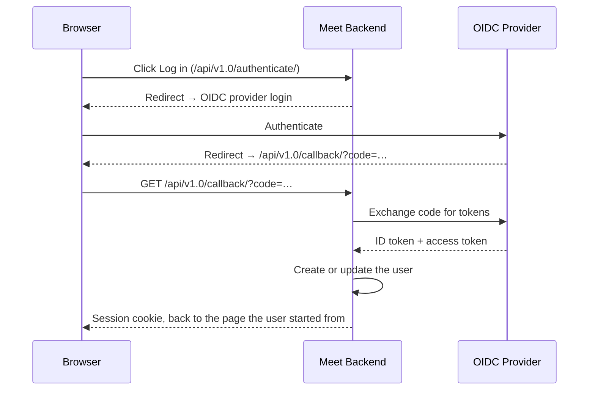

# SSO & Authentication

Meet signs users in through an **OpenID Connect (OIDC)** provider, and a production instance needs one. Users have no password in Meet. The only local passwords belong to the Django admin accounts created with `createsuperuser`.



When a page loads without a Meet session, Meet first tries a silent login, `prompt=none`. A user already signed in at the provider is signed in to Meet without seeing a form. Anyone else stays on Meet, with a **Log in** button.

Any standards-compliant OIDC provider works. Keycloak, Authentik and Google each have a section here. Every variable is in [Environment Variables: Authentication](../../reference/env-variables.md#authentication-oidc).

## Client configuration

Register Meet at the provider as a confidential client, one that authenticates with a client secret, with:

- **Redirect URI**: `https://meet.example.com/api/v1.0/callback/`, trailing slash included
- **Post-logout redirect URI**: `https://meet.example.com/*`. Without it, Keycloak refuses every logout Meet sends
- **Web origin**: `https://meet.example.com`

Then give Meet the client ID and secret, and the provider's endpoints.

## Keycloak

The [Deployment Guide](../compose/deployment-guide.md) runs Keycloak with a realm that already holds this client, and `env.d/common` ships with its endpoints filled in from your hosts file. Only `OIDC_RP_CLIENT_SECRET` needs setting. The Keycloak admin console is at `https://auth.example.com`.

## Authentik

1. In **Applications → Providers → Create**, choose **OAuth2/OpenID Provider**, set the redirect URI above, and note the client ID and secret.
2. In **Applications → Applications → Create**, create an application bound to that provider. Its slug is the `<slug>` below.
3. Read the endpoints from `https://authentik.example.com/application/o/<slug>/.well-known/openid-configuration`, then set:

```dotenv
OIDC_RP_CLIENT_ID=<client-id>
OIDC_RP_CLIENT_SECRET=<client-secret>
OIDC_OP_JWKS_ENDPOINT=https://authentik.example.com/application/o/<slug>/jwks/
OIDC_OP_AUTHORIZATION_ENDPOINT=https://authentik.example.com/application/o/authorize/
OIDC_OP_TOKEN_ENDPOINT=https://authentik.example.com/application/o/token/
OIDC_OP_USER_ENDPOINT=https://authentik.example.com/application/o/userinfo/
OIDC_OP_LOGOUT_ENDPOINT=<end_session_endpoint from the well-known document>
```

Without `OIDC_OP_LOGOUT_ENDPOINT`, logging out ends the Meet session only: the provider's session survives, and the next visit signs the user straight back in.

## Google Workspace

1. In the [Google Cloud Console](https://console.cloud.google.com), open **APIs & Services → Credentials → Create Credentials → OAuth client ID**, type **Web application**.
2. Add the redirect URI above, and note the client ID and secret.
3. Set:

```dotenv
OIDC_RP_CLIENT_ID=<client-id>.apps.googleusercontent.com
OIDC_RP_CLIENT_SECRET=<client-secret>
OIDC_OP_JWKS_ENDPOINT=https://www.googleapis.com/oauth2/v3/certs
OIDC_OP_AUTHORIZATION_ENDPOINT=https://accounts.google.com/o/oauth2/v2/auth
OIDC_OP_TOKEN_ENDPOINT=https://oauth2.googleapis.com/token
OIDC_OP_USER_ENDPOINT=https://openidconnect.googleapis.com/v1/userinfo
OIDC_RP_SCOPES=openid email profile
```

Meet takes a user's display name from the `given_name` claim, which Google sends only with the `profile` scope. Google has no logout endpoint for third parties, so logging out ends the Meet session only.

## Unauthenticated access

While [`ALLOW_UNREGISTERED_ROOMS`](../../reference/env-variables.md#rooms-and-waiting-room) is `True`, the code's default, anyone can start a meeting without an account. They open a room code no room uses yet, from **Join a meeting** or straight from the address bar. That meeting is open to anyone with the code, has no owner, and creates no room.

With `False`, which `env.d/production.dist/common` ships, such a code answers 404 to anonymous visitors. A signed-in visitor who opens it creates the room and owns it.

Signed-in users create rooms from the home page. A room keeps its code and an owner, and its access level decides who joins directly. Everyone else goes to the waiting room.

| Access level | Joins directly |
|---|---|
| `public` | Anyone with the link |
| `trusted` | Signed-in users |
| `restricted` | People holding a role on the room |

A new room takes the level its creator picked under **Settings → Rooms**. A creator who never picked one gets [`RESOURCE_DEFAULT_ACCESS_LEVEL`](../../reference/env-variables.md#rooms-and-waiting-room). To make it `trusted`:

```dotenv
RESOURCE_DEFAULT_ACCESS_LEVEL=trusted
```

The setting changes neither existing rooms nor the level a user already picked.

## Test it

1. Open `https://meet.example.com` and click **Log in**: you reach your provider's login page.
2. After signing in, you are back on Meet, signed in.
3. Your user appears in the Django admin at `https://meet.example.com/admin/`.

When it fails, see [Troubleshooting: Login issues](../../reference/troubleshooting.md#login-issues).
