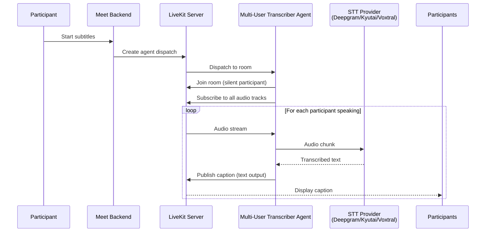

# Real-time Subtitles

Real-time subtitles show live captions in the meeting as participants speak. A LiveKit agent sends their audio to a speech-to-text (STT) provider and publishes the text it gets back.

## How it works



The multi-user transcriber agent ([`src/agents/multi_user_transcriber.py`](https://github.com/suitenumerique/meet/blob/main/src/agents/multi_user_transcriber.py)) joins each room once and opens one STT stream per participant, for as long as the room runs. Any participant can start subtitles, anonymous ones in a public room included. What that costs:

- **Provider:** cost grows with participants × time.
- **Agent:** one instance serves several rooms at once, through LiveKit's dispatch. Its CPU, memory and network use grow with the number of participants in rooms with subtitles on.

## Setup

### Step 1: Backend

`ROOM_SUBTITLE_AGENT_NAME` must match the agent's `TRANSCRIBER_AGENT_NAME`, see [Environment Variables: Subtitles](../../reference/env-variables.md#subtitles).

=== "Docker Compose"

    Add to `env.d/common`:

    ```dotenv
    ROOM_SUBTITLE_ENABLED=True
    ROOM_SUBTITLE_AGENT_NAME=multi-user-transcriber
    ```

    ```bash
    docker compose up -d --force-recreate backend
    ```

=== "Kubernetes"

    Add to `backend.envVars` in your `values.yaml`:

    ```yaml
    backend:
      envVars:
        ROOM_SUBTITLE_ENABLED: "True"
        ROOM_SUBTITLE_AGENT_NAME: "multi-user-transcriber"
    ```

### Step 2: Agent

Every agent variable, with its default, is in [Environment Variables: Subtitles agent](../../reference/env-variables.md#subtitles-agent).

=== "Docker Compose"

    Create `env.d/multi-user-transcriber`:

    ```dotenv
    LIVEKIT_URL=ws://livekit:7880
    LIVEKIT_API_KEY=meet
    LIVEKIT_API_SECRET=<your LiveKit API secret>

    # Choose STT provider: deepgram, kyutai or voxtral-vllm
    STT_PROVIDER=deepgram

    # Deepgram configuration (if using Deepgram)
    DEEPGRAM_API_KEY=your-deepgram-api-key
    DEEPGRAM_STT_MODEL=nova-3
    DEEPGRAM_STT_LANGUAGE=multi

    # Kyutai configuration (if using Kyutai)
    KYUTAI_STT_BASE_URL=http://kyutai-stt:8000
    KYUTAI_API_KEY=your-kyutai-api-key

    # Voice activity detection, on by default
    ENABLE_SILERO_VAD=true

    # Optional: Sentry error tracking
    SENTRY_DSN=
    SENTRY_ENVIRONMENT=production
    ```

    Add the agent to `compose.yml`, under `services:`:

    ```yaml
      multi-user-transcriber:
        image: lasuite/meet-agents:latest
        command: python multi_user_transcriber.py start
        restart: unless-stopped
        env_file:
          - env.d/multi-user-transcriber
        depends_on:
          - livekit
        networks:
          - internal
    ```

    ```bash
    docker compose up -d multi-user-transcriber
    ```

=== "Kubernetes"

    The chart always deploys the agent as `agentSubtitles`. Configure it in your `values.yaml`:

    ```yaml
    agentSubtitles:
      replicas: 1
      envVars:
        LIVEKIT_URL: "ws://livekit-server:7880"
        LIVEKIT_API_KEY: "meet"
        LIVEKIT_API_SECRET: "<your LiveKit API secret>"
        STT_PROVIDER: "deepgram"
        DEEPGRAM_STT_MODEL: "nova-3"
        DEEPGRAM_STT_LANGUAGE: "multi"
        ENABLE_SILERO_VAD: "true"
        DEEPGRAM_API_KEY:
          secretKeyRef:
            name: meet-secrets
            key: deepgram-api-key
    ```

    ```bash
    helm upgrade meet meet/meet --namespace meet --values values.yaml
    ```

## STT providers

Set `STT_PROVIDER` in the agent's environment, then the provider's variables:

| | Deepgram | Kyutai Moshi | Voxtral via vLLM |
|---|---|---|---|
| `STT_PROVIDER` | `deepgram` | `kyutai` | `voxtral-vllm` |
| Runs | In Deepgram's cloud | Self-hosted, on a GPU | Self-hosted, on a GPU |
| Setup | Sign up at [deepgram.com](https://deepgram.com/) and create an API key | Deploy a Kyutai STT service | Deploy vLLM serving [Voxtral](https://mistral.ai/news/voxtral), `mistralai/Voxtral-Mini-4B-Realtime-2602` or a compatible model, with a realtime WebSocket endpoint |
| Variables | `DEEPGRAM_API_KEY` | `KYUTAI_STT_BASE_URL`, `KYUTAI_API_KEY` | `VOXTRAL_VLLM_BASE_URL`, and `VOXTRAL_VLLM_API_KEY` if the endpoint requires one |
| Cost | Per minute | Your infrastructure only | Your infrastructure only |
| Audio | Sent to Deepgram | Stays on your servers | Stays on your servers |
| Notes | Many languages, high accuracy | | Keep `ENABLE_SILERO_VAD=true`: voxtral-vllm has no server-side endpointing, the detection of when a speaker stops |

## Testing

1. Join a room from a browser.
2. Start subtitles from the meeting controls.
3. Speak: captions appear.

Check the agent logs for errors:

```bash
docker compose logs -f multi-user-transcriber
```

When captions do not appear, see [Subtitles issues](../../reference/troubleshooting.md#subtitles-issues).
