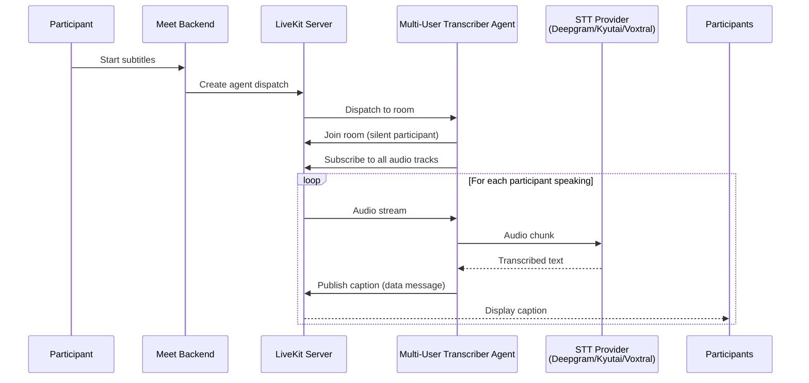

# Real-time Subtitles

Real-time subtitles provide live captions during meetings for accessibility. This feature uses a LiveKit agent with speech-to-text (STT) to generate captions as participants speak.

## How it works



The multi-user transcriber agent (`src/agents/multi_user_transcriber.py`) handles transcription for all participants simultaneously. Any participant in the room can start subtitles, anonymous ones in a public room included, and each start runs the paid speech-to-text provider.

---

## Backend configuration

Enable subtitles in the Meet backend:

```bash
# env.d/development/common or env.d/production.dist/common
ROOM_SUBTITLE_ENABLED=True
ROOM_SUBTITLE_AGENT_NAME=multi-user-transcriber
```

`ROOM_SUBTITLE_AGENT_NAME` must match the agent's `TRANSCRIBER_AGENT_NAME`, see [Environment Variables: Subtitles](../../reference/env-variables.md#subtitles).

---

## Agent deployment

### Docker Compose

Add the multi-user transcriber agent to your `compose.yml`:

```yaml
multi-user-transcriber:
  image: lasuite/meet-agents:latest
  command: python multi_user_transcriber.py start
  env_file:
    - env.d/development/multi_user_transcriber.dist
  depends_on:
    - livekit
  restart: unless-stopped
```

Create `env.d/development/multi_user_transcriber.dist`:

```bash
LIVEKIT_URL=ws://livekit:7880
LIVEKIT_API_KEY=your-api-key
LIVEKIT_API_SECRET=your-api-secret

# Choose STT provider: deepgram, kyutai or voxtral-vllm
STT_PROVIDER=deepgram

# Deepgram configuration (if using Deepgram)
DEEPGRAM_API_KEY=your-deepgram-api-key
DEEPGRAM_STT_MODEL=nova-3
DEEPGRAM_STT_LANGUAGE=multi

# Kyutai configuration (if using Kyutai)
KYUTAI_STT_BASE_URL=http://kyutai-stt:8000
KYUTAI_API_KEY=your-kyutai-api-key

# Optional: Enable Voice Activity Detection
ENABLE_SILERO_VAD=true

# Optional: Sentry error tracking
SENTRY_DSN=
SENTRY_ENVIRONMENT=production
```

---

## STT Provider setup

### Option 1: Deepgram (Cloud)

1. Sign up at [deepgram.com](https://deepgram.com/)
2. Create an API key
3. Set `STT_PROVIDER=deepgram` and `DEEPGRAM_API_KEY` in the agent config

**Advantages:**
- No infrastructure required
- Supports many languages
- High accuracy

**Disadvantages:**
- Requires internet connectivity
- Per-minute usage costs
- Audio sent to third party

### Option 2: Kyutai Moshi (Self-hosted)

Deploy your own Kyutai instance for on-premise STT.

1. Set `STT_PROVIDER=kyutai`
2. Deploy a Kyutai STT service (implementation details depend on your Kyutai setup)
3. Configure `KYUTAI_STT_BASE_URL` and `KYUTAI_API_KEY`

**Advantages:**
- No third-party data sharing
- No per-use costs after deployment
- Full control

**Disadvantages:**
- Requires GPU for reasonable performance
- Self-hosted infrastructure maintenance

### Option 3: Voxtral via vLLM (Self-hosted)

Deploy [Voxtral](https://mistral.ai/news/voxtral) behind a vLLM realtime endpoint.

1. Set `STT_PROVIDER=voxtral-vllm`
2. Deploy vLLM serving `mistralai/Voxtral-Mini-4B-Realtime-2602` (or a compatible model) with a realtime WebSocket endpoint
3. Configure `VOXTRAL_VLLM_BASE_URL` and, if required, `VOXTRAL_VLLM_API_KEY`

**Advantages:**
- No third-party data sharing
- No per-use costs after deployment

**Disadvantages:**
- Requires GPU for reasonable performance
- Self-hosted infrastructure maintenance
- Requires the shared Silero VAD instance for endpointing - see the agent's own docstring

---

## Kubernetes deployment

Add the agent to your Helm values:

```yaml
agentSubtitles:
  replicas: 1
  envVars:
    STT_PROVIDER: "deepgram"
    DEEPGRAM_STT_MODEL: "nova-3"
    DEEPGRAM_STT_LANGUAGE: "multi"
    ENABLE_SILERO_VAD: "true"
    DEEPGRAM_API_KEY:
      secretKeyRef:
        name: meet-secrets
        key: deepgram-api-key
```

The agent connects to the LiveKit server and waits for dispatch requests from the backend.

---

## Configuration reference

Every agent variable, with its default: [Environment Variables: Subtitles agent](../../reference/env-variables.md#subtitles-agent).

---

## Testing

1. Enable subtitles in backend config and restart
2. Deploy the agent
3. Create a room as an owner
4. Start subtitles from the meeting controls
5. Speak - you should see captions appear within 1-2 seconds

Check agent logs for errors:

```bash
docker compose logs -f multi-user-transcriber
```

---

## Troubleshooting

**No captions appear**
- Check that `ROOM_SUBTITLE_ENABLED=True` in backend config
- Verify the agent is running: `docker compose ps multi-user-transcriber`
- Check agent logs for connection errors

**Captions are delayed or choppy**
- Network latency to STT provider (if using Deepgram)
- Insufficient agent resources
- Enable `ENABLE_SILERO_VAD=true` for better timing

**Agent fails to start**
- Missing required environment variables
- Invalid API keys
- Cannot connect to LiveKit server

---

## Resource requirements

- **CPU**: 0.5-1 core per active agent session
- **Memory**: 512MB-1GB per agent
- **Network**: Continuous audio streaming to STT provider (if cloud-based)

One agent instance can handle multiple rooms simultaneously through LiveKit's dispatch system.
