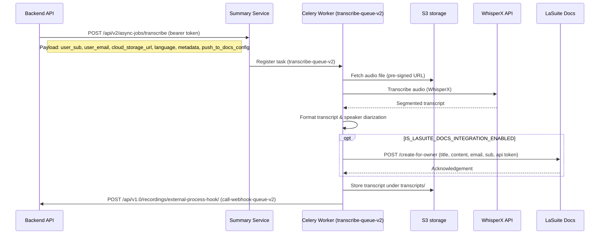

# AI Transcription

AI transcription is in beta. Whoever may start a recording, as [Recording: Who can record](recording.md#who-can-record) lists, can start a transcription, or add one to a screen recording. Meet sends the recording to the summary service, which transcribes it.

Meet delivers the transcript only by pushing it to [LaSuite Docs](https://github.com/suitenumerique/docs), as a document owned by the person who started the transcription. Without `IS_LASUITE_DOCS_INTEGRATION_ENABLED`, the transcript stays under `transcripts/` in the bucket and reaches no user.

Every variable and its default is in the Environment Variables reference: the backend side under [Transcription](../../reference/env-variables.md#transcription), the summary service under [Summary service](../../reference/env-variables.md#summary-service).

## Requirements

- **[Recording](recording.md), set up and working.** Transcription uses the same LiveKit Egress, object storage and LiveKit webhook.
- **A WhisperX API.** The summary service calls `POST {WHISPERX_BASE_URL}/audio/transcriptions` with `response_format=diarized_json` and needs speaker labels and word segments back. [meet-whisperx](https://github.com/suitenumerique/meet-whisperx) provides them, under the `/v1` prefix, so `WHISPERX_BASE_URL` ends in `/v1`. Run it on a GPU: transcription on CPU is very slow for anything beyond short recordings.
- **An LLM API.** The summary service needs `LLM_BASE_URL`, `LLM_API_KEY` and `LLM_MODEL` to start, even with summaries off.
- **LaSuite Docs, to deliver the transcript.** Set `IS_LASUITE_DOCS_INTEGRATION_ENABLED`, `LASUITE_DOCS_BASE_URL` and `LASUITE_DOCS_SERVER_TO_SERVER_API_KEY` in the summary service's environment, see [LaSuite Docs](../../reference/env-variables.md#lasuite-docs). Whether or not the push is enabled, each tenant needs `"allowed_push_to_docs": true` in `AUTHORIZED_TENANTS`: Meet always sends its Docs settings, and the summary service answers 400 to a tenant without the flag.

The summary service rejects a transcription whose language is outside `WHISPERX_ALLOWED_LANGUAGES`, by default `en`, `fr`, `de` and `nl`. See [Speech-to-text (WhisperX)](../../reference/env-variables.md#speech-to-text-whisperx).

## How it works

Meet sends the summary service an `.ogg` audio file for a transcription, or the `.mp4` of a screen recording with transcription.



## Setup

### Step 1: Summary service environment

The summary service is the FastAPI application that handles transcription tasks, published on Docker Hub as `lasuite/meet-summary`. Its Celery workers run the same code, so they need the same environment.

The summary service reads the same bucket as the backend, with the backend's keys and region. Its storage settings work as follows:

- It takes `AWS_S3_ENDPOINT_URL` with or without a scheme, and picks HTTP or HTTPS from `AWS_S3_SECURE_ACCESS` alone. That is `True` by default: set it to `False` for the plain-HTTP Garage of the Recording guide.
- It signs every request for `AWS_S3_REGION_NAME`. Its signed links to transcripts and summaries are path-style, `<endpoint>/<bucket>/<key>`, so the storage must serve that form.
- Storage built on Google Cloud Storage refuses the checksums that boto3, the AWS SDK for Python, sends by default. There, set `AWS_S3_REQUEST_CHECKSUM_CALCULATION` and `AWS_S3_RESPONSE_CHECKSUM_VALIDATION` to `when_required`.

`AUTHORIZED_TENANTS` is a JSON array with one entry per Meet backend allowed to submit tasks. The `api_key` authenticates the backend's requests to the summary service, and the `webhook_api_key` authenticates the summary service's callbacks to Meet. Use a separate strong secret for each, for example from `openssl rand -hex 32`.

=== "Docker Compose"

    Create `env.d/summary`:

    ```dotenv
    # Celery broker (dedicated Redis instance for the summary service)
    CELERY_BROKER_URL=redis://redis-summary:6379/0
    CELERY_RESULT_BACKEND=redis://redis-summary:6379/0

    # Object storage, to download the recordings
    AWS_S3_ENDPOINT_URL=http://garage:9000
    AWS_S3_ACCESS_KEY_ID=<GARAGE_ACCESS_KEY>
    AWS_S3_SECRET_ACCESS_KEY=<GARAGE_SECRET_KEY>
    AWS_S3_REGION_NAME=garage
    AWS_STORAGE_BUCKET_NAME=meet-media-storage
    AWS_S3_SECURE_ACCESS=False

    # Meet backends allowed to submit tasks
    AUTHORIZED_TENANTS='[{"id":"meet","api_key":"<generate-a-strong-secret>","webhook_url":"https://meet.example.com/api/v1.0/recordings/external-process-hook/","webhook_api_key":"<generate-a-strong-secret>","allowed_push_to_docs":true}]'

    # WhisperX API
    WHISPERX_BASE_URL=http://whisperx:8000/v1
    WHISPERX_ASR_MODEL=large-v3
    WHISPERX_API_KEY=your-api-key

    # LLM API
    LLM_BASE_URL=https://your-llm-api.example.com/v1
    LLM_API_KEY=your-llm-api-key
    LLM_MODEL=gpt-4o-mini
    ```

=== "Kubernetes"

    Add to your `values.yaml`. The `&summaryEnv` anchor lets Step 2 reuse the block, and the S3 keys come from the `garage-secrets` Secret of the Recording guide:

    ```yaml
    summary:
      replicas: 1
      envVars: &summaryEnv
        CELERY_BROKER_URL: "redis://redis-master:6379/1"
        CELERY_RESULT_BACKEND: "redis://redis-master:6379/1"
        AWS_S3_ENDPOINT_URL: "http://garage.meet.svc.cluster.local:9000"
        AWS_S3_ACCESS_KEY_ID:
          secretKeyRef:
            name: garage-secrets
            key: GARAGE_DEFAULT_ACCESS_KEY
        AWS_S3_SECRET_ACCESS_KEY:
          secretKeyRef:
            name: garage-secrets
            key: GARAGE_DEFAULT_SECRET_KEY
        AWS_S3_REGION_NAME: "garage"
        AWS_STORAGE_BUCKET_NAME: "meet-media-storage"
        AWS_S3_SECURE_ACCESS: "False"
        AUTHORIZED_TENANTS: '[{"id":"meet","api_key":"<generate-a-strong-secret>","webhook_url":"https://meet.example.com/api/v1.0/recordings/external-process-hook/","webhook_api_key":"<generate-a-strong-secret>","allowed_push_to_docs":true}]'
        WHISPERX_BASE_URL: "http://whisperx:8000/v1"
        WHISPERX_ASR_MODEL: "large-v3"
        WHISPERX_API_KEY: "your-api-key"
        LLM_BASE_URL: "https://your-llm-api.example.com/v1"
        LLM_API_KEY: "your-llm-api-key"
        LLM_MODEL: "gpt-4o-mini"
    ```

### Step 2: Summary service and workers

=== "Docker Compose"

    The summary service needs its own Redis as the Celery broker, its API, and one worker per queue: `transcribe-queue-v2` transcribes, `call-webhook-queue-v2` sends the result back to Meet. Add them to the Meet stack's `compose.yml`, under `services:`:

    ```yaml
      redis-summary:
        image: redis:7
        restart: unless-stopped
        networks:
          - internal

      app-summary:
        image: lasuite/meet-summary:latest
        restart: unless-stopped
        env_file:
          - env.d/summary
        depends_on:
          - redis-summary
        networks:
          - internal

      celery-summary-transcribe:
        image: lasuite/meet-summary:latest
        restart: unless-stopped
        command: celery -A summary.core.celery_worker worker --pool=solo -Q transcribe-queue-v2
        env_file:
          - env.d/summary
        depends_on:
          - redis-summary
        networks:
          - internal

      celery-summary-webhook:
        image: lasuite/meet-summary:latest
        restart: unless-stopped
        command: celery -A summary.core.celery_worker worker --pool=solo -Q call-webhook-queue-v2
        env_file:
          - env.d/summary
        depends_on:
          - redis-summary
        networks:
          - internal
    ```

    ```bash
    docker compose up -d redis-summary app-summary celery-summary-transcribe celery-summary-webhook
    ```

=== "Kubernetes"

    The chart always deploys the summary service and its Celery workers. Give the workers the Step 1 environment:

    ```yaml
    celeryTranscribe:
      envVars: *summaryEnv
      instances:
        - name: transcribe-1
          replicas: 1

    celerySummarize:
      envVars: *summaryEnv

    celerySummaryBackend:
      envVars: *summaryEnv
      replicas: 1
    ```

### Step 3: Connect the Meet backend

`SUMMARY_SERVICE_API_TOKEN` and `SUMMARY_SERVICE_WEBHOOK_API_TOKEN` must match the tenant's `api_key` and `webhook_api_key` in `AUTHORIZED_TENANTS`.

=== "Docker Compose"

    Add to `env.d/common`:

    ```dotenv
    SUMMARY_SERVICE_VERSION=2
    SUMMARY_SERVICE_ENDPOINT=http://app-summary:8000/api/v2/async-jobs/transcribe
    SUMMARY_SERVICE_API_TOKEN=<same-api_key-you-set-in-AUTHORIZED_TENANTS>
    SUMMARY_SERVICE_WEBHOOK_API_TOKEN=<same-webhook_api_key-you-set-in-AUTHORIZED_TENANTS>
    ```

    Recreate the backend and its worker:

    ```bash
    docker compose up -d --force-recreate backend celery
    ```

=== "Kubernetes"

    Add to `backend.envVars` in your `values.yaml`:

    ```yaml
    backend:
      envVars:
        SUMMARY_SERVICE_VERSION: "2"
        SUMMARY_SERVICE_ENDPOINT: "http://meet-summary:80/api/v2/async-jobs/transcribe"
        SUMMARY_SERVICE_API_TOKEN: "<same-api_key-you-set-in-AUTHORIZED_TENANTS>"
        SUMMARY_SERVICE_WEBHOOK_API_TOKEN: "<same-webhook_api_key-you-set-in-AUTHORIZED_TENANTS>"
    ```

    Apply the updated chart:

    ```bash
    helm upgrade meet meet/meet --namespace meet --values values.yaml
    ```

### Step 4: Speaker names (optional)

Without this step, speakers stay labelled `SPEAKER_00`, `SPEAKER_01` and so on. The summary service replaces these labels with participant names by matching WhisperX's speakers against voice-activity metadata, which the metadata collector agent records during the recording. The backend asks for that metadata only with `METADATA_COLLECTOR_ENABLED=True`. Every agent variable is in [Metadata collector agent](../../reference/env-variables.md#metadata-collector-agent).

=== "Docker Compose"

    Add `METADATA_COLLECTOR_ENABLED=True` to `env.d/common`.

    Create `env.d/metadata-collector`. Like the summary service, the agent takes the storage endpoint with or without a scheme and picks HTTP or HTTPS from `AWS_S3_SECURE_ACCESS`, which is `False` by default for the agent:

    ```dotenv
    LIVEKIT_URL=ws://livekit:7880
    LIVEKIT_API_KEY=meet
    LIVEKIT_API_SECRET=<your LiveKit API secret>

    AWS_S3_ENDPOINT_URL=garage:9000
    AWS_S3_ACCESS_KEY_ID=<GARAGE_ACCESS_KEY>
    AWS_S3_SECRET_ACCESS_KEY=<GARAGE_SECRET_KEY>
    AWS_S3_REGION_NAME=garage
    AWS_STORAGE_BUCKET_NAME=meet-media-storage
    ```

    Add the agent to `compose.yml`, under `services:`:

    ```yaml
      metadata-collector:
        image: lasuite/meet-agents:latest
        command: python metadata_collector.py start
        restart: unless-stopped
        env_file:
          - env.d/metadata-collector
        depends_on:
          - livekit
        networks:
          - internal
    ```

    ```bash
    docker compose up -d metadata-collector
    docker compose up -d --force-recreate backend celery
    ```

=== "Kubernetes"

    The chart always deploys the agent as `agentMetadata`. Add to your `values.yaml`:

    ```yaml
    backend:
      envVars:
        METADATA_COLLECTOR_ENABLED: "True"

    agentMetadata:
      envVars:
        LIVEKIT_URL: "ws://livekit-server:7880"
        LIVEKIT_API_KEY: "meet"
        LIVEKIT_API_SECRET: "<your LiveKit API secret>"
        AWS_S3_ENDPOINT_URL: "garage.meet.svc.cluster.local:9000"
        AWS_S3_ACCESS_KEY_ID:
          secretKeyRef:
            name: garage-secrets
            key: GARAGE_DEFAULT_ACCESS_KEY
        AWS_S3_SECRET_ACCESS_KEY:
          secretKeyRef:
            name: garage-secrets
            key: GARAGE_DEFAULT_SECRET_KEY
        AWS_S3_REGION_NAME: "garage"
        AWS_STORAGE_BUCKET_NAME: "meet-media-storage"
    ```

    ```bash
    helm upgrade meet meet/meet --namespace meet --values values.yaml
    ```

## LLM summarization (optional)

Summarization writes a summary of the transcript with an LLM and pushes it to LaSuite Docs as a second document. Summaries run only when all of these hold:

- The push to LaSuite Docs is enabled.
- The person who started the transcription has the feature flag `summary-enabled`. Meet reads it from the analytics backend `ANALYTICS_BACKEND` names, such as PostHog, or from a static list when no backend is set.
- `IS_SUMMARY_ENABLED=True` in the summary service, its default. Set it to `False` to produce transcripts only.
- A worker consumes `summarize-queue-v2`. The Helm chart already deploys it as `celerySummarize`. On Docker Compose, add a service like `celery-summary-transcribe` above, with `-Q summarize-queue-v2`.

The LLM variables are in [Summaries (LLM)](../../reference/env-variables.md#summaries-llm), and the analytics ones in [Analytics and marketing](../../reference/env-variables.md#analytics-and-marketing).

### Turning summaries on without an analytics backend

Leave `ANALYTICS_BACKEND` unset and declare the flag in `ANALYTICS_BACKEND_SETTINGS`. It then holds for every user, and Meet sends no analytics data anywhere. The value is a Python dictionary, not JSON: write `True`, not `true`. Set it on every container running the backend image, the Celery worker included.

=== "Docker Compose"

    Add to `env.d/common`:

    ```dotenv
    ANALYTICS_BACKEND_SETTINGS={"feature_flags": {"summary-enabled": True}}
    ```

    Recreate the backend and its worker:

    ```bash
    docker compose up -d --force-recreate backend celery
    ```

=== "Kubernetes"

    Add to `backend.envVars` in your `values.yaml`, which the `celeryBackend` worker inherits:

    ```yaml
    backend:
      envVars:
        ANALYTICS_BACKEND_SETTINGS: '{"feature_flags": {"summary-enabled": True}}'
    ```

    ```bash
    helm upgrade meet meet/meet --namespace meet --values values.yaml
    ```
