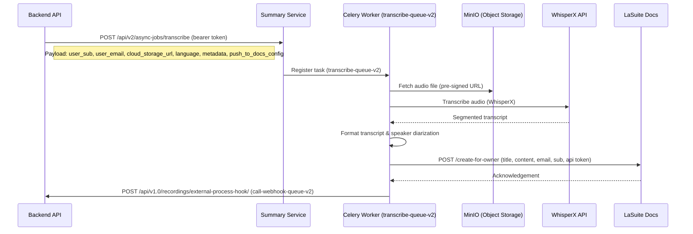

# AI Transcription

AI transcription is available in beta. When enabled, room owners and administrators can start a transcription, or add one to a screen recording; that recording is then sent to the summary service. Optionally, the transcript can be pushed to a LaSuite Docs instance for whoever started it to read and edit.

!!!info
    **Prerequisite:** Transcription requires the [Recording](recording.md) feature to be fully set up and working first. Transcription uses the same LiveKit Egress, Object Store, and LiveKit webhook infrastructure.

**Speaker identification:**

Speaker-to-participant assignment is implemented. The system:
1. Uses WhisperX for speaker diarization (generates `SPEAKER_00`, `SPEAKER_01`, etc.)
2. Matches diarized speakers to participant names by correlating with Voice Activity Detection (VAD) metadata from the metadata collector agent
3. Replaces generic speaker labels with actual participant names in the transcript

**Requirements for speaker identification:**
- The metadata collector agent must be running and collecting VAD events during the recording
- Without VAD metadata, speakers remain labeled as `SPEAKER_00`, `SPEAKER_01`, etc.

See `src/summary/summary/core/user_assign.py` for the speaker assignment implementation.

**Technical requirements:**

- Transcription requires [WhisperX](https://github.com/m-bain/whisperX), which provides a custom API (not OpenAI-compatible). A Docker image is available at [github.com/suitenumerique/meet-whisperx](https://github.com/suitenumerique/meet-whisperx).

**Optional: LaSuite Docs integration**
Pushing the transcript to a LaSuite Docs instance (`POST /api/v1.0/documents/create-for-owner/`) is opt-in, controlled by `IS_LASUITE_DOCS_INTEGRATION_ENABLED` (`False` by default) plus `LASUITE_DOCS_BASE_URL` and `LASUITE_DOCS_SERVER_TO_SERVER_API_KEY`, all set in the summary service's environment. With it disabled, transcription still completes normally - the transcript just isn't pushed anywhere else. Whether or not the push is enabled, each tenant needs `"allowed_push_to_docs": true` in `AUTHORIZED_TENANTS`: Meet always sends its Docs settings, and the summary service answers 400 to a tenant without the flag.

## How it works



---

## Docker Compose setup

### Step 1: Configure the summary service

The summary service is the FastAPI application that handles transcription tasks. It is published on Docker Hub as `lasuite/meet-summary`.

Create its environment file `env.d/summary`:

```dotenv
# Celery broker (dedicated Redis instance for the summary service)
CELERY_BROKER_URL=redis://redis-summary:6379/0
CELERY_RESULT_BACKEND=redis://redis-summary:6379/0

# MinIO/S3 (to download audio recordings)
AWS_S3_ENDPOINT_URL=http://minio:9000
AWS_S3_ACCESS_KEY_ID=minioadmin
AWS_S3_SECRET_ACCESS_KEY=minioadmin123
AWS_STORAGE_BUCKET_NAME=meet-media-storage
AWS_S3_SECURE_ACCESS=False

# Authorized tenants - authenticates the Meet backend and delivers results back to it.
# Replace the api_key values with strong random secrets (openssl rand -hex 32).
AUTHORIZED_TENANTS='[{"id":"meet","api_key":"<generate-a-strong-secret>","webhook_url":"https://meet.example.com/api/v1.0/recordings/external-process-hook/","webhook_api_key":"<generate-a-strong-secret>","allowed_push_to_docs":true}]'

# WhisperX STT API
WHISPERX_BASE_URL=https://your-whisperx-instance.example.com
WHISPERX_ASR_MODEL=large-v3
WHISPERX_API_KEY=your-api-key

# LLM for summarization (required even if IS_SUMMARY_ENABLED=False)
LLM_BASE_URL=https://your-llm-api.example.com/v1
LLM_API_KEY=your-llm-api-key
LLM_MODEL=gpt-4o-mini
```

!!!info
    `AUTHORIZED_TENANTS` is a JSON array. Each entry defines one Meet backend that is allowed to submit transcription tasks and receive results. The `api_key` authenticates inbound requests from the Meet backend; the `webhook_api_key` authenticates outbound callbacks to Meet. Use separate strong secrets for each.

    `AUTHORIZED_TENANTS` is the only supported authentication mode.

You need a running WhisperX API, such as [meet-whisperx](https://github.com/suitenumerique/meet-whisperx), which wraps WhisperX in FastAPI.

### Step 2: Add to compose.yml

```yaml
redis-summary:
  image: redis:7
  restart: unless-stopped
  networks:
    - internal

app-summary:
  image: lasuite/meet-summary:latest
  restart: unless-stopped
  env_file:
    - env.d/summary
  depends_on:
    - redis-summary
  networks:
    - internal

celery-summary-transcribe:
  image: lasuite/meet-summary:latest
  restart: unless-stopped
  command: celery -A summary.core.celery_worker worker --pool=solo -Q transcribe-queue-v2
  env_file:
    - env.d/summary
  depends_on:
    - redis-summary
    - minio
  networks:
    - internal

celery-summary-webhook:
  image: lasuite/meet-summary:latest
  restart: unless-stopped
  command: celery -A summary.core.celery_worker worker --pool=solo -Q call-webhook-queue-v2
  env_file:
    - env.d/summary
  depends_on:
    - redis-summary
  networks:
    - internal
```

### Step 3: Connect the Meet backend to the summary service

Add to your `env.d/development/common` or `.env`:

```dotenv
SUMMARY_SERVICE_VERSION=2
SUMMARY_SERVICE_ENDPOINT=http://app-summary:8000/api/v2/async-jobs/transcribe/
SUMMARY_SERVICE_API_TOKEN=<same-api_key-you-set-in-AUTHORIZED_TENANTS>
SUMMARY_SERVICE_WEBHOOK_API_TOKEN=<same-webhook_api_key-you-set-in-AUTHORIZED_TENANTS>
```

- `SUMMARY_SERVICE_VERSION=2` is **required**. The default is `1` (deprecated). The backend logs a warning if this is not set to `2`.
- `SUMMARY_SERVICE_ENDPOINT` points to the v2 transcribe endpoint: `/api/v2/async-jobs/transcribe/`
- `SUMMARY_SERVICE_API_TOKEN` must match the `api_key` you set in the summary service's `AUTHORIZED_TENANTS`.
- `SUMMARY_SERVICE_WEBHOOK_API_TOKEN` must match the `webhook_api_key` you set in the summary service's `AUTHORIZED_TENANTS`.

Restart the backend:

```bash
docker compose up -d --force-recreate backend
```

### Step 4: Configure the WhisperX STT backend

The summary service connects to a WhisperX API for speech-to-text. Point it to your WhisperX instance in `env.d/summary`:

```dotenv
WHISPERX_BASE_URL=https://your-whisperx-instance.example.com
WHISPERX_ASR_MODEL=large-v3
WHISPERX_API_KEY=your-api-key
```

For production, a GPU-enabled WhisperX instance is strongly recommended. Transcription on CPU is very slow for anything beyond short recordings.

---

## Kubernetes setup

Transcription in Kubernetes uses the summary service and Celery workers included in the Meet Helm chart. The recording infrastructure (MinIO, Egress, `ingressMedia`) must be set up first. See [Recording: Kubernetes setup](recording.md#kubernetes-setup).

### Step 1: Enable the summary service

Add to your `values.yaml`:

```yaml
summary:
  replicas: 1
  envVars: &summaryEnv
    CELERY_BROKER_URL: "redis://redis-master:6379/1"
    CELERY_RESULT_BACKEND: "redis://redis-master:6379/1"
    AWS_S3_ENDPOINT_URL: "http://minio:9000"
    AWS_S3_ACCESS_KEY_ID: "minioadmin"
    AWS_S3_SECRET_ACCESS_KEY: "minioadmin123"
    AWS_STORAGE_BUCKET_NAME: "meet-media-storage"
    AWS_S3_SECURE_ACCESS: "False"
    AUTHORIZED_TENANTS: '[{"id":"meet","api_key":"<generate-a-strong-secret>","webhook_url":"https://meet.example.com/api/v1.0/recordings/external-process-hook/","webhook_api_key":"<generate-a-strong-secret>","allowed_push_to_docs":true}]'
    WHISPERX_BASE_URL: "https://your-whisperx-instance.example.com"
    WHISPERX_ASR_MODEL: "large-v3"
    WHISPERX_API_KEY: "your-api-key"
    LLM_BASE_URL: "https://your-llm-api.example.com/v1"
    LLM_API_KEY: "your-llm-api-key"
    LLM_MODEL: "gpt-4o-mini"
```

You need a running [WhisperX](https://github.com/suitenumerique/meet-whisperx) instance reachable from within the cluster. For production, a GPU-enabled instance is strongly recommended.

### Step 2: Enable the Celery workers

The transcribe worker and the webhook worker run the summary service's code, so they need the same environment, which the `*summaryEnv` alias repeats:

```yaml
celeryTranscribe:
  envVars: *summaryEnv
  instances:
    - name: transcribe-1
      replicas: 1

celerySummaryBackend:
  envVars: *summaryEnv
  replicas: 1
```

### Step 3: Connect the Meet backend to the summary service

Add to `backend.envVars` in your `values.yaml`:

```yaml
backend:
  envVars:
    SUMMARY_SERVICE_VERSION: "2"
    SUMMARY_SERVICE_ENDPOINT: "http://meet-summary:80/api/v2/async-jobs/transcribe/"
    SUMMARY_SERVICE_API_TOKEN: "<same-api_key-you-set-in-AUTHORIZED_TENANTS>"
    SUMMARY_SERVICE_WEBHOOK_API_TOKEN: "<same-webhook_api_key-you-set-in-AUTHORIZED_TENANTS>"
```

Apply the updated chart:

```bash
helm upgrade meet meet/meet --namespace meet --values values.yaml
```


## Full configuration reference

Every variable, with its default: the backend side in [Environment Variables: Transcription](../../reference/env-variables.md#transcription), the summary service in [Environment Variables: Summary service](../../reference/env-variables.md#summary-service).

## Supported audio formats

The summary service accepts: `.mp4`, `.webm`, `.wav`, `.mp3`, `.ogg`.


## LLM summarization (optional, separate feature)

Summarization (generating a written summary from the transcript using an LLM) is a separate optional feature, not part of basic transcription. It needs its own Celery worker: add a service like `celery-summary-transcribe` above, with `-Q summarize-queue-v2`. The summary service needs `LLM_BASE_URL`, `LLM_API_KEY`, and `LLM_MODEL` to start, even with summaries off - see the [Summaries (LLM)](../../reference/env-variables.md#summaries-llm) section of the Environment Variables reference. Set `IS_SUMMARY_ENABLED=False` to produce transcripts only.
