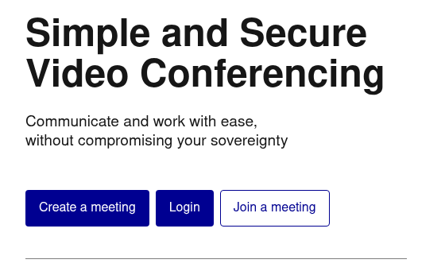
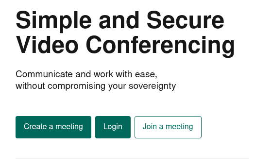
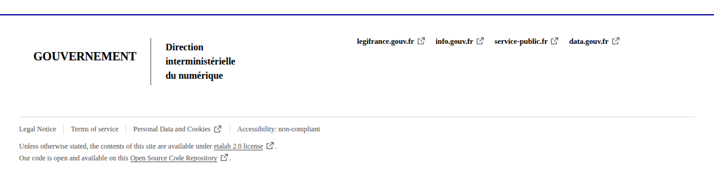

# Customising Meet

Everything an administrator can change in Meet is listed below, from its colours and logo to who can join a meeting and what gets recorded. Each row gives the default and links to the guide that explains the change.

## Applying a change

Most changes are settings of Meet's backend. Where you write them depends on how Meet is installed:

| Installation | Where the setting goes | How to apply it |
|---|---|---|
| Docker Compose | `env.d/common` | Run `docker compose up -d` in `~/docker/meet` |
| Kubernetes | `backend.envVars` in `values.yaml` | Run `helm upgrade`, as [Upgrading](kubernetes/helm.md#upgrading) shows |
| Scalingo | The app's environment | Run `scalingo env-set`, as [Step 2](scalingo.md#step-2-set-the-environment-variables) shows |

A few settings belong to another service, transcription for example. [Environment Variables](../reference/env-variables.md) tells you which file each one goes in.

## The usual changes

A new install usually starts with these:

| Setting | Default |
|---|---|
| [Colours and font](configuration/theming.md#colors-and-fonts) | Meet's blue, and the device's own font |
| [The logo, the home page pictures and the browser-tab icon](configuration/theming.md#custom-assets-logo-images) | Meet's own |
| [The sign-in service: Keycloak, Authentik, Google or any other OpenID Connect provider](configuration/sso.md) | None: one is required |
| [Who joins a new room directly, and who waits for the host to let them in](configuration/sso.md#unauthenticated-access) | **Open**: anyone with the link joins directly |
| [Recording, with the download link sent by email](configuration/recording.md) | Off |
| [Sending email, for recording download links and room invitations](configuration/email.md) | Nothing is sent until you name an email server |
| [AI transcription, in beta, delivered to LaSuite Docs](configuration/transcription.md) | Offered once recording is on, and delivers nothing until set up |
| [Real-time subtitles, in beta](configuration/subtitles.md) | Off |
| [Phone dial-in](configuration/telephony.md) | Off |

## Look and feel

??? note "Colours, logo, backgrounds, the footer, home page and help links (9 settings)"

    ??? example "Meet's default colours, then the teal theme of the shipped custom.css"

        

        
        
        

    ??? example "The French government footer"

        

    ??? example "The built-in backgrounds"

        

    | Setting | Default |
    |---|---|
    | [Colours and font](configuration/theming.md#colors-and-fonts) | Meet's blue, and the device's own font |
    | [The logo, the home page pictures and the browser-tab icon](configuration/theming.md#custom-assets-logo-images) | Meet's own |
    | [The built-in virtual backgrounds](configuration/theming.md#custom-assets-logo-images) | Eight pictures from Meet |
    | [The app's name, in the browser tab and once installed](configuration/theming.md#build-time-theming) | Empty in the published image: it needs your own build |
    | [The French government footer](../reference/env-variables.md#FRONTEND_USE_FRENCH_GOV_FOOTER) | Off |
    | [A page of your own in place of the home page, for signed-out visitors](../reference/env-variables.md#FRONTEND_EXTERNAL_HOME_URL) | Off |
    | [A "Learn more" link on the home page](../reference/env-variables.md#FRONTEND_MANIFEST_LINK) | None |
    | [Documentation and feedback links in the meeting's menu](../reference/env-variables.md#FRONTEND_DOCUMENTATION_URL) | None |
    | [A support button, and help links in the meeting's side panels](../reference/env-variables.md#FRONTEND_SUPPORT) | Off |

## Sign-in and who can join

??? note "The sign-in service, sessions, guests and the waiting room (9 settings)"

    ??? example "Who can join, in the host settings"

        

    | Setting | Default |
    |---|---|
    | [The sign-in service: Keycloak, Authentik, Google or any other OpenID Connect provider](configuration/sso.md) | None: one is required |
    | [Signing in without a click, for someone already signed in to that service](../reference/env-variables.md#FRONTEND_IS_SILENT_LOGIN_ENABLED) | On |
    | [The ProConnect button, for French public servants](../reference/env-variables.md#FRONTEND_USE_PROCONNECT_BUTTON) | Off |
    | [Creating a Meet account at someone's first sign-in](../reference/env-variables.md#OIDC_CREATE_USER) | On |
    | [How long a sign-in lasts](../reference/env-variables.md#SESSION_COOKIE_AGE) | 12 hours |
    | [Starting a meeting without an account, under a room code nobody created](configuration/sso.md#unauthenticated-access) | On. The Docker Compose template turns it off |
    | [Who joins a new room directly, and who waits for the host to let them in](configuration/sso.md#unauthenticated-access) | **Open**: anyone with the link joins directly |
    | [How long someone let in from the waiting room has to join](../reference/env-variables.md#LOBBY_ACCEPTED_TIMEOUT) | 6 hours |
    | [How soon someone turned away may ask again](../reference/env-variables.md#LOBBY_DENIED_TIMEOUT) | 5 seconds |

## Recording and transcription

??? note "Recording, its quality and expiry, transcription and summaries (10 settings)"

    ??? example "Recording and transcription, in the menu"

        

    | Setting | Default |
    |---|---|
    | [Recording, with the download link sent by email](configuration/recording.md) | Off |
    | [Recording by any signed-in participant, in a room that is not "Restricted"](configuration/recording.md#who-can-record) | On |
    | [The recording quality](configuration/recording.md#configuring-recording-encoding) | 720p at 30 images a second, about 1.4 GB an hour |
    | [Hosts choosing the quality of each recording](configuration/recording.md#letting-users-choose) | Off |
    | [When Meet shows a recording as expired, without deleting it](../reference/env-variables.md#RECORDING_EXPIRATION_DAYS) | Never |
    | [AI transcription, in beta, delivered to LaSuite Docs](configuration/transcription.md) | Offered once recording is on, and delivers nothing until set up |
    | [AI summaries of the transcript](configuration/transcription.md#llm-summaries) | Off |
    | [Speaker names in the transcript](configuration/transcription.md#step-4-name-the-speakers) | Off: speakers are numbered |
    | [Telling users where their transcripts go](../reference/env-variables.md#FRONTEND_TRANSCRIPTION_DESTINATION) | Not shown |
    | [A satisfaction survey link after a transcription](../reference/env-variables.md#TRANSCRIPTION_SATISFACTION_FORM_BASE_URL) | None |

## In a meeting

??? note "Subtitles, phone dial-in, room hardware, sharing and sounds (11 settings)"

    ??? example "The subtitles button"

        

    | Setting | Default |
    |---|---|
    | [Real-time subtitles, in beta](configuration/subtitles.md) | Off |
    | [The speech-to-text service behind subtitles](configuration/subtitles.md#stt-providers) | Deepgram |
    | [Phone dial-in](configuration/telephony.md) | Off |
    | [The PIN callers type](../reference/env-variables.md#ROOM_TELEPHONY_PIN_LENGTH) | 10 digits |
    | [Meeting-room hardware joining a room, in beta](../reference/env-variables.md#ROOMKIT_ENABLED) | Off |
    | [Uploading your own virtual backgrounds](../reference/env-variables.md#FILE_UPLOAD_ENABLED) | Off. Once on, 10 per person, 2 MB each |
    | [What participants may share, until the host changes it](../reference/env-variables.md#LIVEKIT_DEFAULT_SOURCES) | Camera, microphone, screen and its sound |
    | [Signed-in people changing their name in a meeting](../reference/env-variables.md#AUTHENTICATED_PARTICIPANTS_CAN_EDIT_DISPLAY_NAME) | On |
    | [Joining muted, in a large meeting](../reference/env-variables.md#FRONTEND_AUTO_MUTE_ON_JOIN_THRESHOLD) | Above 50 participants |
    | [Join and leave sounds](../reference/env-variables.md#FRONTEND_MAX_PARTICIPANTS_FOR_SOUND) | Muted from 5 participants |
    | [Ending the call of someone left alone, after a warning](../reference/env-variables.md#FRONTEND_IDLE_DISCONNECT_WARNING_DELAY) | Off |

## Connection

??? note "The TURN relay, the connection test page and network requirements (3 settings)"

    | Setting | Default |
    |---|---|
    | [A relay for people whose network blocks calls, as some company networks do](configuration/livekit.md#turn) | Off |
    | [A page where visitors test their connection before a meeting](../reference/env-variables.md#CONNECTION_TEST_ENABLED) | Off. Once on, the [French government footer](https://github.com/suitenumerique/meet/blob/main/src/frontend/src/layout/Footer.tsx#L274) links it |
    | [A link to your network requirements, for a visitor's IT team](../reference/env-variables.md#FRONTEND_TECHNICAL_DOCUMENTATION_URL) | None |

## Email

??? note "Sending, the sender, your branding and retries (4 settings)"

    | Setting | Default |
    |---|---|
    | [Sending email, for recording download links and room invitations](configuration/email.md) | Nothing is sent until you name an email server |
    | [The sender address](../reference/env-variables.md#DJANGO_EMAIL_FROM) | A placeholder, `from@example.com` |
    | [Your name, logo and support address in emails](../reference/env-variables.md#email) | None |
    | [Retrying an email that failed](../reference/env-variables.md#CELERY_ENABLED) | Off |

## Languages

??? note "For transcription, subtitles and phone prompts (4 settings)"

    | Setting | Default |
    |---|---|
    | [The languages a transcription accepts](../reference/env-variables.md#WHISPERX_ALLOWED_LANGUAGES) | English, French, German, Dutch |
    | [The language a transcription assumes when none is picked](../reference/env-variables.md#WHISPERX_DEFAULT_LANGUAGE) | Detected from the speech |
    | [The language of subtitles](../reference/env-variables.md#DEEPGRAM_STT_LANGUAGE) | Detected from the speech, with Deepgram |
    | [The language of the phone prompts](configuration/telephony.md#audio-prompt-language) | English |

## Other applications

??? note "The external API, the Outlook add-in and embedding Meet (7 settings)"

    | Setting | Default |
    |---|---|
    | [Letting other applications create and manage rooms](../reference/external-api.md) | Off |
    | [The ways those applications sign in](../reference/external-api.md#getting-a-token) | All off |
    | [The Outlook add-in](../reference/external-api-addons.md) | Off |
    | [Showing Meet inside another application's page](../reference/external-api.md#signing-a-user-in-to-an-iframe) | Allowed |
    | [Signing the user in to Meet there](../reference/env-variables.md#USER_ACCESS_TOKEN_ENABLED) | Off |
    | [Who joins a room another application created](../reference/env-variables.md#EXTERNAL_API_DEFAULT_ACCESS_LEVEL) | **Open to trusted people**: signed-in users join directly, others wait |
    | [Other applications creating rooms open to anyone](../reference/env-variables.md#EXTERNAL_API_ALLOW_PUBLIC_ACCESS) | Off |

## Data, logs and analytics

??? note "Deleting rooms, the audit log, analytics and error reports (7 settings)"

    | Setting | Default |
    |---|---|
    | [Deleting unused rooms, and rooms their host deleted, for good](configuration/room-purge.md) | Off: every room is kept |
    | [Deleting uploaded backgrounds for good, once their owner removes them](../reference/env-variables.md#FILE_PURGE_GRACE_DAYS) | After 7 days |
    | [The audit log of sign-ins, recordings, and external API and admin actions](configuration/audit-logging.md) | Always on, in the backend's output |
    | [Usage analytics in the browser, with [PostHog](https://posthog.com/)](../reference/env-variables.md#FRONTEND_ANALYTICS) | Off |
    | [Usage analytics from the server](../reference/env-variables.md#ANALYTICS_BACKEND) | Off |
    | [Adding new users to a marketing mailing list](../reference/env-variables.md#SIGNUP_NEW_USER_TO_MARKETING_EMAIL) | Off |
    | [Error reports to [Sentry](https://sentry.io/)](../reference/env-variables.md#DJANGO_SENTRY_DSN) | Off |

## Limits

??? note "Rooms and recordings per person, and every other rate limit (3 settings)"

    | Setting | Default |
    |---|---|
    | [Rooms one person can create](../reference/env-variables.md#ROOM_CREATION_THROTTLE_RATES) | 50 a minute, 1,000 a day |
    | [Recordings one person can start](../reference/env-variables.md#START_RECORDING_THROTTLE_RATES) | 10 a minute, 100 a day |
    | [Every other limit, such as requests to join from the waiting room](../reference/security.md#rate-limiting) | Each has its own |

## What you cannot change

- The interface's languages:
  [English, French, Dutch, German and Spanish](https://github.com/suitenumerique/meet/blob/main/src/frontend/src/i18n/init.ts#L18).
  Until someone picks one, Meet follows
  [the browser's language](https://github.com/suitenumerique/meet/blob/main/src/frontend/src/i18n/init.ts#L22),
  or [French](https://github.com/suitenumerique/meet/blob/main/src/frontend/src/i18n/init.ts#L6)
  when it is none of these.
- A footer of your own: the only one is the
  [French government footer](configuration/theming.md#footer).
- The recording's layout, which is
  [always LiveKit's](configuration/recording.md#what-it-cannot-do).
- A second dial-in number: Meet [shows one](configuration/telephony.md#limitations).
