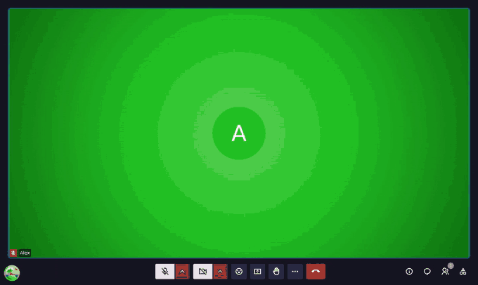
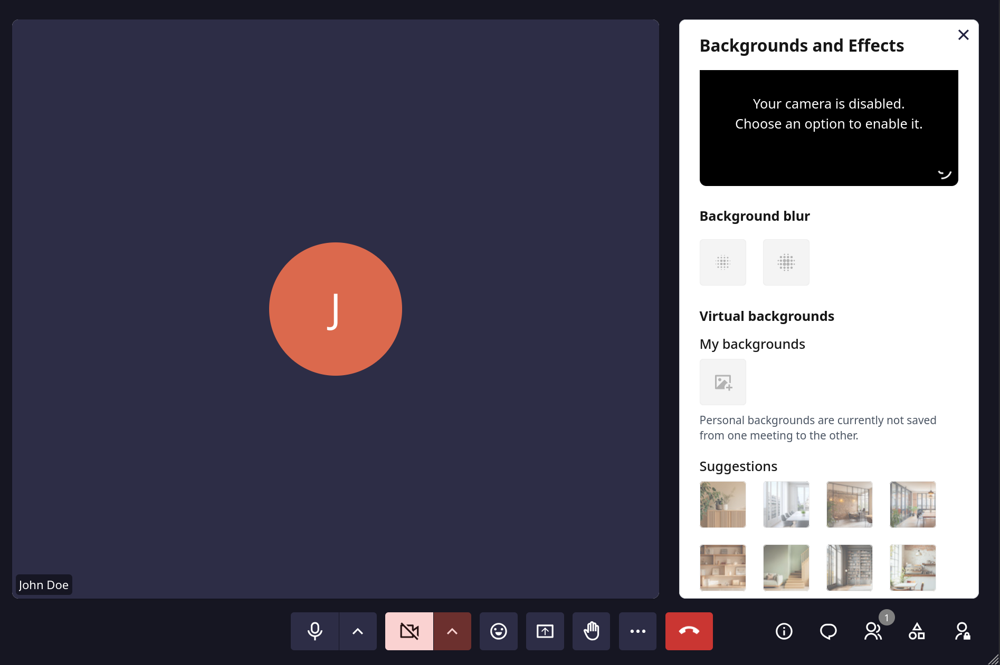
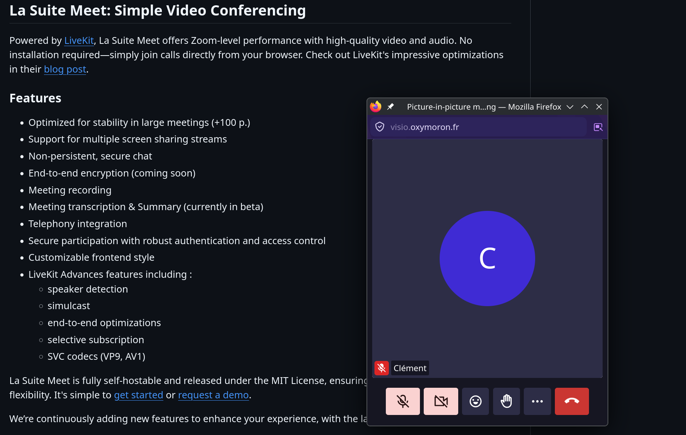
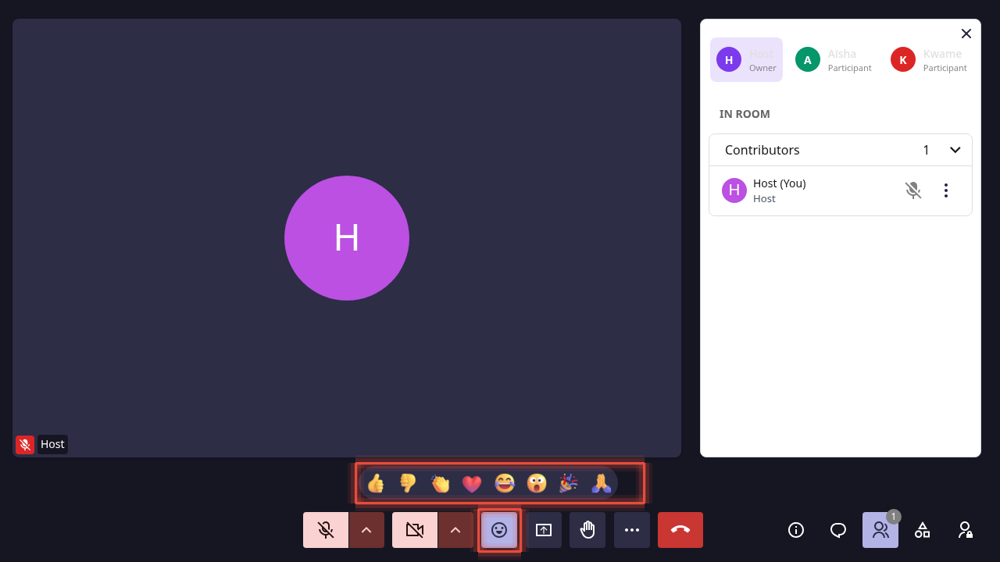
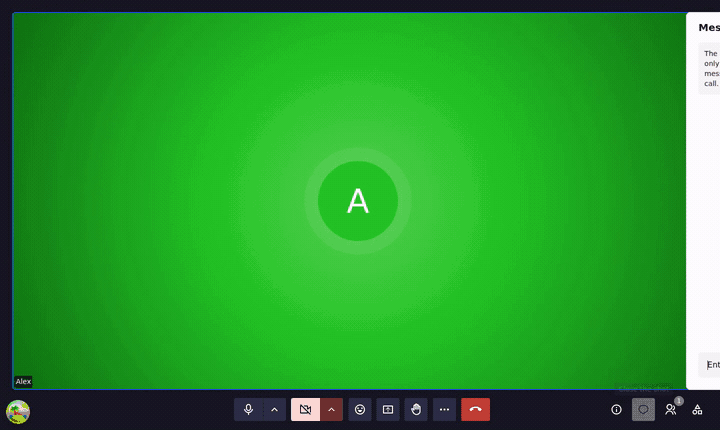
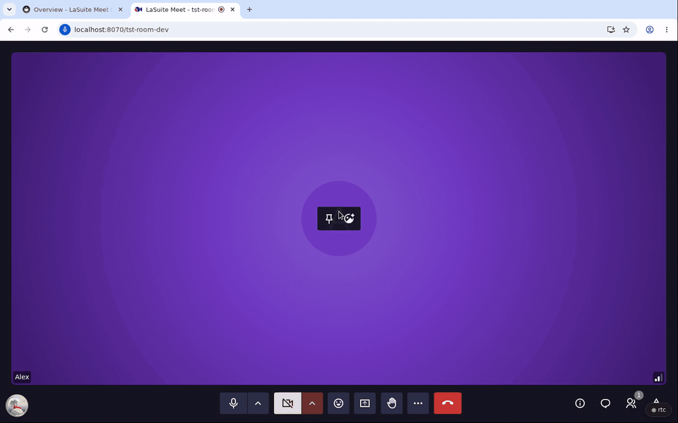
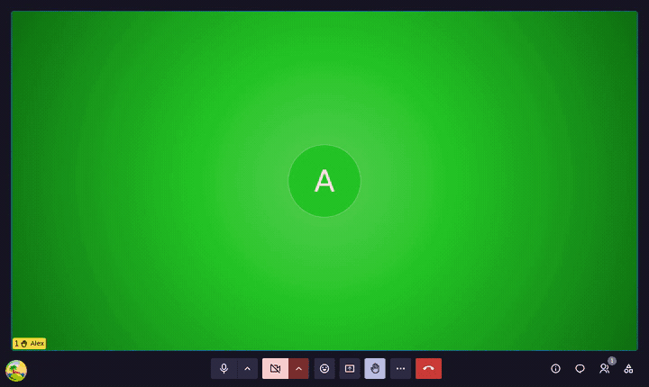
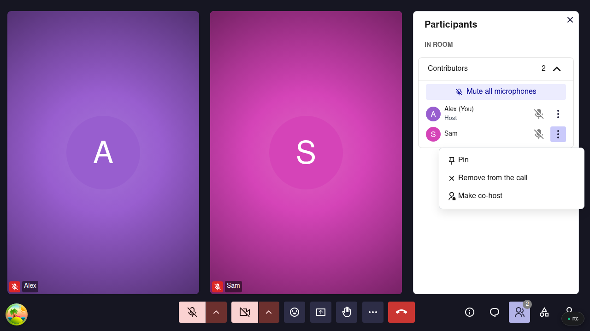
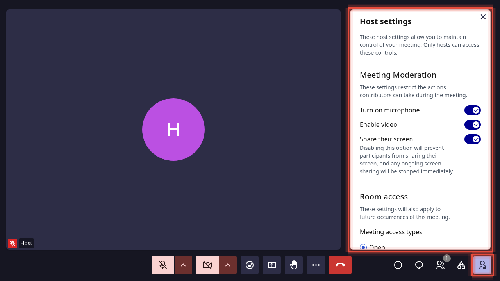
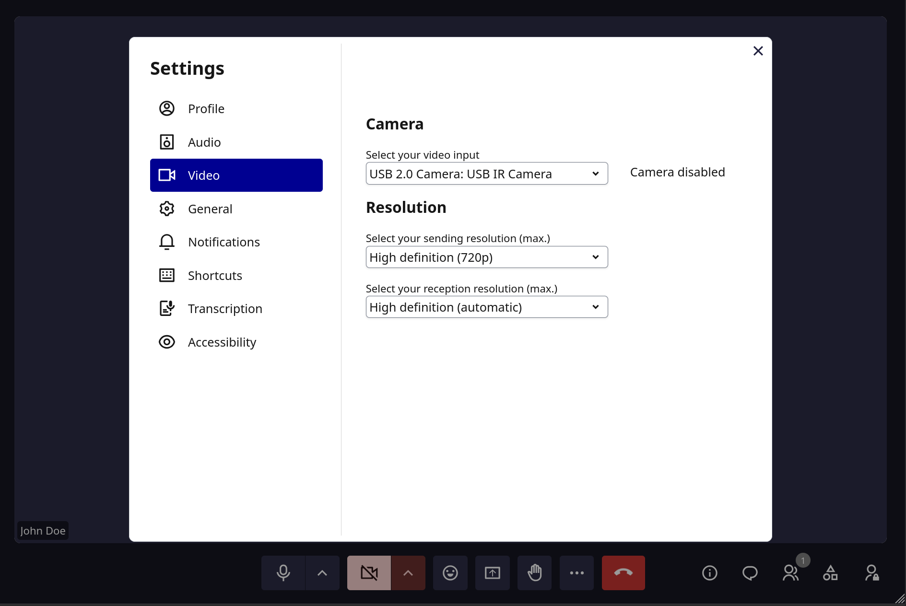

# Features & Controls

<figure markdown="span">
  
  <figcaption>A tour of the meeting controls</figcaption>
</figure>

## The basics

| | Action | Shortcut |
|---|---|---|
|  | Mute or unmute | `Ctrl+D` |
|  | Camera on or off | `Ctrl+E` |
|  | [Chat](#chat) | `Ctrl+Shift+M` |
|  | [Share your screen](#screen-sharing) | |
|  | [Raise your hand](#raised-hands) | `Ctrl+Shift+H` |
|  | Leave: the meeting goes on without you, see [When the meeting ends](../overview/how-meet-works.md#when-the-meeting-ends) | |

The  beside the microphone and the camera picks the device. Every shortcut is in [Accessibility & Shortcuts](accessibility.md#keyboard).

## For hosts

The owner and co-hosts can:

| Action | Where |
|---|---|
| Admit someone waiting |  **See everyone** → **Lobby**, or the pop-up |
| Mute someone | **See everyone** → the microphone beside the name |
| Remove someone | **See everyone** → menu beside the name → **Remove from the call**. They can come back as the [access level](#access-levels) allows |
| Choose who can join |  **Open admin** → **Host settings**, see [Access levels](#access-levels) |

Everything else hosts can do is under [Hosting](#hosting). Running a class or a large meeting? See [the guide](guides/large-meeting-host.md).

## More in the call

| Feature | Where | Notes |
|---|---|---|
| Push-to-talk | Hold `V` | |
| Reactions |  **Send reaction**, or `Ctrl+Shift+E` | |
| Pin a participant | Hover their video → **Pin** | |
| Fullscreen | **More Options** (the ⋯ button) → **Fullscreen**, or `Ctrl+Shift+F` | |
| Picture-in-picture | **More Options** → **Picture-in-picture** | |
| Backgrounds and effects | The  beside the camera, **More Options**, or the pre-join screen | Blur or an image. Uploading your own needs a sign-in, where [allowed](#set-up-by-your-administrator) |
| Subtitles *(beta)* |  **Show subtitles** | See [Real-time subtitles](recording.md#real-time-subtitles) |
| Phone dial-in | The info button (ⓘ) | See [Phone dial-in](#phone-dial-in) |
| Switch camera | On a phone, **More Options** → **Switch camera** | |
| Change your name | **More Options** → **Settings** → **Profile** | |

<figure markdown="span">
  
  <figcaption>Backgrounds and effects: blur or an image</figcaption>
</figure>
<figure markdown="span">
  
  <figcaption>Picture-in-picture: a floating window</figcaption>
</figure>

<figure markdown="span">
  { width="700" }
  <figcaption>The reactions toolbar</figcaption>
</figure>

### Chat

<figure markdown="span">
  { width="700" }
  <figcaption>Sending a chat message</figcaption>
</figure>

- Messages go to everyone; there are no private messages.
- Nothing is kept after the meeting, unless a transcription is running and your Meet server collects its metadata.

### Screen sharing

<figure markdown="span">
  { width="700" }
  <figcaption>Share screen → pick a tab, keep Share with tab audio on, and share</figcaption>
</figure>

- Several people can share at once, and you can zoom into someone else's share.
- To share sound, pick a tab and keep **Share with tab audio** on. Sound from a window or a whole screen depends on your browser, see [Browser support](#browser-support).

### Raised hands

<figure markdown="span">
  { width="700" }
  <figcaption>Raising a hand marks your video</figcaption>
</figure>

- Hands queue in the order they went up.
- Speaking lowers your hand, unless you click **Keep hand raised**.

### Phone dial-in

- Dial the number shown under the info button (ⓘ), then enter the PIN.
- Callers have audio only, and can join only once someone is in the meeting from a browser.

## Browser support

Every browser, iPhone included, can join, talk, use the camera, chat, react and raise a hand. Only these features differ:

| | Share screen | Its sound | Picture-in-picture | Speaker choice | Noise suppression | Fullscreen |
|---|---|---|---|---|---|---|
| Chrome, Edge | ✅ | From a tab | ✅ | ✅ | ✅ | ✅ |
| Firefox | ✅ | ❌ | From version 151 | ✅ | ✅ | ✅ |
| Safari on a Mac | ✅ | ❌ | ❌ | ❌ | ✅ | ✅ |
| Android phone | ❌ | ❌ | ❌ | ✅ | ❌ | ✅ |
| iPhone | ❌ | ❌ | ❌ | ❌ | ❌ | ❌ |

On a Mac, allow your browser to record the screen in **System Settings → Privacy & Security**, and read `Ctrl` as `⌘` in shortcuts. On a phone or a weak connection, see [the guide](guides/phone-or-weak-connection.md).

## Hosting

Besides [the basics for hosts](#for-hosts), the owner and co-hosts can:

| Action | Where | Notes |
|---|---|---|
| Make co-host | **See everyone** → menu beside the name → **Make co-host** | Signed-in participants only, see [Roles](#roles) |
| Mute everyone, lower all hands | **See everyone** → **Mute all microphones**, **Lower all hands** | |
| Stop participants from using their microphone, camera or screen share, or from muting others | **Host settings** | See [Permissions](#permissions) |

<figure markdown="span">
  
  <figcaption>The menu beside a name: Pin, Remove from the call, Make co-host</figcaption>
</figure>
<figure markdown="span">
  
  <figcaption>Host settings: permissions and access</figcaption>
</figure>

### Permissions

| Action | Owner | Co-host | Everyone else |
|---|---|---|---|
| Change the access level and host settings | ✅ | ✅ | ❌ |
| Make co-host, remove participants, mute everyone, lower all hands | ✅ | ✅ | ❌ |
| Admit from the waiting room | ✅ | ✅ | Signed in, in a room open to trusted people |
| Mute others, share screen, turn on microphone and camera | ✅ | ✅ | ✅ unless turned off in the host settings |
| Start or stop [recording and transcription](recording.md) | ✅ | ✅ | Signed in, in a room that is not **Restricted**, where the Meet server [allows it](#set-up-by-your-administrator) |
| Chat, react, raise hand | ✅ | ✅ | ✅ |
| [Delete the room](#deleted-rooms) | ✅ | ❌ | ❌ |

Turning off **Enable video** in the host settings stops everyone except the owner and co-hosts from using their camera. No one can turn off a single participant's camera.

### Roles

| Role | Who |
|---|---|
| **Owner** | Whoever created the room while signed in |
| **Co-host** | A signed-in participant the owner or a co-host promoted, from the participants panel. *Administrator* in the API |
| **Member** | Given through the [API](../reference/api.md#room-access-roles). Joins a **Restricted** room directly |

### Room access levels { #access-levels }

Each room has an access level, set by its owner or a co-host in **Host settings**. It decides who joins directly and who waits to be admitted.

| Access level | Joins directly | Requests entry |
|---|---|---|
| **Open** | Anyone with the link | No one |
| **Open to trusted people** | Signed-in users | Everyone else |
| **Restricted** | People with a role on the room | Everyone else |

### Deleted rooms

- Meet has no delete button: an owner deletes a room through the [API](../reference/api.md), from another application.
- Everyone in it is disconnected, and its link then says the meeting was deleted.
- Whoever runs your Meet server can also have old rooms deleted automatically, see [Room purge](../self-hosting/configuration/room-purge.md).

## Settings

<figure markdown="span">
  
  <figcaption>The Settings dialog in a meeting, on its Video tab</figcaption>
</figure>

In a meeting, open **More Options** → **Settings**. Everything there stays in the browser you set it in, your name included. Only the language is also saved to your account, once you are signed in.

| Tab | What you can change |
|---|---|
| Profile | Your name |
| Audio | Microphone, speakers, noise suppression *(beta)* |
| Video | Camera and resolution |
| General | Language, leaving when alone, joining large meetings muted |
| Notifications | Sounds |
| Shortcuts | The list of [keyboard shortcuts](accessibility.md#keyboard) |
| Transcription | The meeting language, for the owner and co-hosts |
| Recording | The recording quality, for the owner and co-hosts, where [allowed](#set-up-by-your-administrator) |
| Accessibility | Fonts, [caption style](accessibility.md#display), reactions read aloud |

- A signed-in user can change their name only where the Meet server allows it.

On the home page, the settings button sets the language and, once signed in, who can join the rooms you create and what participants may publish there.

## Set up by your administrator

A feature missing from your meeting may be off on your Meet server.

| Feature | Default | Guide for administrators |
|---|---|---|
| Recording | Needs setup | [Recording](../self-hosting/configuration/recording.md) |
| Recording by any signed-in participant | On | [Recording](../self-hosting/configuration/recording.md#who-can-record) |
| Choosing the recording quality | Off | [Recording encoding](../self-hosting/configuration/recording.md#configuring-recording-encoding) |
| Transcription and AI summary *(beta)* | Needs setup | [AI Transcription](../self-hosting/configuration/transcription.md) |
| Real-time subtitles *(beta)* | Needs setup | [Real-time Subtitles](../self-hosting/configuration/subtitles.md) |
| Phone dial-in | Needs setup | [Telephony](../self-hosting/configuration/telephony.md) |
| Uploaded backgrounds | Off | [Environment Variables](../reference/env-variables.md#custom-backgrounds) |
| Meeting-room devices (Roomkit) *(beta)* | Off | [Environment Variables](../reference/env-variables.md#roomkit-meeting-room-sip-devices) |
| [Outlook add-in](https://github.com/suitenumerique/meet/tree/main/src/addons/outlook), other applications | Needs setup | [External API](../reference/external-api.md) |
| **Test your configuration**, in the page footer | Off | [Environment Variables](../reference/env-variables.md#connection-test) |
