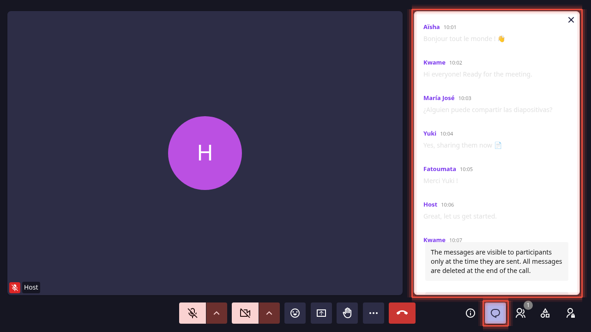
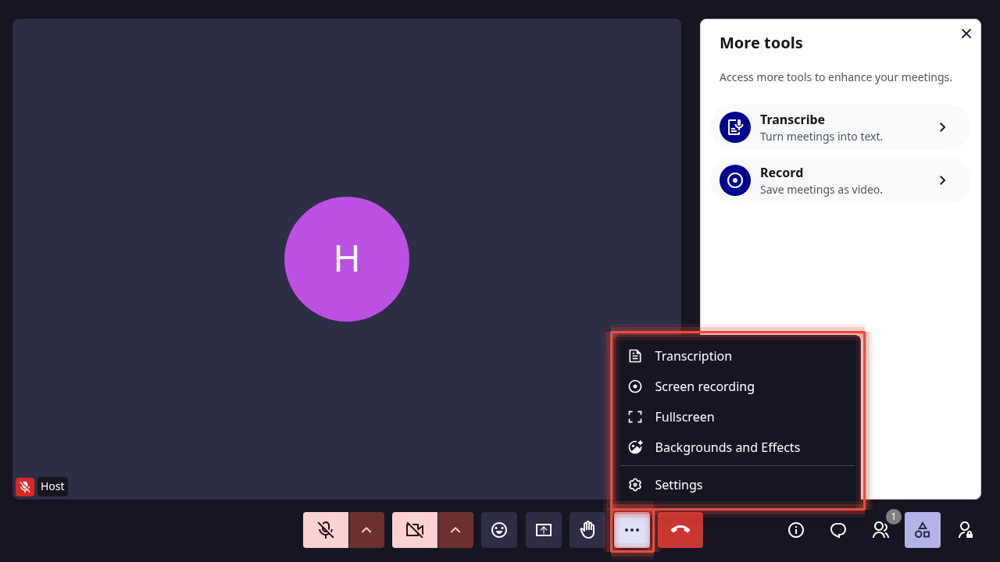
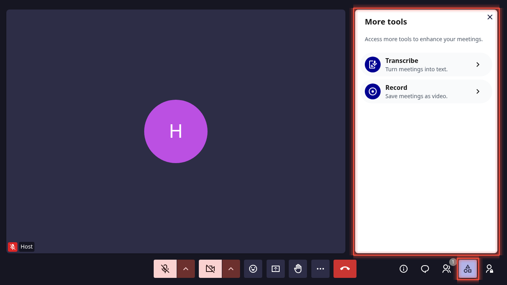

# Features & Controls

Everything you can do in a meeting, and where to find it. Joining and the pre-join screen are in [Getting Started](getting-started.md). ⚗️ marks a beta feature.

<figure markdown="span">
  
  <figcaption>The control bar: your own controls in the middle, the panels on the right</figcaption>
</figure>

<figure markdown="span">
  
  <figcaption>A tour of the meeting controls</figcaption>
</figure>

## In the call

Anyone in the meeting can use these.

| Feature | Where | Notes |
|---|---|---|
| Microphone, camera |   in the control bar; the  beside each picks the device | `Ctrl+D`, `Ctrl+E`, see [shortcuts](accessibility.md#keyboard) |
| Push-to-talk | Hold `V` | Unmutes while held |
| Pin a participant | Hover their video → **Pin** | The person speaking is highlighted on their own |
| Picture-in-picture | **More options** (the ⋯ button) → **Picture-in-picture** | A floating window that stays visible over other tabs and applications |
| Backgrounds and effects | The  beside the camera, **More options**, or the pre-join screen | Blur or an image. Your own images, up to 10 JPEG or PNG of 2 MB each, need a sign-in on an instance that [allows them](#set-up-by-your-administrator) |
| Noise suppression ⚗️, video quality | [Settings](#settings) → **Audio**, **Video** | |
| Leave |  **Leave** | The meeting goes on without you. There is no "end for all"; the room stays and can be reused, see [When the meeting ends](../overview/how-meet-works.md#when-the-meeting-ends) |

<figure markdown="span">
  
  <figcaption>Backgrounds and effects: blur or an image</figcaption>
</figure>
<figure markdown="span">
  
  <figcaption>Picture-in-picture: a floating window</figcaption>
</figure>

## Talking together

Anyone in the meeting can use these, and a host can [turn off](#permissions) screen sharing.

| Feature | Where | Notes |
|---|---|---|
| Screen sharing |  **Share screen** | Several at once, and you can zoom into someone else's, see [below](#screen-sharing) |
| Chat |  **Open the chat** | Not kept after the meeting, see [below](#chat) |
| Reactions |  **Send reaction**, or `Ctrl+Shift+E` | The emoji and your name float up the screen for 3 seconds |
| Raise hand |  **Raise hand** | Queued in order, see [below](#raised-hands) |
| Subtitles ⚗️ |  **Show subtitles** | Where the instance runs them, see [Real-time subtitles](recording.md#real-time-subtitles) |
| Phone dial-in | The room info panel shows the number and PIN | Audio only, see [below](#phone-dial-in) |

<figure markdown="span">
  { width="700" }
  <figcaption>The reactions toolbar, opened from Send reaction</figcaption>
</figure>

### Screen sharing

Your browser asks what to share: the entire screen, a window, or a browser tab. Sharing a tab can also share its sound: tick **Share tab audio** in that dialog. Sound from a window or the whole screen depends on the browser: Chrome on Windows shares system audio, Firefox and Safari do not.

To stop, click **Stop screen share** or the browser's **Stop sharing** bar. Turning off **Share their screen** in the host settings also stops the shares in progress.

### Zooming into a shared screen

Someone else's shared screen carries zoom controls in its bottom right corner: **Zoom in** and **Full screen**, and once zoomed, **Zoom out**, **Fit to window** and the zoom level. The scroll wheel zooms too while you hold `Ctrl`, or `⌘` on a Mac, up to 400 %. Drag the zoomed picture to move around it. The zoom changes only your own view, and its keyboard shortcuts are in [Accessibility & Shortcuts](accessibility.md#keyboard).

### Chat

<figure markdown="span">
  
  <figcaption>The chat panel</figcaption>
</figure>
<figure markdown="span">
  
  <figcaption>Sending a chat message</figcaption>
</figure>

Messages go to everyone in the meeting; there are no private messages. While the panel is closed, a dot on the chat button marks unread messages and screen readers announce new ones. Messages sent while a transcription runs can be kept with it, see [What is stored where](../overview/how-meet-works.md#what-is-stored-where).

### Raised hands

<figure markdown="span">
  { width="700" }
  <figcaption>Raising a hand marks your video</figcaption>
</figure>

Raised hands form a queue, in the order they went up, that everyone sees. Click **Raise hand** again to lower yours. Speaking with your hand up lowers it for you, unless you click **Keep hand raised**.

### Phone dial-in

Dial the number shown in the room info panel, then enter the PIN. A caller has audio only, with no video, screen sharing, reactions or chat, and appears in the participants panel. A caller cannot join before someone has joined from a browser. No number in the panel means your instance has no telephony.

## Hosting

The owner and co-hosts run the meeting from **See everyone** and **Host settings**. What each role may do is in [Permissions](#permissions).

| Feature | Where | Notes |
|---|---|---|
| Room access level |  **Open admin** → **Host settings** | See [Access levels](#access-levels) |
| Admit from the waiting room |  **See everyone** → **Lobby**, or the pop-up | |
| Make co-host | **See everyone** → menu beside the name → **Make co-host** | Signed-in participants only, see [Roles](#roles) |
| Mute someone | **See everyone** → the microphone beside the name | |
| Mute everyone, lower all hands | **See everyone** → **Mute all microphones**, **Lower all hands** | |
| Remove someone | **See everyone** → menu beside the name → **Remove from the call** | Never the owner. They can rejoin unless the room is **Restricted** |
| Turn off microphones, video or screen sharing for participants, or stop them muting others | **Host settings** | |

<figure markdown="span">
  
  <figcaption>Participants panel, a menu per name</figcaption>
</figure>
<figure markdown="span">
  
  <figcaption>Host settings: permissions and access</figcaption>
</figure>

### Permissions

| Action | Owner | Co-host | Everyone else |
|---|---|---|---|
| Change the access level and host settings | ✅ | ✅ | ❌ |
| Make co-host, remove participants, mute everyone, lower all hands | ✅ | ✅ | ❌ |
| Admit from the waiting room | ✅ | ✅ | Signed in, in a room open to trusted people |
| Mute others, share screen, turn on microphone and camera | ✅ | ✅ | ✅ unless turned off in the host settings |
| Start or stop [recording and transcription](recording.md) | ✅ | ✅ | Signed in, in an **Open** room or one open to trusted people, where the instance [allows it](#set-up-by-your-administrator) |
| Chat, react, raise hand | ✅ | ✅ | ✅ |
| [Delete the room](#deleted-rooms) | ✅ | ❌ | ❌ |

**Enable video** in the host settings turns off video for everyone but the owner and co-hosts; no one can turn off a single participant's camera.

### Roles

A room's access list gives each person one role:

| Role | Who |
|---|---|
| **Owner** | Whoever created the room while signed in, see [Getting Started](getting-started.md#start-a-meeting). A meeting started signed out has no owner |
| **Co-host** | Called *administrator* in the API. The owner and co-hosts make a signed-in participant co-host from the participants panel |
| **Member** | Set through the API, which also gives roles to people not in the meeting, see [Room Access & Roles](../reference/api.md#room-access-roles). A member joins a **Restricted** room directly; in the meeting, a member has the same rights as anyone else |

Email invitations, also sent through the API, carry a join link and no role.

### Access levels

| Access level | Joins directly | Requests entry |
|---|---|---|
| **Open** | Anyone with the link | No one |
| **Open to trusted people** | Signed-in users | Everyone else |
| **Restricted** | People with a role on the room | Everyone else |

### Deleted rooms

Meet has no delete button: an owner deletes a room through the [API](../reference/api.md), from another application. Everyone in the meeting is disconnected and sees **This meeting has been deleted**, and anyone in the waiting room or opening the link later is told the same. The room's code stays taken, so the link cannot open a new meeting.

Your instance can also [purge rooms](../self-hosting/configuration/room-purge.md): deleted ones after a delay, and ones nobody has started for a set number of days. A purged room's link then works like [a code that matches no room](../overview/how-meet-works.md#who-gets-in).

## Recording and transcription

[Recording & Transcription](recording.md) compares recording, transcription and live subtitles: what each gives, who can start it and where the result goes.

<figure markdown="span">
  
  <figcaption>The More options menu</figcaption>
</figure>
<figure markdown="span">
  
  <figcaption>The More tools panel: Transcribe and Record</figcaption>
</figure>

## Settings

<figure markdown="span">
  
  <figcaption>The Settings dialog in a meeting, on its Video tab</figcaption>
</figure>

In a meeting, open **More options** → **Settings**. Everything there stays in the browser you set it in, your name included.

| Tab | What you can change |
|---|---|
| Profile | The name others see. A signed-in user can change it only where the instance allows it. Signed in, the tab also shows your account and a log-out link |
| Audio | Microphone and speakers, with a **Test** button for the speakers; Safari cannot pick the speakers. **Advanced voice optimization** ⚗️ turns on noise suppression, except on phones |
| Video | Camera; the highest resolution you send: 1080p, 720p, 360p or 180p; and the one you receive: high, adjusted automatically, standard or low |
| General | Interface language: French, English, Dutch, German or Spanish. It starts in your browser's language, or French when Meet does not offer it. Leaving a call on your own after a few minutes alone, and joining large meetings muted |
| Notifications | A sound for each of: someone joins, in meetings of fewer than 5 people; a hand goes up; a chat message arrives; someone is in the waiting room |
| Shortcuts | Every keyboard shortcut, also shown by `Ctrl+Shift+/`, see [Accessibility & Shortcuts](accessibility.md#keyboard) |
| Transcription | The meeting language for transcription. Owner and co-hosts only |
| Recording | **Recording quality**: the **Resolution**, 540p, 720p or 1080p, and the **Content type**, from **Talking heads**, the smallest files, to **Maximum quality**, the largest. **Content type** needs a resolution other than **Default**. Owner and co-hosts only, on an instance that [allows it](#set-up-by-your-administrator); locked while a recording starts or runs |
| Accessibility | Reactions announced aloud, an easier-to-read font (Lexend, Atkinson Hyperlegible, OpenDyslexic), caption size and colours, see [Accessibility & Shortcuts](accessibility.md#display) |

On the home page, the settings button opens two tabs. **General** shows who you are signed in as, a log-out link and the interface language. **Rooms**, once signed in, sets who can join the rooms you create and what participants may publish there; it is saved to your account, and each meeting's host settings can still change it.

## Set up by your administrator

These appear only where your instance enables them.

| Feature | Status | Set up in |
|---|---|---|
| Recording | Needs setup | [Recording](../self-hosting/configuration/recording.md) |
| Recording by any signed-in participant | On by default | `RECORDING_AUTHENTICATED_PARTICIPANTS_ENABLED`, [Environment Variables](../reference/env-variables.md#recording) |
| Choosing the recording quality | Off by default | `RECORDING_CUSTOM_ENCODING_ENABLED`, [Environment Variables](../reference/env-variables.md#recording) |
| Transcription and AI summary | ⚗️ Beta, needs setup | [AI Transcription](../self-hosting/configuration/transcription.md) |
| Real-time subtitles | ⚗️ Beta, needs setup | [Real-time Subtitles](../self-hosting/configuration/subtitles.md) |
| Phone dial-in | Needs setup | [Telephony](../self-hosting/configuration/telephony.md) |
| Uploaded backgrounds | Off by default | `FILE_UPLOAD_ENABLED`, [Environment Variables](../reference/env-variables.md#custom-backgrounds) |
| Branding | Optional | [Theming](../self-hosting/configuration/theming.md) |
| Meeting-room devices (Roomkit) | ⚗️ Beta, off by default | [Environment Variables](../reference/env-variables.md#roomkit-meeting-room-sip-devices) |
| Outlook add-in, other applications | Needs setup | [External API](../reference/external-api.md) |
| Connection test, **Test your configuration** in the page footer | Off by default | `CONNECTION_TEST_ENABLED`, [Environment Variables](../reference/env-variables.md#connection-test) |
| Deleting unused rooms | Off by default | [Room purge](../self-hosting/configuration/room-purge.md) |
