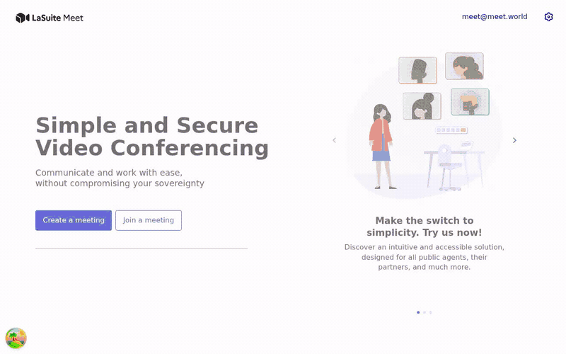
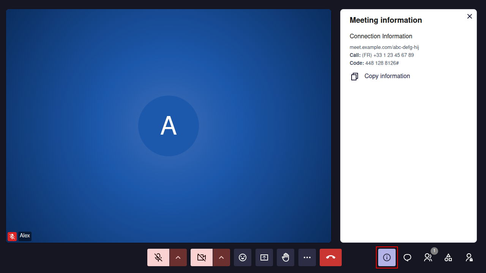
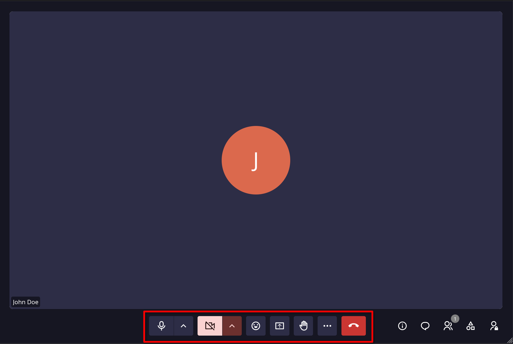
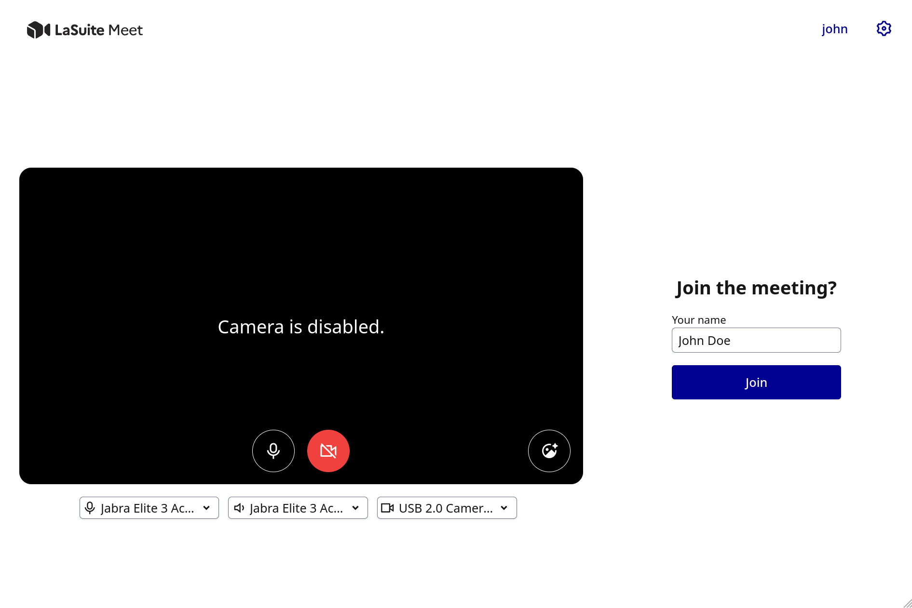

# Getting Started

You need a microphone and a recent Chrome, Firefox, Safari or Edge, see [Browser support](features-controls.md#browser-support).

!!! tip "No instance yet?"

    Try Meet on the demo, [visio.lasuite.coop](https://visio.lasuite.coop/). Starting a meeting there takes a free test account, created from the [LaSuite.coop demo page](https://lasuite.coop/applications/demo/) and deleted after one month; joining someone's link needs none. Other public instances are listed on the [home page](../index.md#known-public-instances).

## Start a meeting

<figure markdown="span">
  
  <figcaption>Create a meeting → Start an instant meeting</figcaption>
</figure>

- Sign in first: you then own the room and control its host settings.
- To send a link before the day, pick **Create a meeting for a later date** instead.
- Where your Meet server allows it, you can start a meeting signed out. It has no owner, so no one can change its settings or record it.

## Invite people

Click **Copy link** in **Your meeting is ready** and send it. To copy it again later, click the ⓘ info button → **Copy information**.

<figure markdown="span">
  
  <figcaption>The info button (ⓘ)</figcaption>
</figure>

## In the meeting

<figure markdown="span">
  
  <figcaption>The control bar: your own controls in the middle, the panels on the right</figcaption>
</figure>

The controls you need most are in [The basics](features-controls.md#the-basics).

## Join a meeting

Open the link, or click **Join a meeting** on the home page, paste the link or code, and click **Join meeting**.

<figure markdown="span">
  { width="700" }
  <figcaption>The pre-join screen: your name, camera, microphone and background</figcaption>
</figure>

Allow the camera and microphone, enter your name, and click **Join**. Depending on the room's [access level](features-controls.md#access-levels), you may wait until someone admits you.

!!! tip "See both sides"

    Open your own link in a second browser tab to see what your guests see, the waiting room included.

A guide for your case: [hosting a large meeting or a class](guides/large-meeting-host.md), [on a phone or a weak connection](guides/phone-or-weak-connection.md), [deaf or hard of hearing](guides/deaf-hard-of-hearing.md), [blind or low vision](guides/blind-low-vision.md), [sign-language interpreter](guides/sign-language-interpreter.md).
