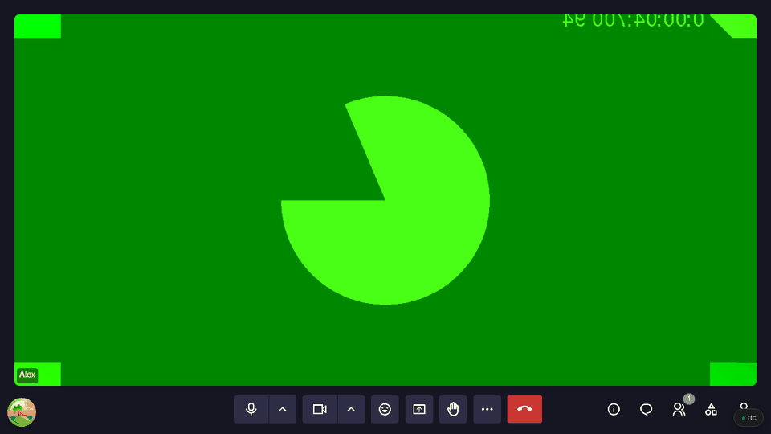

# Blind and low-vision participants

For anyone using a screen reader, a keyboard alone or a screen magnifier.

## The keys to learn first

<figure markdown="span">
  { width="700" }
  <figcaption>F2, Ctrl+D, then the chat, the participants list and the list of every shortcut</figcaption>
</figure>

| Key | Does |
|---|---|
| `F2` | Jump to the control bar |
| `Ctrl+D` / `Ctrl+E` | Microphone / camera on or off |
| `Ctrl+Shift+M` | Open the chat |
| `Ctrl+Shift+H` | Raise or lower your hand |
| `Ctrl+Shift+P` | Open the participants list, raised hands in order |
| `Ctrl+Shift+/` | List every shortcut |

On a Mac, use `⌘` instead of `Ctrl`. The full list is in [Accessibility & Shortcuts](../accessibility.md#keyboard).

## What your screen reader tells you

Meet announces:

- your microphone or camera going on or off
- people joining
- a recording starting or stopping
- chat messages, while the chat is closed
- whose video you pinned or unpinned
- a shared screen's zoom level

To hear reactions too, turn on **Announce reactions aloud** in **More Options** → **Settings** → **Accessibility**.

## Easier to see

<figure markdown="span">
  { width="700" }
  <figcaption>Settings → Accessibility: reactions read aloud, display font, captions</figcaption>
</figure>

- **A readable font:** pick [Atkinson Hyperlegible](https://www.brailleinstitute.org/freefont/) under **Display font**.
- **Zoom a shared screen:** click it, then `+` and `-`; the arrow keys move around.
- **Fullscreen:** `Ctrl+Shift+F`.
- **Less motion:** Meet stops its animations when your system asks for reduced motion.

## What Meet cannot do

- Meet does not announce who is speaking, and screen readers do not read the subtitles.
- A shared screen is a picture: ask the presenter to post the document's link in the chat.
- No high-contrast mode.
- Meet follows [RGAA](https://accessibilite.numerique.gouv.fr/), France's accessibility standard, but has not been audited yet.
