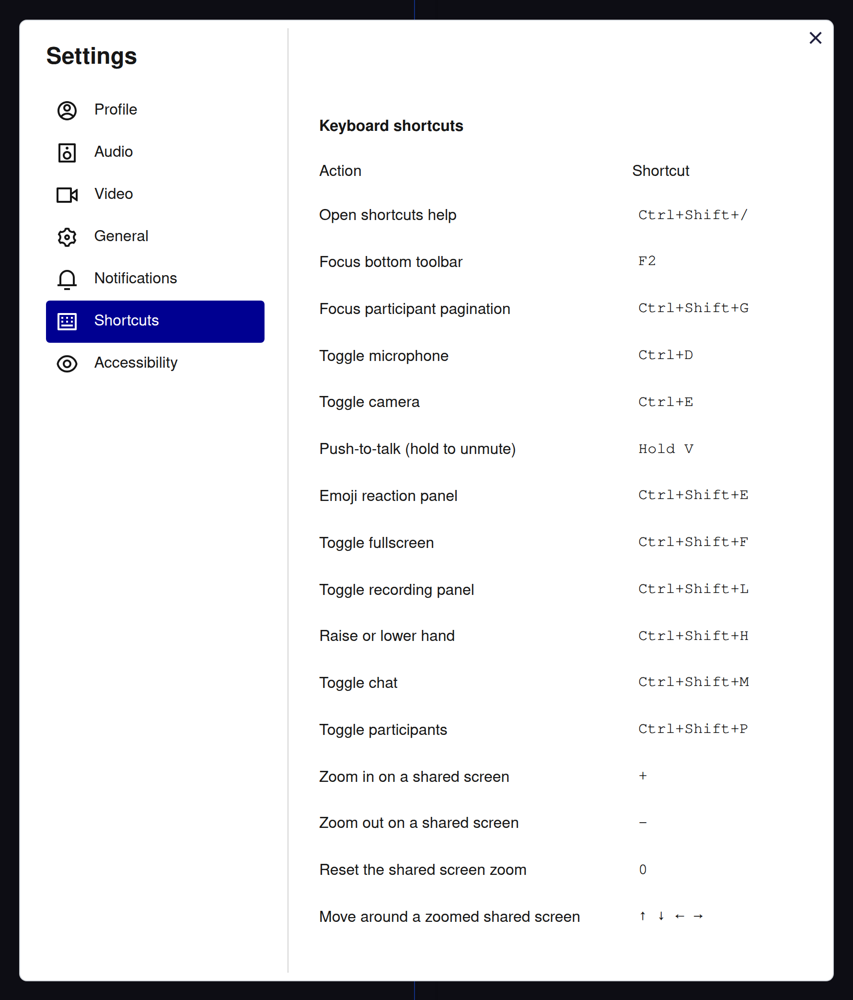
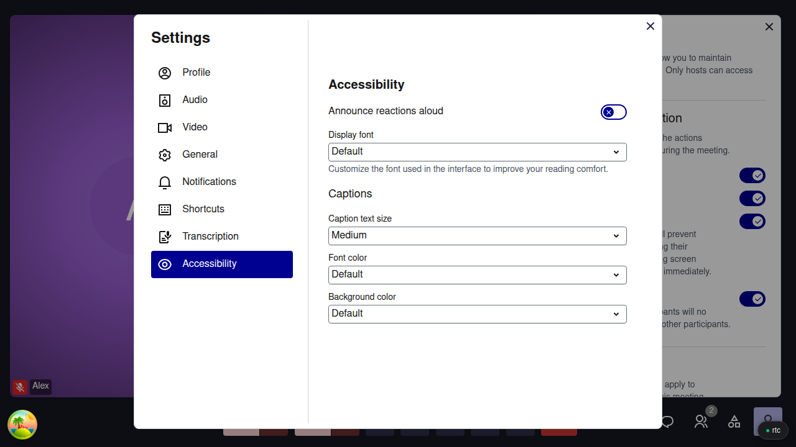

# Blind and low-vision participants

For anyone using a screen reader, a keyboard alone or a screen magnifier.

## The keys to learn first

| Key | Does |
|---|---|
| `F2` | Jump to the control bar |
| `Ctrl+D` / `Ctrl+E` | Microphone / camera on or off |
| `Ctrl+Shift+M` | Open the chat |
| `Ctrl+Shift+H` | Raise or lower your hand |
| `Ctrl+Shift+P` | Open the participants list, raised hands in order |
| `Ctrl+Shift+/` | List every shortcut |

<figure markdown="span">
  { width="700" }
  <figcaption>Settings → Shortcuts lists them all, also with Ctrl+Shift+/</figcaption>
</figure>

On a Mac, use `⌘` instead of `Ctrl`. The full list is in [Accessibility & Shortcuts](../accessibility.md#keyboard).

## What your screen reader tells you

Meet announces your microphone going on or off, people joining, a recording starting or stopping, chat messages while the chat is closed, and whose video you pinned. To hear reactions too, turn on **Announce reactions aloud** in **More Options** → **Settings** → **Accessibility**.

## Easier to see

<figure markdown="span">
  { width="700" }
  <figcaption>Settings → Accessibility: reactions read aloud, display font, captions</figcaption>
</figure>

**Display font**, in the same tab, offers Atkinson Hyperlegible, made for low vision. On a shared screen, `+` and `-` zoom once it has focus, and the arrow keys move around. `Ctrl+Shift+F` puts the meeting in fullscreen, and Meet stops its animations when your system asks for reduced motion.

## What Meet cannot do

- Meet does not announce who is speaking, and screen readers do not read the subtitles.
- A shared screen is a picture: ask the presenter to post the document's link in the chat.
- No high-contrast mode.
- Meet follows RGAA, France's accessibility standard, but has not been audited yet.
