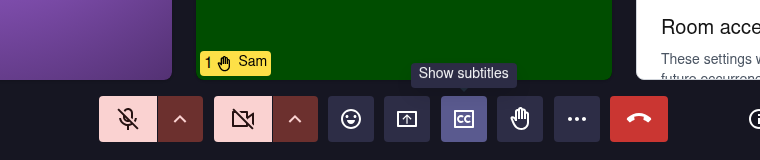

# Deaf and hard-of-hearing participants

For anyone who follows a meeting by reading, or through a sign-language interpreter.

## Before the meeting

Ask the host whether **Show subtitles** appears in their meeting, since not every Meet server offers it, and whether an interpreter is coming. With an interpreter, see [how to keep them large on your screen](sign-language-interpreter.md).

## Live subtitles

<figure markdown="span">
  { width="700" }
  <figcaption>Show subtitles, in the control bar</figcaption>
</figure>

Click **Show subtitles** in the control bar; anyone in the meeting can. To change their size and colours, open **More Options** → **Settings** → **Accessibility** → **Captions**.

<figure markdown="span">
  { width="700" }
  <figcaption>Settings → Accessibility → Captions: text size and colours</figcaption>
</figure>

Subtitles are in beta. For a written record afterwards, the host can start a [transcription](../recording.md#transcription).

## Take part without sound

<figure markdown="span">
  { width="700" }
  <figcaption>A raised hand shows on your video, for everyone</figcaption>
</figure>

- **Ask to speak:**  **Raise hand**
- **Write:**  **Open the chat**
- **Answer without speaking:**  **Send reaction**

## What Meet cannot do

- No subtitles on a phone: the button exists only on a computer.
- A host cannot turn subtitles on for everyone: each person clicks the button.
- Subtitles are not saved.
