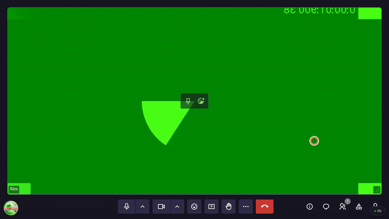
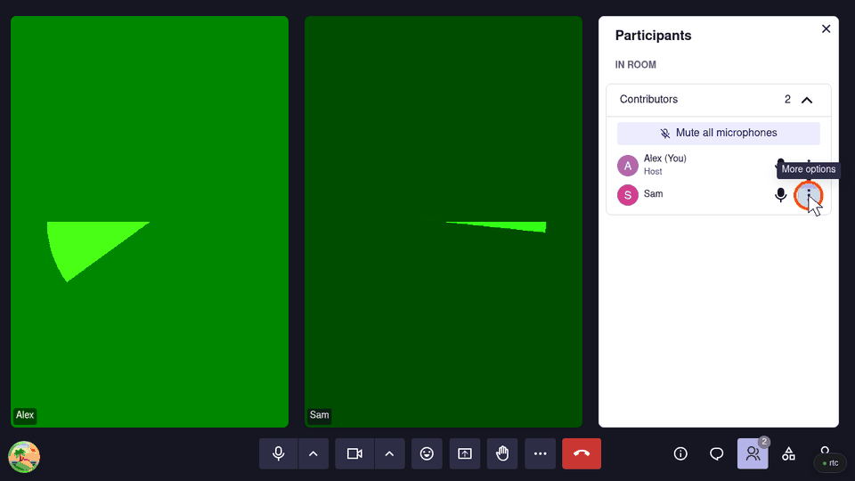
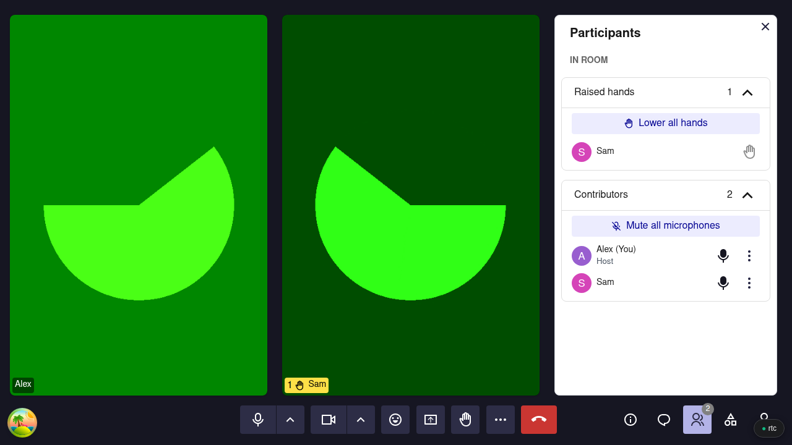
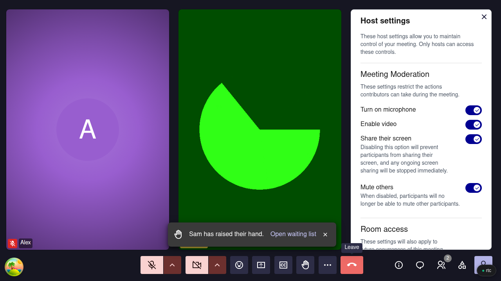

# Hosting a large meeting or a class

For teachers, speakers and anyone running a meeting with many people.

## Before the meeting

### Choose who gets in

<figure markdown="span">
  { width="700" }
  <figcaption>Open admin → Host settings → Room access</figcaption>
</figure>

Sign in before you create the room, so you own it. Then open **Open admin** → **Host settings** and pick an [access level](../features-controls.md#access-levels):

- **Open to trusted people**: people who are not signed in wait in the **Lobby**.
- **Restricted**: everyone without a role on the room waits there.

**Accept all** in **See everyone** admits everyone waiting at once.

### Add a co-host

<figure markdown="span">
  { width="700" }
  <figcaption>See everyone → the menu beside a name → Make co-host</figcaption>
</figure>

Share the work: one person teaches, the other admits latecomers and watches the chat. In **See everyone**, open the menu beside a signed-in participant's name and click **Make co-host**.

## During the meeting

### Keep the room quiet

<figure markdown="span">
  { width="700" }
  <figcaption>See everyone: Lower all hands, above the raised hands, and Mute all microphones</figcaption>
</figure>

**Mute all microphones**, in **See everyone**, mutes everyone but you, and people can unmute again. When a question round ends, **Lower all hands** clears the raised hands.

<figure markdown="span">
  { width="700" }
  <figcaption>Open admin → Host settings: each switch applies to everyone but the hosts</figcaption>
</figure>

To keep participants muted, turn off **Turn on microphone** in **Host settings**. **Enable video** and **Share their screen** work the same way, and turning off **Mute others** stops participants muting each other.

### Remove someone

<figure markdown="span">
  { width="700" }
  <figcaption>The menu beside a name: Remove from the call</figcaption>
</figure>

**Remove from the call** disconnects them but does not ban them: in an **Open** room they can come straight back. To keep them out, set the room to **Restricted** first, then click **Deny** when they ask to join. A co-host, current or former, still walks in.

### Record

Start it from **More tools**, see [Recording](../recording.md#recording).

## What Meet cannot do

- A switch already off keeps a new co-host muted until they rejoin. Make co-hosts first. In progress: [#1919](https://github.com/suitenumerique/meet/issues/1919).
- No one can unmute someone else, and there is no button to turn off a single participant's camera.
- A removed or denied person can always ask to join again.
- No breakout rooms. In progress: [#1765](https://github.com/suitenumerique/meet/pull/1765).
- No polls.
