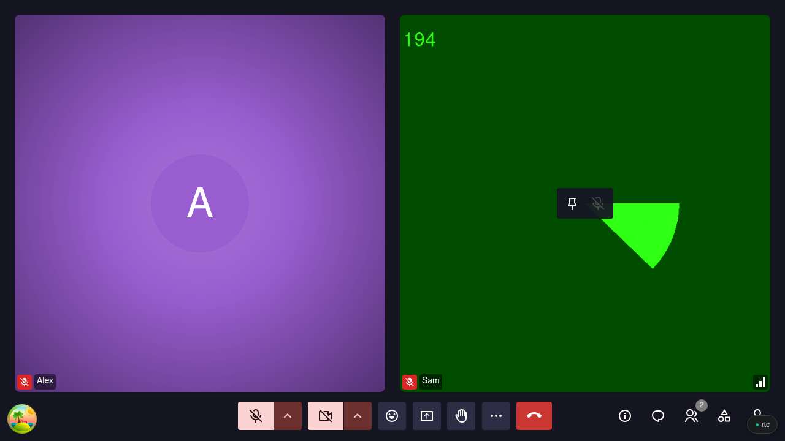
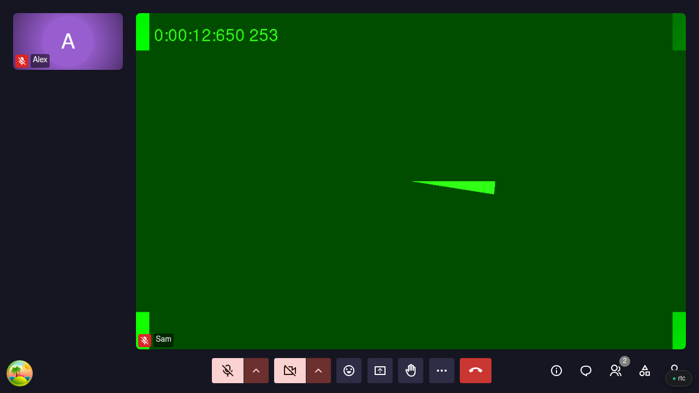

# Sign-language interpreters

For interpreters signing in a Meet meeting, and the hosts who invite them.

## Get pinned

Join like anyone else, see [Getting Started](../getting-started.md), and keep your camera on. Then ask everyone who follows you to pin your video.

<figure markdown="span">
  
  <figcaption>Hover the video, click the pin</figcaption>
</figure>
<figure markdown="span">
  
  <figcaption>The pinned video fills the screen</figcaption>
</figure>

## Agree with the host beforehand

- **Your name**, so they can let you in from the **Lobby**.
- **Who tells people to pin you**, at the start and in the invitation.
- **Making you co-host**, so you keep your camera if they turn off everyone else's. You must be signed in.

## What Meet cannot do

- A host cannot pin you for everyone. In progress: [#528](https://github.com/suitenumerique/meet/issues/528).
- A new screen share takes the large spot over a pin: people pin you again. In progress: [#1476](https://github.com/suitenumerique/meet/pull/1476).
- Picture-in-picture ignores pins. In progress: [#1516](https://github.com/suitenumerique/meet/pull/1516).
