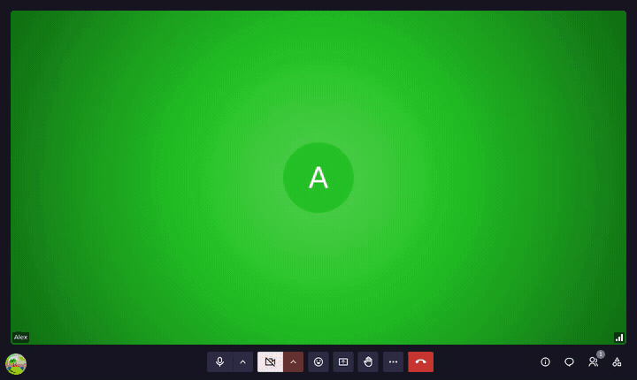

# Recording

Only room owners and administrators can start a recording. Members cannot record directly.

## Start a recording

Click **...** (More options) → **Screen recording** to open the recording panel, then click **Start recording the meeting**. A red indicator appears for all participants.

## Stop a recording

In the same panel, click **Stop recording the meeting**. The file is processed and uploaded automatically.

## What gets recorded

LaSuite Meet uses LiveKit's room composite recording (Egress). The recording captures:

- All participants' video feeds
- All audio streams
- Active screen shares

The result is a single video file matching the meeting layout.

## Download a recording

When recording processing is complete, **the person who started the recording receives an email** with a download link. The email contains a unique URL to the recording page.

To download your recording:

1. Open the email sent to your account after the meeting
2. Click the download link to open the recording page at `/recording/<recordingId>`
3. Log in if prompted (only the person who started the recording can access it)
4. Click **Download** to save the video file

The download page shows:

- The meeting room name
- The recording date and time
- An expiration warning if the recording expires after a set number of days

> If you do not receive an email, your instance may not have email (SMTP) configured. Ask your administrator to check the email settings or look up the recording in the admin panel at `/admin/ → Recordings`.

## Notes

- Recording requires the LiveKit Egress service and S3-compatible storage to be configured by your administrator
- Email (SMTP) must be configured for the download notification to be sent
- Download links are authenticated; only the person who started the recording can access them
- Your administrator may set a maximum recording duration; the recording stops and saves automatically if it's reached
- After the expiration period set by your administrator, the recording's download page says it has expired and no longer offers the file
