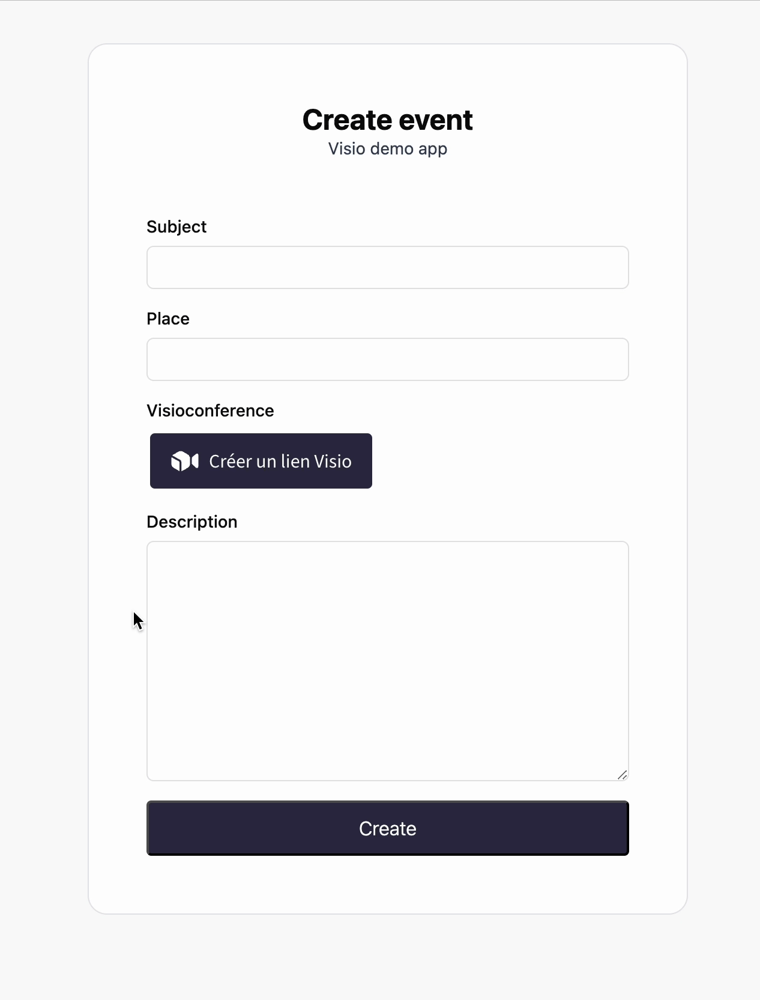
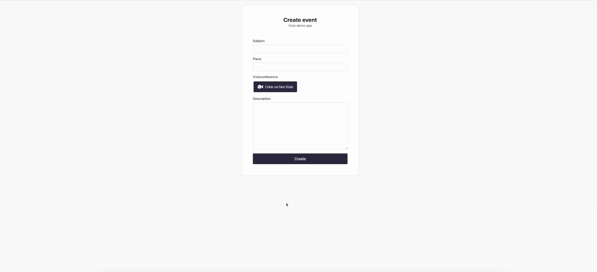

<div align="center">

# 🎥 Visio SDK

**Easily add a button to create visio link to your product**



<br/>
<br/>
<strong>... that also handles seamless authentication out of the box</strong>
<br/>
<br/>



<br/>
<br/>
<strong>As simple as</strong>
<br/>
<br/>

</div>

```ts
import { VisioCreateButton } from "@gouvfr-lasuite/visio-sdk";

function App() {
  const [roomUrl, setRoomUrl] = useState();

  return <VisioCreateButton onRoomCreated={setRoomUrl} />;
}
```

## Room data

`onRoomCreated` receives the room that was just created:

```ts
type RoomData = {
  slug: string;
  url: string;
  // Only when the Visio instance has telephony enabled
  phone?: string; // dial-in number, e.g. "+33 1 23 45 67 89"
  code?: string; // PIN code to enter after dialing, e.g. "1234567890"
};
```

The button does not keep it: your product stores it with its own data, and
gives `slug` and `code` back to show the room again, for instance when the
user reopens an event or reads it without being allowed to change it.

```tsx
<VisioCreateButton
  slug={room.slug}
  code={room.code}
  readOnly={!canEdit}
  onRoomCreated={saveRoom}
  onClear={removeRoom}
/>
```

The dial-in number is not given back: the button always shows the current
number of the Visio instance, next to the `code` of the room. Without a
`code`, it shows the link alone.

## Installation

To install, you can use npm or yarn:

```
$ npm install --save @gouvfr-lasuite/visio-sdk
$ yarn add @gouvfr-lasuite/visio-sdk
```
